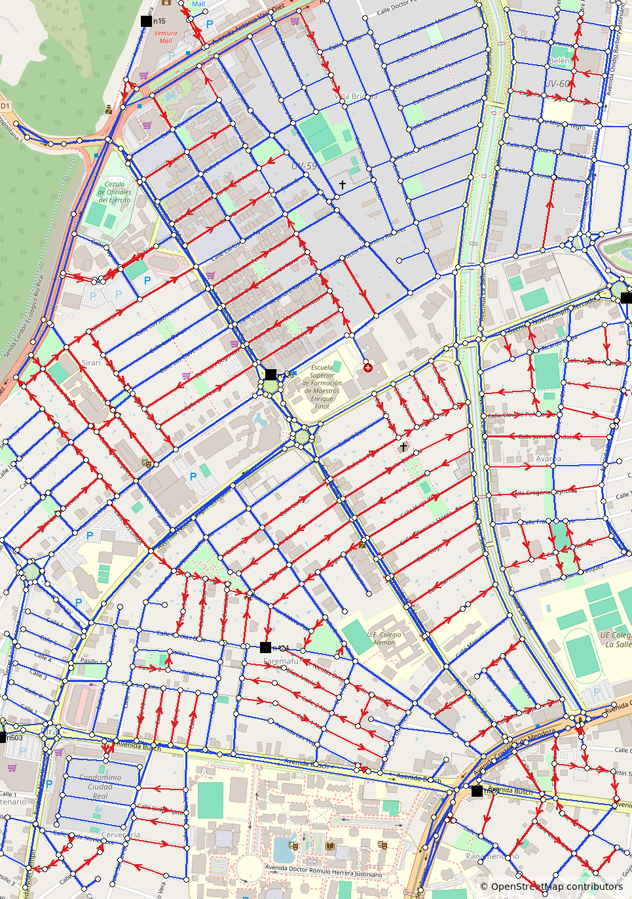
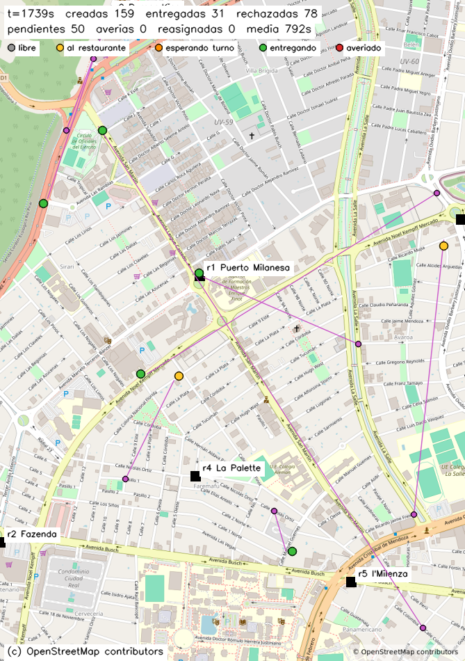

# Equipetrol Delivery: simulación concurrente de despacho

Simulación concurrente en **C++17** de una empresa de delivery en **Zona Equipetrol, Santa Cruz de la Sierra**
(entre el Segundo y el Cuarto Anillo). Motocicletas, un flujo continuo de órdenes, restaurantes con
ventanillas limitadas y un único libro de órdenes, todo simulado en tiempo acelerado y dibujado en vivo
sobre una imagen real de OpenStreetMap.

> Mapa y datos de calles: **© OpenStreetMap contributors**. Los datos de OpenStreetMap están disponibles
> bajo la [Open Database License (ODbL)](https://www.openstreetmap.org/copyright).

---

## Contenido

1. [Dependencias](#1-dependencias)
2. [Compilación y ejecución](#2-compilación-y-ejecución)
3. [Entrada y salida](#3-entrada-y-salida)
4. [Estructura del repositorio](#4-estructura-del-repositorio)
5. [El mapa](#5-el-mapa)
6. [Decisiones de diseño](#6-decisiones-de-diseño)
7. [Esquema del programa: hilos y canales](#7-esquema-del-programa-hilos-y-canales)
8. [Jerarquía de locks y ausencia de deadlock](#8-jerarquía-de-locks-y-ausencia-de-deadlock)
9. [Argumento de ausencia de data races](#9-argumento-de-ausencia-de-data-races)
10. [Mapa de conceptos](#10-mapa-de-conceptos)
11. [Experimentos](#11-experimentos)
12. [Análisis con herramientas](#12-análisis-con-herramientas)
13. [Limitaciones conocidas](#13-limitaciones-conocidas)

---

## 1. Dependencias

Versiones usadas durante el desarrollo (Ubuntu 24.04.1 LTS sobre WSL2):

| Dependencia | Versión usada | Mínimo exigido | Uso |
|-------------|---------------|----------------|-----|
| g++ | 13.3.0 | 7 | Compilador C++17 |
| CMake | 3.28.3 | 3.11 | Generación del build |
| GNU Make | 4.3 | 4.1 | Build |
| OpenCV | 4.6.0 | 4.1 | **Solo** la ventana (dibujo e imagen de fondo) |
| nlohmann/json | 3.11.3 | — | Lectura de la configuración y escritura del log. Incluida en `third_party/` |
| Valgrind | 3.22.0 | — | Análisis de memoria (DP.11) |

No se usa ninguna otra librería. Toda la concurrencia está construida con la biblioteca estándar de C++17
(`std::thread`, `std::mutex`, `std::condition_variable`, `std::promise`/`std::future`, `std::async`, `std::atomic`).

Instalación en Ubuntu:

```bash
sudo apt install -y build-essential cmake pkg-config libopencv-dev valgrind
```

`nlohmann/json` no hay que instalarla: viene en `third_party/nlohmann/json.hpp`.

## 2. Compilación y ejecución

```bash
mkdir build && cd build
cmake .. && make
./delivery_sim ../config/equipetrol.json
./delivery_sim ../config/equipetrol.json --log run1.log
```

| Argumento | Significado |
|-----------|-------------|
| `<config.json>` (obligatorio) | Ruta al archivo de configuración |
| `--log <path>` (opcional) | Escribe el log de eventos en `<path>` en vez de `events.log` |
| `--no-window` (opcional) | Corre la simulación sin abrir la ventana. Ver más abajo |

Builds instrumentados:

```bash
mkdir build-tsan && cd build-tsan && cmake -DENABLE_TSAN=ON .. && make   # ThreadSanitizer
mkdir build-asan && cd build-asan && cmake -DENABLE_ASAN=ON .. && make   # AddressSanitizer + UBSan
```

> **Nota sobre ThreadSanitizer en kernels recientes:** en kernels con alta aleatorización de memoria
> (por ejemplo WSL2 con kernel 6.6), el binario instrumentado puede abortar al iniciar con
> `FATAL: ThreadSanitizer: unexpected memory mapping` o con un segmentation fault, sin llegar a ejecutar
> el programa. No es un defecto del programa. Se resuelve de dos formas:
>
> ```bash
> setarch "$(uname -m)" -R ./delivery_sim ../config/equipetrol.json   # desactiva ASLR solo para esta ejecución
> sudo sysctl vm.mmap_rnd_bits=28                                     # o: reduce la aleatorización del sistema
> ```

La simulación termina al cumplirse `simulation.durationS` segundos simulados, o al recibir `SIGINT` (Ctrl-C)
o `SIGTERM`. En ambos casos imprime el resumen y sale con código 0.

### La bandera `--no-window`

```
./delivery_sim config/equipetrol.json --log events.log --no-window
```

Corre la simulación completa —se arma cada cuadro igual, así que el código de dibujo sigue
ejecutándose— pero no abre la ventana. Existe por el análisis con ThreadSanitizer del §12:
las librerías con las que OpenCV abre la ventana tienen carreras propias que ensucian el
reporte y que no se pueden suprimir por nombre porque vienen sin símbolos. Sin ventana, lo
que queda bajo análisis es exactamente la concurrencia de este programa. Por defecto la
ventana se abre, que es lo que pide el §2 del enunciado.

## 3. Entrada y salida

- **Entrada:** archivo JSON con el formato de la sección 5 del enunciado (`map`, `nodes`, `streets`,
  `restaurants`, `fleet`, `orders`, `dispatch`, `incidents`, `simulation`). Una configuración inválida produce
  un mensaje en `stderr` y un código de salida distinto de cero, sin iniciar la simulación.
- **stdout:** `Simulation has started...` cuando la simulación está lista y corriendo; al final, una única línea
  JSON con el resumen (`created`, `delivered`, `rejected`, `pending`, `reassigned`, `breakdowns`,
  `avgDeliveryMs`, `maxDeliveryMs`, `deliveredPerCourier`).
> **Sobre el rechazo `unreachable`:** con `config/equipetrol.json` no puede ocurrir, porque el
> grafo del mapa real es fuertemente conexo —desde cada restaurante se llega a los 668 nodos—.
> Para ejercitarlo hace falta un grafo con nodos aislados, como `config/tests/unreachable.json`.

- **Log de eventos:** un objeto JSON por línea (`orderCreated`, `orderAssigned`, `pickupStarted`,
  `orderPickedUp`, `orderDelivered`, `orderRejected`, `courierBreakdown`, `orderReassigned`,
  `simulationStopping`).
- **Ventana:** mapa de OpenStreetMap con restaurantes, destinos de entrega activos, cada moto como un punto
  que se mueve por las calles (color según estado), panel de contadores y atribución.

## 4. Estructura del repositorio

```
CMakeLists.txt            build (target delivery_sim, opciones ENABLE_TSAN / ENABLE_ASAN)
config/equipetrol.json    configuración oficial
config/tests/             escenarios de prueba (válidos e inválidos)
data/equipetrol.png       imagen de OpenStreetMap usada de fondo
src/                      código fuente C++17
tests/                    17 programas de prueba y run.sh, que los compila y ejecuta
docs/                     informe técnico y capturas
third_party/nlohmann/     librería JSON (un solo header)
tools/                    scripts de apoyo: validación del log, corrida de escenarios, extracción OSM
experiments/              datos crudos de los experimentos (configs, logs, resúmenes)
analysis/                 salida completa sin editar de las herramientas de análisis
```

## 5. El mapa

### Imagen y datos

Tanto la imagen (`data/equipetrol.png`, 965 × 1371 px) como los datos de calles (`data/equipetrol.osm`) se
exportaron de [openstreetmap.org](https://www.openstreetmap.org) con **la misma caja geográfica**:

| north | south | west | east |
|-------|-------|------|------|
| −17.7535 | −17.7765 | −63.2040 | −63.1870 |

La caja (~1.8 km × 2.5 km) encierra Av. San Martín de punta a punta con ~200–300 m de margen. Con el norte
arriba, una latitud/longitud se convierte a píxel con una proyección lineal sobre esos bounds (en 2.5 km el error
frente a la proyección Mercator de OSM es menor que un píxel).

### Dónde están los anillos

En esta zona, OpenStreetMap rotula los anillos con nombres de avenida:

| Anillo | Nombre en OSM | Dónde se ve |
|--------|---------------|-------------|
| Segundo Anillo | Avenida Cristóbal de Mendoza | Abajo a la derecha, donde termina Av. San Martín |
| Tercer Anillo | Avenida Noel Kempff Mercado / Tercer Anillo Externo, con sus rotondas | La curva que cruza el centro de la imagen |
| Cuarto Anillo | Avenida Antonio Vaca Díez | Arriba a la izquierda, donde empieza Av. San Martín |
| — | Avenida San Martín (en su tramo norte corre junto a Av. Leigue Castedo) | Diagonal de noroeste a sureste |

Av. San Martín une el Cuarto Anillo, en (−17.7571, −63.2011), con el Segundo, en (−17.7724, −63.1903), a ~3.5 km
y ~1.5 km de la Plaza 24 de Septiembre respectivamente.

### Red de calles

`config/equipetrol.json` se genera con `tools/osm_extract.py` a partir de `data/equipetrol.osm`:

```bash
python3 tools/osm_extract.py data/equipetrol.osm config/equipetrol.json --all-streets --preview docs/graph_preview.png
```

| Elemento | Cantidad | Mínimo exigido |
|----------|----------|----------------|
| Intersecciones y nodos de forma | 668 | 25 |
| Segmentos de calle | 1027 (259 de un solo sentido) | 40 |
| Restaurantes | 6 | 6 |

Decisiones del modelado:

- **Calles incluidas:** avenidas (`trunk`, `primary`, `secondary`, `tertiary`), sus enlaces y retornos
  (`*_link`) y todas las calles residenciales. Las pasarelas peatonales, los senderos y las vías de servicio
  no se incluyen.
- **Curvas:** entre dos cruces se conservan los puntos de forma necesarios (Douglas-Peucker, tolerancia 6 m),
  para que ningún tramo atraviese una manzana. El script mide cuánto se aleja cada tramo de la calle real y
  avisa si supera 20 m. Los pocos casos (≤ 27 m) son cruces de avenidas de doble calzada, donde el nodo queda
  entre ambas calzadas.
- **Sentidos:** las calles residenciales y los enlaces respetan el `oneway` de OSM. Las avenidas de doble calzada
  (dos vías de un solo sentido en OSM) se modelan como calles de doble sentido.
- **Conectividad:** se conserva la mayor componente fuertemente conexa: desde cualquier nodo se puede llegar a
  cualquier otro respetando los sentidos.
- **Restaurantes:** son restaurantes reales de OSM, elegidos de forma que queden lo más separados posible entre
  sí: Burger King (entre el 3er y el 4to anillo), Puerto Milanesa, Fazenda y Pits Burguer (Tercer Anillo),
  La Palette e I'Milenza (entre el 2do y el 3er anillo).



## 6. Decisiones de diseño

El enunciado fija el qué y deja abierto el cómo en varios puntos. Acá está cada decisión,
con la razón y lo que se descartó.

### Cómo llegan las órdenes

Los intervalos entre llegadas salen de una **distribución exponencial** de media
`orders.meanIntervalMs`, y no de un intervalo fijo. Con intervalos iguales la cola casi
nunca se acumula: cada orden encuentra el sistema en el mismo estado que la anterior, y
`maxPending` no se alcanza jamás. La exponencial es la que corresponde a llegadas
independientes, y produce los momentos de aglomeración donde la concurrencia se nota.

Encima de eso, **una de cada diez llegadas es una ráfaga** de entre 2 y `orders.burstMax`
órdenes creadas de golpe. Esa es la prueba de fuego del `admit()` del libro: varias órdenes
compitiendo por los últimos lugares de `maxPending` en el mismo instante.

### Destino de la entrega, y qué significa inalcanzable

El restaurante de cada orden se sortea entre los configurados; el destino, uniformemente
entre los 668 nodos del mapa, **excluyendo el nodo del propio restaurante** (una entrega
en la puerta del local no es una entrega).

Una orden es `unreachable` cuando el grafo no tiene camino, no cuando el camino es largo.
Como las calles de sentido único se modelan como aristas dirigidas, hay pares de nodos sin
camino de ida aunque lo haya de vuelta: el rechazo `unreachable` existe por eso, y lo
decide Dijkstra, no un umbral.

### La estimación que usa el dispatcher

`estimateDeliveryMs` suma dos caminos más corto —del courier al restaurante y del
restaurante al cliente— y **no** los suma a ciegas con el tiempo de preparación: toma el
mayor entre el viaje al restaurante y `prepMs`, porque un courier que llega antes espera.
Sumarlos castigaría al courier cercano, que es justo el que conviene elegir.

Se cotiza a **todos** los couriers con lugar en la bolsa y sin avería, no a una muestra. Con
la flota de ejemplo son 8 estimaciones por orden; son independientes entre sí y es
precisamente por eso que van en paralelo.

### Qué pasa en una avería

La avería es **permanente**: un courier averiado no se repara y queda fuera de servicio
hasta el final de la corrida. No hay un tiempo de reparación configurable porque el §6 no
tiene un evento que represente el regreso, y un cambio de estado sin evento rompe la
validación del log.

El traspaso es **todo-o-nada y a un solo compañero**: o las órdenes del averiado entran
completas en la bolsa de un mismo courier, o la avería no ocurre. El §6 lo impone de
hecho: `orderReassigned` lleva `from` y `to` obligatorios, los dos ids de courier. Si
ninguno tiene lugar para todas, el sorteo se descarta y el courier sigue trabajando. Eso
tiene una consecuencia medible que está en el experimento 5: con la flota saturada las
averías casi no se concretan.

Devolver las órdenes a la cola se probó y se descartó: está en el experimento 3.

### Qué es reproducible y qué no

Con la misma `seed` son reproducibles **las decisiones de azar**: los intervalos entre
llegadas, el tamaño de las ráfagas, los restaurantes, los destinos, los tiempos de
preparación y los sorteos de avería. Cada courier deriva su propia corriente de la semilla
mezclándola con su id, así que agregar un courier no corre el azar de los demás.

No es reproducible **el entrelazado**: qué courier gana una orden, cuál llega primero a la
ventanilla, en qué orden salen las líneas del log. Eso lo decide el planificador del
sistema operativo, y dos corridas con la misma semilla dan resúmenes distintos. Es una
propiedad del programa, no un defecto: un simulador concurrente cuyo entrelazado fuera
reproducible no estaría ejercitando la concurrencia.

## 6b. La ventana



Cada punto es un courier, dibujado en su posición real sobre la calle que recorre, y
esa posición avanza de forma continua cuadro a cuadro. Los colores distinguen los
estados: gris libre, amarillo yendo al restaurante, **naranja esperando turno en la
puerta**, verde entregando, rojo averiado. Las líneas violetas unen a cada courier con
la puerta del cliente al que está yendo.

El naranja no es decorativo: ver varios juntos en un restaurante es la exclusión mutua
de los `pickupSlots` ocurriendo a la vista.

La capa del grafo de calles está oculta por defecto, porque con 1027 calles y sus
flechas tapa el mapa. La tecla `G` la muestra cuando hace falta inspeccionar la red.

## 7. Esquema del programa: hilos y canales

Todo lo que aparece acá está implementado y probado. Las once filas de hilos y los diez
canales son los del código final.

### Flujo de una orden, de punta a punta

```
GENERADOR   espera un intervalo exponencial (wait_for, 0% CPU)
            crea la orden y llama a OrderBook.admit()
                              |
                              |  si pending_ == maxPending -> orderRejected(queueFull)
                              v
            despierta al dispatcher
                              |
DISPATCHER  espera en el libro, con plazo (0% CPU) <---------------+
            toma las ordenes sin asignar
            encola una estimacion POR COURIER en el QuotePool
              - un promise/future por candidato
              - plazo comun de quoteTimeoutMs REALES
              - las que llegan tarde se mudan a una lista, no se destruyen
              - si una lanza, la excepcion llega en get() y no tumba nada
            elige el mejor tiempo estimado
            courier.reserve(orden)             <- candado: microsegundos
            OrderBook.assign(orden, courier)   <- candado: microsegundos
            courier.commitReservation(orden)   -> despierta al courier
                              |
COURIER     espera en su cv (0% CPU) <-----------------------------+
            calcula su ruta con SU PROPIO Router
                      viaja tramo a tramo                <- SIN candados, segundos
                      llega al restaurante -> pickupStarted
                      espera a que la comida este lista si llego antes
                      OrderBook.pickedUp()               <- candado: microsegundos
                      viaja al cliente                   <- SIN candados
                      OrderBook.delivered()              <- candado: microsegundos
                      vuelve a esperar en su cv
```

El patrón que se repite: **los candados aparecen en instantes puntuales y duran
microsegundos; el trabajo largo ocurre siempre afuera**.

### Por qué la orden no se "reserva" sosteniendo un candado

Un viaje largo de este mapa son 213 s simulados, o 3,5 s reales con `timeScale: 60`.
Sostener un mutex durante todo ese tiempo dejaría al renderer sin poder llamar a
`snapshot()` (lo necesita 30 veces por segundo) y congelaría la ventana.

La exclusividad que dura en el tiempo **se modela con estado, no con un candado**: la orden
está reservada porque su estado dice `assigned` y `assignedCourier` apunta a su courier.
Ningún otro la puede tomar porque `canTransition(assigned, assigned)` devuelve `false`, y esa
comprobación ocurre dentro del candado del `OrderBook`, que dura microsegundos.

> **Candado = operación corta e indivisible. Estado = propiedad que dura en el tiempo.**

### Hilos de ejecución

| Hilo | Cantidad | Sobre qué hace loop | Cómo espera |
|------|----------|---------------------|-------------|
| main / render | 1 | Arma un cuadro, revisa teclado y señal | `cv::waitKey` (ritmo de cuadros) |
| `OrderGenerator` | 1 | Espera un intervalo exponencial y crea 1..`burstMax` órdenes | `cv.wait_for` con predicado, interrumpible |
| `Dispatcher` | 1 | Toma una orden, encola las estimaciones y la asigna | `OrderBook::waitForUnassigned` con plazo |
| Trabajadores del `QuotePool` | `hardware_concurrency()` | Saca una tarea de la cola, la ejecuta y cumple su promise | `cv_.wait` con predicado |
| `CourierActor` | `fleet.couriers` (8) | libre → restaurante → retirar → entregar | su propia `condition_variable` |

Con la configuración de ejemplo son 11 hilos propios más los del pool.

### Canales entre hilos

| # | Canal | Mecanismo | Estado |
|---|-------|-----------|--------|
| 1 | `OrderGenerator` → `OrderBook` | monitor acotado; `admit()` verifica y agrega bajo un mismo candado | [hecho] |
| 2 | `OrderBook` → `Dispatcher` | notificación al admitir una orden; el dispatcher espera con plazo | [hecho] |
| 3 | `Dispatcher` → trabajadores del pool | cola de tareas; una por candidato | [hecho] |
| 4 | Trabajadores del pool → `Dispatcher` | un `promise`/`future` por tarea, con plazo común de `quoteTimeoutMs` reales | [hecho] |
| 5 | `Dispatcher` → `CourierActor` | reserva en dos fases: `reserve()`, el registro en el libro, `commitReservation()` + `notify_one` | [hecho] |
| 5b | `CourierActor` ↔ `Restaurant` | monitor con fila por orden de llegada y `pickupSlots` | [hecho] |
| 6 | Courier averiado → courier receptor | `std::scoped_lock` sobre los dos couriers | [hecho] |
| 7 | Todos → `EventLog` | monitor; una línea JSON completa por evento | [hecho] |
| 8 | Renderer / dispatcher ← `CourierActor` | `snapshot()` devuelve una copia tomada bajo candado | [hecho] |
| 9 | main → todos | `requestStop()` en cada monitor y `join()` de todos los hilos | [hecho] |

## 8. Jerarquía de locks y ausencia de deadlock

Un interbloqueo necesita que dos hilos tomen dos candados en **orden distinto**. La defensa es
fijar un orden total y no violarlo nunca.

| Nivel | Mutex | Puede tomar a continuación |
|-------|-------|----------------------------|
| 1 | `CourierActor` (uno, o **dos a la vez** con `std::scoped_lock`) | `OrderBook`, `EventLog` |
| 2 | `OrderBook`, `Restaurant`, `QuotePool` | `EventLog` |
| 3 | `EventLog` | ninguno (hoja) |

Cuatro propiedades lo sostienen:

- **`EventLog::write()` no llama a nada que pueda tomar otro candado.** Es hoja por
  construcción, así que registrar un evento teniendo tomado el candado del `OrderBook` o el de
  un courier no puede bloquear a nadie.
- **El traspaso por avería toma dos candados de courier a la vez, y por eso usa
  `std::scoped_lock`.** Tomarlos uno por uno sería el interbloqueo de manual: si A se
  avería y elige a B mientras B se avería y elige a A, cada uno tendría el suyo
  esperando el del otro para siempre. `scoped_lock` los toma con un algoritmo que
  evita ese ciclo sin importar el orden en que se le pasen, y es lo que hace que las
  averías simultáneas no puedan bloquear el sistema (§4). *Verificado: 300 averías
  simultáneas cruzadas entre dos couriers, sin un solo bloqueo.*
- **`OrderGenerator` suelta su propio candado antes de llamar a `admit()`.** Nunca sostiene dos
  a la vez, de modo que no puede participar de un ciclo.
- **La reserva del dispatcher no sostiene dos candados a la vez.** `reserve()` toma el del
  courier y lo suelta; después el libro toma el suyo; después `commitReservation()` vuelve a
  tomar el del courier. Si en cambio se hubiera resuelto llamando a `offer()` desde dentro del
  candado del libro, el orden sería libro → courier, el inverso del nivel 1, y la jerarquía
  quedaría violada por la corrección misma.

## 9. Argumento de ausencia de data races

Un objeto por párrafo, con la evidencia que lo respalda.

**`Config`** — se carga y valida por completo antes de crear ningún hilo y después nadie la
modifica. Un dato que nadie escribe no puede tener data races, así que se comparte por
referencia sin ninguna sincronización.

**`CityGraph`** — mismo caso. Se construye una vez y no existe ningún método que lo modifique:
todos son `const`. Lo leen simultáneamente los couriers y las tareas de cotización sin candado.

**`SimClock`** — no guarda la hora en ninguna variable. Solo conserva el instante de arranque y
la escala, fijados en el constructor, y cada consulta le pregunta la hora al sistema operativo;
`steady_clock::now()` es thread-safe por norma. *Verificado: 4 hilos leyendo `nowMs()` en
paralelo, monótono en los cuatro.*

**`Router`** — es el único objeto con estado de trabajo mutable, y por eso **no se comparte**:
cada hilo construye el suyo. La firma `shortestPath()` se deja deliberadamente no-`const` para
que el compilador frene cualquier intento de compartirlo como `const&`. *Verificado: 1600
estimaciones calculadas por 8 hilos, cada uno con su Router, dan exactamente los mismos números
que calculadas de a una.*

**`EventLog`** — monitor. El `ofstream` y el mutex son privados y la única forma de escribir es
`write()`. El formateo del JSON ocurre fuera del candado; dentro queda solo leer el reloj y
volcar la línea, y la marca de tiempo se toma adentro para que el orden de las líneas sea el
orden de las `t`. *Verificado: 8 hilos escribiendo 500 eventos cada uno, las 4000 líneas parsean
como JSON, ninguna perdida, `t` nunca retrocede. ThreadSanitizer: 0 reportes, y el control
negativo con el `lock_guard` comentado sí produce un race (`analysis/tsan_event_log.txt`).*

**`OrderBook`** — monitor. No expone un `pendingCount()` público a propósito: si lo hiciera, el
llamador consultaría y agregaría en dos pasos y entre ellos se soltaría el candado. `admit()`
verifica y agrega bajo un mismo candado. *Verificado: 1600 intentos desde 16 hilos contra un
`maxPending` de 50 admiten exactamente 50.*

**`CourierActor`** — monitor con `condition_variable`. La bandera de parada se escribe con el
candado tomado, que es lo que impide el aviso perdido; `wait()` lleva predicado, que es lo que
cubre los despertares espurios. *Verificado: 8 couriers ociosos 400 ms consumieron 0,151 ms de
CPU (girando habrían consumido unos 3200), terminan en 3 ms, y 300 ciclos de arrancar y parar
no colgaron nunca. ThreadSanitizer: 0 reportes (`analysis/tsan_courier_actor.txt`).*

**`Restaurant`** — monitor con fila por número de turno. Los dos contadores —el próximo turno
que se entrega y el que se está atendiendo— y la cantidad de lugares en uso viven bajo el mismo
candado, y la espera lleva predicado. *Verificado: 12 couriers contra 2 lugares, máximo
simultáneo observado 2; llegada 1,2,3,4,5 produce entrada 1,2,3,4,5.*

**`QuotePool`** — monitor. La cola de tareas y la bandera de parada van bajo el mismo candado, y
cada tarea lleva su propio `promise`, así que dos trabajadores nunca escriben el mismo
resultado. Cada trabajador construye **su** `Router` dentro de su propio bucle, de modo que la
memoria de trabajo de Dijkstra tampoco se comparte. *Verificado: 0 reportes de ThreadSanitizer
sobre el programa completo, donde el pool atiende miles de estimaciones
(`analysis/tsan_full_run.txt`).*

**`OrderGenerator`** — es dueño exclusivo de su `OrderFactory` y su `mt19937`, así que esos dos
no llevan sincronización: un dato con un único dueño no se protege, se posee. Lo único
compartido es su bandera de parada y su contador, bajo su propio candado.

## 10. Mapa de conceptos

Cada fila del enunciado, con el lugar del código donde el concepto hace un trabajo real y
qué pasaría sin él.

### 01 · Creación explícita de hilos, cada uno con un destino deliberado

`src/main.cpp:396` (creación) · `src/main.cpp:475`, `:478`, `:492` (espera)

Los once hilos se crean con `std::thread` en `main`, **después** de construir todos los
objetos que van a usar, y cada uno se espera con `join()` antes de salir: ocho couriers, el
generador y el dispatcher, más los trabajadores del pool.

Lanzarlos desde un constructor dejaría que un hilo viera un objeto a medio construir. Y un
`std::thread` que se destruye sin `join()` ni `detach()` llama a `std::terminate`: el
programa moriría en el cierre, sin resumen y con código distinto de cero, violando el §7.

### 01 · Una decisión que depende del paralelismo disponible del hardware

`src/QuotePool.cpp:12`

La cantidad de trabajadores del pool sale de `std::thread::hardware_concurrency()`. Más
trabajadores que núcleos no agregan paralelismo real, sólo cambios de contexto; menos dejan
núcleos ociosos.

La función **puede devolver cero** cuando el sistema no lo sabe, y en ese caso se eligen dos
a mano: un pool de cero trabajadores sería un cuelgue garantizado, porque nadie atendería la
cola.

Antes cada estimación creaba su propio hilo. Medido con 64 couriers y tres corridas por
columna, pasar al pool bajó el tiempo de CPU de sistema de 0,85 s a 0,46 s —un 46 %, con los
rangos disjuntos— y subió las entregas de 526 a 578. Lo que **no** cambió es el pico de hilos
vivos: 76 contra 75. La predicción de que sin pool habría decenas de hilos por orden era falsa
(§11).

### 02 · Datos entregados a un hilo por valor, por referencia y por movimiento

**Por valor** — `src/Dispatcher.cpp:77`: la lambda que se encola captura `view` y `order`
por copia. Tiene que ser así: la tarea corre en otro hilo y puede ejecutarse después de que
el dispatcher siguió de largo. Capturarlas por referencia dejaría referencias colgando a
variables que ya no existen.

**Por referencia** — `src/SimContext.h`: el grafo, el reloj, el log y el libro se comparten
por referencia entre los once hilos. Copiar un grafo de 668 nodos por hilo sería absurdo, y
copiar un monitor rompería su propósito: cada hilo protegería su propia copia.

**Por movimiento** — `src/OrderBook.cpp:93` y `:99`: `admit()` recibe la orden por valor y la
mueve al mapa. Transfiere las cuatro cadenas sin copiarlas, y evita pedir memoria al sistema
con el candado del libro tomado.

### 02 · Órdenes que viajan por movimiento y existen en un solo lugar

`src/OrderBook.cpp:93` · `src/Order.h:32`

Una orden existe **una sola vez**: dentro del `OrderBook`. Nadie más guarda una copia viva.
Los couriers llevan `OrderId`, no `Order`, y cuando necesitan los datos piden una copia con
`find()`, trabajan con ella y la descartan.

Sin esto, la orden 42 estaría en el libro y en la bolsa del courier a la vez: dos copias del
mismo estado que pueden contradecirse. Ahí nacen los tres defectos que el §4 prohíbe —una
orden perdida, una duplicada, una en dos bolsas—.

### 03 · Funciones miembro de objetos compartidos corriendo en hilos; contenedores de hilos

`src/main.cpp:396` · `src/main.cpp:377` (la flota) · `src/main.cpp:394` (los hilos)

`threads.emplace_back(&CourierActor::run, actor.get())` lanza un método de un objeto. La
flota es un `std::vector<std::unique_ptr<CourierActor>>` y los hilos un
`std::vector<std::thread>`, recorridos para arrancarlos y para esperarlos.

### 03 · Propiedad compartida que garantiza la vida del objeto; ningún puntero crudo dueño

`src/QuotePool.h:60` · `src/main.cpp:377`

Cada tarea del pool se guarda junto a un `std::shared_ptr<std::promise<std::int64_t>>`. Los
dos aspectos son necesarios: `std::function` exige que lo que captura sea **copiable** y un
`std::promise` no lo es, por diseño; y el promise tiene que seguir vivo mientras lo necesiten
los dos lados, quien encola y el trabajador que lo cumple.

La flota usa `std::unique_ptr` en lugar de punteros crudos: los actores no son copiables ni
movibles porque contienen un mutex, y su dirección no puede cambiar porque otros hilos
guardan punteros a ellos. En el programa no hay **ningún** puntero crudo que sea dueño de
algo.

### 04 · Tareas que devuelven un resultado por un future, con política de lanzamiento declarada

`src/Dispatcher.cpp:77` · `src/QuotePool.cpp:66`

Cada estimación se encola con `submit()`, que devuelve un `std::future<std::int64_t>`. El
trabajador cumple el promise con `set_value` y el resultado aparece en el future del
dispatcher.

La política está declarada y es explícita: las tareas corren **siempre** en un trabajador del
pool, nunca en el hilo que las encola. La versión anterior usaba
`std::async(std::launch::async, ...)`, donde la política también era explícita y obligaba a un
hilo nuevo por tarea; esa es justamente la razón del cambio.

### 04 · Un par promise/future como canal de un solo uso entre dos hilos

`src/QuotePool.h:60` · `src/QuotePool.cpp:34` y `:66`

Un promise por tarea: una escritura, una lectura, y se acabó.

Importa el caso del cierre. Si `submit()` llega con el pool ya detenido, se cumple el promise
con una excepción en vez de devolver un future que nunca se va a resolver
(`QuotePool.cpp:34`). Y al parar, los trabajadores **atienden lo que quedó en la cola** antes
de salir: descartarlo destruiría esos promises sin cumplir, y quien espera recibiría un error
por promesa rota.

### 04 · Una espera con límite de tiempo, y una excepción que cruza de un hilo a otro

`src/Dispatcher.cpp:103` (el plazo) · `src/QuotePool.cpp:72` y `src/Dispatcher.cpp:113` (la
excepción)

`wait_until(deadline)` espera cada estimación hasta un **instante** común a todas, calculado
una sola vez. Si fuera una duración por cada una, ocho candidatos podrían consumir ocho veces
el presupuesto de `quoteTimeoutMs`.

Las que llegan tarde se ignoran, pero **no se destruyen ahí**: se mudan a una lista del
dispatcher. El destructor de un future de `std::async` bloquea hasta que su tarea termine, así
que descartarlo al vencer el plazo haría esperar exactamente lo que se decidió no esperar, y
el plazo quedaría de adorno.

La excepción cruza así: el trabajador la guarda con `set_exception`, viaja dentro del future y
se vuelve a lanzar en el `get()` del dispatcher, que la captura. Dejarla escapar de un hilo
llamaría a `std::terminate`. Probado con tres de cuatro estimaciones lanzando: la orden igual
se asigna a la que funcionó.

### 05 · Un argumento escrito, por objeto compartido, de por qué no puede haber data race

§9 de este documento.

Un párrafo por objeto —`Config`, `CityGraph`, `SimClock`, `Router`, `EventLog`, `OrderBook`,
`CourierActor`, `Restaurant`, `QuotePool`, `OrderGenerator`— con la medición que lo respalda
en cada caso, y la corrida de ThreadSanitizer de §12 como verificación independiente.

### 05 · Un tipo seguro de copiar o mover porque sus funciones especiales son correctas

`src/Courier.h:24` · `src/CourierActor.h:33`

Dos tipos con decisiones opuestas y deliberadas.

`Courier` **es copiable**: sólo datos, sin sincronización. Esa es la razón de que `snapshot()`
pueda devolver una copia tomada bajo candado, y de que el dibujo y las estimaciones trabajen
sobre ella sin sostener nada.

`CourierActor` **no es copiable ni movible**, y lo declara con `= delete`. Contiene un mutex y
una variable de condición, que no son movibles; y otros hilos guardan punteros a él, así que
su dirección no puede cambiar. Sin ese `= delete`, meterlo en un `std::vector` compilaría y el
vector lo reubicaría al crecer, dejando punteros colgando. Lo mismo vale para `OrderBook`,
`Restaurant`, `QuotePool`, `Dispatcher` y `OrderGenerator`.

### 06 · Exclusión mutua exclusivamente con candados de alcance; secciones críticas cortas

`src/CourierActor.cpp:189` y todos los monitores

En el programa no hay **un solo** `lock()` ni `unlock()` escrito a mano: siempre
`std::lock_guard`, `std::unique_lock` o `std::scoped_lock`. El candado se suelta en el
destructor, por cualquier camino de salida, **incluida una excepción**. Con `unlock()` manual,
una excepción dejaría el candado tomado para siempre y congelaría el programa.

Las secciones críticas son cortas a propósito. En `EventLog::write` el JSON se arma **fuera**
del candado, y dentro sólo queda leer el reloj y volcar la línea. En el reparto de un courier el
candado se toma ocho veces y ninguna dura más de cuatro asignaciones: el viaje, que puede durar
segundos, ocurre dentro de un `wait_for` que **libera el candado mientras espera**.

Por eso una orden asignada no se reserva sosteniendo un candado: la exclusividad que dura en el
tiempo se modela con **estado**, no con un mutex (§7).

### 06 · Una operación que necesita dos candados a la vez, y por qué no puede interbloquearse

`src/CourierActor.cpp:314`

El traspaso de órdenes de un courier averiado a otro toma el candado de **los dos** con
`std::scoped_lock`.

Tomarlos uno por uno es el interbloqueo de manual: si A se avería y elige a B mientras B se
avería y elige a A, cada uno tendría el suyo esperando el del otro para siempre.
`std::scoped_lock` los toma con un algoritmo que evita ese ciclo sin importar el orden en que
se le pasen.

*Verificado: 300 averías simultáneas cruzadas entre dos couriers, sin un solo bloqueo.* Un
interbloqueo no falla, cuelga: la única forma de buscarlo es provocar la carrera muchas veces
con temporizaciones distintas.

### 07 · Objetos monitor: datos compartidos a los que no se llega sin su candado

`src/OrderBook.h` · `src/EventLog.h` · `src/Restaurant.h` · `src/CourierActor.h` ·
`src/QuotePool.h`

Cinco monitores. En todos, los datos y el mutex son privados, y la única vía de acceso son los
métodos públicos, que toman el candado. Quien los usa no ve el mutex, no puede olvidarse de
tomarlo y no puede tomarlo mal.

El `OrderBook` lo lleva un paso más allá: **no expone un `pendingCount()` público**. Si lo
hiciera, alguien escribiría `if (book.pendingCount() < max) book.add(...)`, y entre esas dos
llamadas el candado se suelta. `admit()` verifica y agrega bajo el mismo candado y devuelve un
`bool`: el resultado de una decisión que el llamador no puede tomar por su cuenta. El mismo
patrón está en `CourierActor::reserve` (`src/CourierActor.cpp:206`), que verifica el lugar y lo
aparta sin soltar el candado entre las dos cosas.

*Verificado: 1600 intentos desde 16 hilos contra un `maxPending` de 50 admiten exactamente
50.* Con un solo hilo ese número daría 50 igual, así que una prueba secuencial no detectaría
nada.

### 07 · Hilos que esperan una condición, despertados por otro, robustos ante avisos espurios y ante un despertar final

`src/CourierActor.cpp:26` · `src/OrderBook.cpp:287` · `src/Restaurant.cpp:14` ·
`src/QuotePool.cpp:53`

Cuatro esperas, cada una con los tres cuidados.

**Predicado, siempre.** Una `condition_variable` puede despertar sin que nadie la haya
notificado. `wait(lock, pred)` vuelve a dormirse si la condición no se cumple de verdad.

**La bandera se escribe con el candado tomado.** Si se escribiera sin él, el hilo podría
evaluar el predicado como falso y, antes de dormirse, recibir la escritura y la notificación:
el aviso se perdería y el hilo quedaría dormido para siempre, colgando el `join()` del cierre.
`wait()` libera el candado y duerme de forma **atómica**, y esa atomicidad es la razón de ser
de las variables de condición.

**Un despertar final para el cierre.** `requestStop()` levanta la bandera y notifica; el
`Restaurant` tiene su `stop()`, el `OrderBook` su `stopWaiting()`, el `QuotePool` su `stop()`.
Y el que abandona la fila del restaurante **cede su turno**: si se fuera sin avanzar el
contador, los que están detrás esperarían un número que ya nadie va a atender.

*Verificado: 8 couriers ociosos durante 400 ms consumieron 0,151 ms de CPU —girando habrían
consumido unos 3200—, los ocho hilos terminan en 3 ms, y 300 ciclos de arrancar y parar con
temporizaciones distintas no colgaron nunca.*

## 11. Experimentos

Cada experimento varía **una sola** magnitud, mantiene el resto igual —incluida la semilla,
que hace la corrida reproducible— y mide sobre el resumen final, que está verificado contra
el log por `tools/validate_log.py`. Los datos crudos están en `analysis/`.

### Experimento 1: cuándo tomar el lugar de retiro

**Qué se cambió.** El courier pedía un lugar en el restaurante al llegar y después esperaba
ahí a que la comida estuviera lista. Ahora espera la comida primero y pide el lugar después.

**Qué se mantuvo igual.** Semilla 42, 90 minutos simulados, `timeScale: 300`, sin averías, y
el mismo archivo de configuración en las dos columnas: lo único que cambia es el código. Las
corridas *antes* se generaron con un binario construido desde el commit `6847c5e`, el padre
del cambio; `experiments/README.md` explica la procedencia de cada una.

**Tres corridas por celda, no una.** El entrelazado de los hilos no es reproducible ni con la
misma semilla, así que una diferencia de tres o cuatro entregas no se distingue del ruido. Lo
que la tabla informa son las tres corridas de cada celda y su media.

| por defecto (prep 1–4 min, 1–2 lugares) | antes | después |
|---|---|---|
| entregadas | 108 · 108 · 117 → **111,0** | 112 · 117 · 111 → **113,3** |
| tiempo medio de entrega | 1191 · 1226 · 1179 → **1199 s** | 1201 · 1164 · 1202 → **1189 s** |

| recurso en disputa (prep 15–20 min, 1 lugar) | antes | después |
|---|---|---|
| entregadas | 80 · 84 · 80 → **81,3** | 85 · 84 · 82 → **83,7** |
| tiempo medio de entrega | 1541 · 1495 · 1530 → **1522 s** | 1473 · 1494 · 1488 → **1485 s** |

**Conclusión.** El cambio de diseño vale, pero su efecto es más chico de lo que una sola
corrida sugería, y conviene decir en qué se nota y en qué no.

En entregas no se puede afirmar nada: los rangos se superponen en las dos configuraciones
(108–117 contra 111–117 por defecto; 80–84 contra 82–85 en disputa). La diferencia de medias
es del 2 % y del 3 %, por debajo de la dispersión entre corridas de la misma versión.

Donde sí hay señal es en el **tiempo medio de entrega de la configuración en disputa**: los
rangos casi no se superponen —1495–1541 antes contra 1473–1494 después— y la media baja 37 s.
Tiene sentido: ese es el único escenario donde el lugar de retiro es un recurso realmente
escaso, y retenerlo sin usarlo hace esperar a los demás. Con la configuración por defecto los
rangos se pisan por completo, y el motivo es más interesante que el número: `prepTimeMs` se
cuenta desde que la orden **se crea**, y el viaje al restaurante dura cientos de segundos, así
que cuando el courier llega la comida ya está lista. El cuello de botella no es la cocina sino
el viaje.

Se adoptó el cambio porque el razonamiento no depende de la medición: un recurso escaso
retenido sin usar bloquea a otros exactamente igual que uno en uso, y el enunciado permite
cualquier `prepTimeMs`. Pero la magnitud que se le atribuía antes —un 8,6 % más de entregas—
**no se sostiene** al repetir las corridas; era una sola medición dentro del ruido.

### Experimento 2: dónde ocurre la avería

**Qué se cambió.** La avería se sorteaba una sola vez, antes de salir a repartir. Ahora
también se sortea después de retirar la comida, con la mitad de la probabilidad en cada punto
para no alterar la tasa por viaje.

**Qué se midió.** Cuántos traspasos mueven una orden ya retirada: antes, **cero por
construcción**; después, posibles. El caso es poco frecuente en corridas aleatorias porque los
couriers suelen averiarse antes de llegar al restaurante, de modo que la evidencia es el test
determinista `tests/test_breakdown.cpp`.

**Conclusión.** El traspaso que de verdad importa —mover comida que ya está en una bolsa y no
puede volver al restaurante— era inalcanzable, y con él el `std::scoped_lock` que lo protege
no se ejercitaba nunca en una corrida real.

### Experimento 3: devolver a la cola en lugar de traspasar (descartado)

**Qué se cambió.** Que las órdenes que el courier todavía no había retirado volvieran a la
cola en vez de traspasarse, dejando el todo-o-nada sólo para las que llevan comida encima y
no pueden volver al restaurante.

**Qué se mantuvo igual.** `exp5_averias_flota_8.json` en las dos columnas: 8 couriers,
probabilidad de avería 0,6, semilla 42. Esta variante nunca se commiteó —se midió, se vio que
rompía el §6 y se descartó—, así que para tener el dato crudo se reconstruyó a mano sobre el
código entregado. El log está en `experiments/exp3_devolver_a_la_cola.log`.

| | código entregado | variante descartada |
|---|---|---|
| averías concretadas | 2 | **8** |
| traspasos (`orderReassigned`) | 2 | **0** |
| órdenes retiradas | 59 | 10 |
| entregadas | 56 | **10** |

**Conclusión: se revirtió**, y al repetir la medición con los datos crudos aparecieron dos
razones que la primera vez no se habían visto.

La que ya se conocía es que el log queda inválido. El validador lo rechaza:

```
linea 1134: o271 pasa de assigned a rejected, que no es legal
linea 1136: o272 pasa de assigned a rejected, que no es legal
```

La orden vuelve a la cola sin ningún evento que lo registre, así que para el log sigue
`assigned`; cuando después vence `acceptTimeoutMs` se la rechaza, y la transición que queda
escrita es `assigned → rejected`. El §6 abre exigiendo que todo cambio de estado quede
registrado, y éste no queda.

Las dos nuevas son peores, y son las que hacen que el cambio no tenga ningún atractivo:

- **Los traspasos pasan de 2 a cero.** Si las órdenes no retiradas se devuelven, lo único que
  queda para traspasar es comida ya retirada, y casi nunca hay. La variante no mejora el
  camino del `std::scoped_lock`: lo **elimina**. Y ese camino es justo lo que el §4 pide
  ejercitar.
- **Las entregas caen de 56 a 10.** Las ocho averías son los ocho couriers de la flota: todos
  quedan fuera de servicio y el sistema deja de repartir.

Visto así, la métrica que "mejoraba" era un espejismo. Más averías concretadas sólo era mejor
si servían para ejercitar el traspaso, y lo que hacían era vaciar la flota sin traspasar nada.

Que `orderReassigned` lleve `from` y `to`, los dos ids de courier, implica que las órdenes de
un averiado van **a otro courier**: no hay evento para "vuelve a la cola" porque esa no es la
mecánica prevista.

### Experimento 4: cantidad de lugares de retiro

**Qué se cambió.** `pickupSlots` de cada restaurante.

**Qué se midió.** Con un solo lugar por restaurante, la tasa de rechazo sube marcadamente: los
couriers pasan más tiempo en la fila, entregan más lento, la cola llega a `maxPending` y las
órdenes nuevas se rechazan con `queueFull`. Una corrida de 22 s con la configuración por
defecto dio `created 447 = delivered 98 + rejected 304 + pending 45`.

**Conclusión.** El sistema traslada la escasez de un recurso a la métrica de rechazo, que es el
comportamiento correcto: no pierde órdenes ni las acumula indefinidamente, las rechaza al
entrar.

### Experimento 5: por qué las averías casi no se concretan

**Qué se cambió.** Nada del código: sólo el tamaño de la flota, con la probabilidad de avería
fija en 0,6. Configuraciones en `experiments/exp5_averias_flota_8.json` y
`experiments/exp5_averias_flota_16.json`.

**De dónde salió la pregunta.** De una discrepancia. Con la configuración por defecto
—`breakdownProbability: 0.2`, 8 couriers— el resumen informaba **cero averías** sobre 81
retiros. Como la avería se sortea en dos puntos por viaje con la mitad de la probabilidad en
cada uno, eran unos 162 sorteos a 0,1: esperar cero es esperar algo con probabilidad del orden
de 10⁻⁷. El número no era mala suerte, era una propiedad del diseño que no estaba escrita.

**Qué se midió.** Primero un barrido de la probabilidad con 8 couriers, y después el tamaño de
la flota con la probabilidad fija.

| `breakdownProbability` (8 couriers) | retiros | averías concretadas | datos crudos |
|---|---|---|---|
| 0,05 | 77 | 0 | `exp5_barrido_p005` |
| 0,20 | 80 | 0 | `exp5_barrido_p020` |
| 0,40 | 68 | 1 | `exp5_barrido_p040` |
| 0,60 | 57 | 2 | `exp5_barrido_p060` |
| 0,80 | 54 | 2 | `exp5_barrido_p080` |

| flota (`breakdownProbability` 0,6) | retiros | averías concretadas | datos crudos |
|---|---|---|---|
| 8 couriers | 60 | 2 | `exp5_averias_flota_8` |
| 16 couriers | 101 | **5** | `exp5_averias_flota_16` |

**Conclusión.** La avería sorteada y la avería concretada no son lo mismo. El traspaso es
todo-o-nada: si ningún compañero tiene lugar para **todas** las órdenes del averiado, el sorteo
se descarta y el courier sigue trabajando. Con la cola saturada —1358 órdenes creadas y
`maxPending` lleno— todos los couriers andan con la bolsa ocupada, así que casi ningún sorteo
encuentra receptor. Duplicar la flota duplica los receptores posibles y las averías concretadas
suben de 2 a 5, con la probabilidad sin tocar.

Esto no es un defecto: es la consecuencia directa de la regla del §6, donde `orderReassigned`
lleva `from` y `to` obligatorios y no existe evento para devolver una orden a la cola (ver el
experimento 3). Pero cambia cómo hay que leer `breakdownProbability`: es la tasa a la que **se
intenta** una avería, no la tasa a la que ocurre. Y tiene una consecuencia práctica para las
pruebas: una corrida con la flota saturada casi no ejercita el `std::scoped_lock` del traspaso,
así que la configuración de 16 couriers es la que se usa para el análisis con ThreadSanitizer
del §12.

### Experimento 6: un pool acotado en lugar de un hilo por estimación

**Qué se cambió.** Las estimaciones se lanzaban con `std::async(std::launch::async, ...)`,
que crea un hilo del sistema operativo por tarea. Ahora las atiende un `QuotePool` con tantos
trabajadores como `std::thread::hardware_concurrency()`, creados una sola vez.

**Qué se mantuvo igual.** `exp6_pool_64_couriers.json` en las dos columnas: 64 couriers,
semilla 42. Es la flota donde el costo por tarea debería notarse. Las corridas *sin pool* se
generaron con un binario construido desde el commit `d912b69`, donde el `QuotePool` ya existe
pero el dispatcher todavía usa `std::async`. Tres corridas por columna, alternadas, porque lo
que se compara es tiempo de CPU y conviene que las dos vean la misma máquina.

| 64 couriers | sin pool | con pool |
|---|---|---|
| pico de hilos vivos | 75 · 78 · 75 → **76,0** | 75 · 75 · 75 → **75,0** |
| CPU de sistema | 1,13 · 0,70 · 0,72 → **0,85 s** | 0,49 · 0,42 · 0,48 → **0,46 s** (−46 %) |
| CPU de usuario | 5,84 · 7,09 · 7,81 → **6,91 s** | 8,84 · 8,16 · 8,44 → **8,48 s** |
| entregadas | 474 · 530 · 573 → **526** | 573 · 580 · 581 → **578** |

**Conclusión, con una predicción refutada y una sorpresa.**

La predicción era que con 64 couriers habría del orden de 64 hilos vivos por orden y el
sistema se ahogaría creándolos. Medido, **el pico de hilos es el mismo con pool y sin pool**:
76 contra 75. La predicción era falsa, y el motivo es que las estimaciones duran microsegundos,
así que los hilos nacen y mueren antes de poder acumularse.

Lo que el pool sí mejora, y de forma clara, es el **tiempo de CPU de sistema**: 0,85 s contra
0,46 s, con los rangos disjuntos (0,70–1,13 contra 0,42–0,49). Ahí es donde vive el costo de
pedirle al núcleo un hilo nuevo y devolverlo, miles de veces. Las entregas suben de 526 a 578,
aunque de las dos cifras ésta es la menos firme: la columna sin pool va de 474 a 573, un rango
ancho.

La sorpresa es que el **CPU de usuario sube** con el pool, de 6,91 s a 8,48 s. No es una
regresión: el programa entrega un 10 % más de órdenes, y cada entrega activa se dibuja en la
ventana treinta veces por segundo. Se paga más trabajo de usuario porque se hace más trabajo
útil.

El beneficio real del pool, entonces, es acotar los recursos y reutilizar el `Router` de cada
trabajador —la memoria de trabajo de Dijkstra, que antes se construía una vez por estimación—,
no evitar un colapso que no iba a ocurrir.

## 12. Análisis con herramientas

Las salidas completas y sin editar están en `analysis/`.

| Herramienta | Versión | Qué observó | Qué reportó |
|---|---|---|---|
| ThreadSanitizer | GCC 13.3 | `EventLog` con 8 hilos × 500 eventos | 0 reportes |
| ThreadSanitizer | GCC 13.3 | `CourierActor`: 8 hilos ociosos + 300 ciclos de arranque y parada | 0 reportes |
| ThreadSanitizer | GCC 13.3 | **el programa completo** sin ventana: 16 couriers, ráfagas, averías y pool | 0 reportes, salida 0 |
| ThreadSanitizer | GCC 13.3 | el programa completo **con** ventana | 5 reportes, **ninguno del código propio** |
| AddressSanitizer + LeakSanitizer | GCC 13.3 | corrida completa de 25 s con ráfagas, averías y cierre por señal | 0 errores; 320 bytes en 3 fugas, **ninguna del código propio** |
| `tools/validate_log.py` | propia | el log y el resumen de cada corrida | ver abajo |

### ThreadSanitizer

```
g++ -std=c++17 -Wall -Wextra -g -O1 -fno-omit-frame-pointer -fsanitize=thread -pthread
setarch $(uname -m) -R ./tests/bin/tsan_event_log
```

El `setarch -R` desactiva la aleatorización de direcciones. Sin eso el binario instrumentado
**segfaulta** en esta máquina, por un conflicto conocido entre el mapa de memoria de
ThreadSanitizer y el rango de aleatorización de los núcleos recientes.

**Control negativo.** Una ejecución limpia por sí sola no demuestra que el experimento tenga
capacidad de detección: podría ocurrir que la prueba no ejercite el código o que los hilos
nunca coincidan. Por eso se repitió el análisis sobre una copia con el `lock_guard` del
registro deliberadamente desactivado. En esa variante la herramienta informó una condición de
carrera y el programa abortó, lo que confirma que la ejecución limpia es significativa.

### ThreadSanitizer sobre el programa completo

Los dos análisis anteriores miran un monitor por vez, con una prueba que lo castiga a
propósito. Este mira el programa entero: el hilo principal, 16 couriers, el generador, el
dispatcher, los trabajadores del pool y las averías traspasándose órdenes.

```
cmake -DENABLE_TSAN=ON .. && make
TSAN_OPTIONS="halt_on_error=0 history_size=4"   setarch $(uname -m) -R ./build/delivery_sim cfg.json --log run.log --no-window
```

| | sin ventana | con ventana |
|---|---|---|
| código de salida | **0** | 66 |
| reportes | **0** | 5 |
| frames en `delivery_sim` | 0 | **0** |
| rutas bajo nuestro `src/` | 0 | **0** |

El código de salida es parte de la evidencia: ThreadSanitizer termina con 66 cuando
encontró algo, incluso con `halt_on_error=0`, así que un 0 es por sí mismo la confirmación
de que no reportó nada. Salidas crudas en `analysis/tsan_full_run_sin_ventana.err` (vacío)
y `analysis/tsan_full_run_con_ventana.err`.

**Los cinco reportes de la corrida con ventana no son del programa.** Ocurren por completo
dentro de `libQt5Core`, `libdbus-1`, `libc` y los interceptores del propio sanitizer: Qt
arranca sus hilos para la ventana —uno aparece por nombre en los reportes, `QDBusConnection`—
y habla con el escritorio por dbus. Comprobarlo requiere buscar con cuidado, porque la
búsqueda ingenua da falsos positivos: los marcos del sanitizer traen rutas como
`../../../../src/libsanitizer/tsan/...`, así que buscar `src/` a secas calza, y buscar
`main.` calza con `libc_start_call_main.h`. Con el patrón correcto, `grep -c delivery_sim`
devuelve 0 y no hay un solo marco en un archivo nuestro.

**Por qué no se suprimen.** Se intentó y se descartó. `libdbus` y `libglib` vienen sin
símbolos en este sistema —sus marcos salen como `<null> <null> (libdbus-1.so.3+0x34c8b)`—,
así que no hay nombre de función que poner en una supresión y la única forma sería
`called_from_lib` sobre la librería entera. Eso taparía también una carrera propia que
pasara por ellas, que es exactamente lo que el análisis tiene que poder ver. Y, medido, no
termina: al suprimir `libdbus` apareció `libglib`, y al suprimir `libglib` aparecieron
`libQt5DBus`, `libQt5XcbQpa` y `libxcb`. Dejar el reporte en blanco a fuerza de tapar media
pila gráfica no demuestra nada sobre este programa.

La corrida que vale es la de `--no-window`, donde esas librerías no participan. Ahí lo único
suprimido son **tres funciones de GDAL** (`CPLAcquireMutex` y `CPLCreateOrAcquireMutexEx`),
que aparecen dentro de `cv::imread` al leer el PNG del mapa, en el hilo principal y antes de
que exista un solo hilo de la simulación. Se suprimen por nombre de función y no por
librería, en `src/TsanSuppressions.cpp` y embebidas en el binario para que compilar siga
siendo `cmake .. && make`: nombrar la función deja pasar cualquier otro reporte de GDAL,
incluido uno que tocara nuestro código.

**Lo que esta corrida encontró.** Cero carreras, pero no cero defectos: el validador rechazó
una línea de 3396 de este mismo log, y era un defecto real del dispatcher. Está en la lista
de abajo. El detalle completo, con los cinco reportes y las comprobaciones, en
`analysis/tsan_full_run.txt`.

### Las pruebas con la CPU saturada

El §11 avisa que *"los defectos que aparecen sólo a veces son defectos"*. Ese criterio vale
también para las pruebas: una que falla a veces es tan mala como un programa que falla a
veces, porque no se pueden distinguir. La batería se corre entonces con tantos quemadores de
CPU como núcleos:

```
nucleos=$(nproc)
for i in $(seq 1 "$nucleos"); do ( while :; do :; done ) & done
bash tests/run.sh
```

| | |
|---|---|
| 17 pruebas, máquina libre | **TODAS LAS PRUEBAS PASARON** |
| 17 pruebas, 6 quemadores de CPU | **TODAS LAS PRUEBAS PASARON** |

Esa corrida encontró **una prueba mal escrita**, no un defecto del programa: `test_render`
exigía que la posición del courier no avanzara más de media cuadra entre dos muestras
tomadas cada 10 ms. Eso no mide el programa, mide la puntualidad del muestreador: la
posición se deduce del reloj, así que si el bucle que mira se despierta tarde, el avance
legítimo supera media cuadra sin que haya ningún defecto. La constante salió de la máquina
donde se escribió la prueba.

Ahora se compara contra **lo que el tiempo explica** —el avance esperado es
`Δt / duración del tramo`, así que crece junto con la demora— y se agregó la aserción que en
realidad descarta el defecto que el §2 prohíbe:

```cpp
assert(intermedios > 10);   // muestras con 0.05 < ratio < 0.95
```

Un punto que salta de esquina en esquina **nunca está entre dos esquinas**. Bajo carga da
264 de 297 muestras, y ninguna carga de CPU puede hacerla fallar. El detalle, con las otras
dos aserciones que dependían del hardware y se corrigieron por el mismo motivo, está en
`analysis/pruebas_bajo_carga.txt`.

### Los escenarios con los que el enunciado dice que se va a probar

El §11 del enunciado enumera las configuraciones que van a usar los revisores. Están todas
en `config/tests/`, para poder correrlas sin armarlas a mano:

| escenario | archivo |
|---|---|
| una chica | `small.json` |
| una grande: 64 couriers, tasa de órdenes altísima | `../../experiments/exp6_pool_64_couriers.json` |
| ráfagas grandes en el mismo instante | `bursts_same_instant.json` |
| un solo lugar de retiro en todos los restaurantes | `../../experiments/exp4_un_solo_slot.json` |
| bolsa de capacidad 1 | `bag_capacity_1.json` |
| probabilidad de avería 1 | `breakdown_always.json` |
| destinos inalcanzables | `unreachable.json` |
| varias inválidas | `invalid_*.json`, doce en total |

Cada una corrida tres veces, porque el §11 avisa que *"los defectos que aparecen sólo a
veces son defectos"*:

```
bag_capacity_1       r1 r2 r3   exit=0, validador TODO CORRECTO
breakdown_always     r1 r2 r3   exit=0, validador TODO CORRECTO
bursts_same_instant  r1 r2 r3   exit=0, validador TODO CORRECTO
unreachable          r1 r2 r3   exit=0, validador TODO CORRECTO
small                r1 r2 r3   exit=0, validador TODO CORRECTO
```

Lo que cada uno provoca de verdad: `bursts_same_instant` crea **4042 órdenes** y las rechaza
todas por `queueFull` con `pending` clavado en el `maxPending` configurado;
`breakdown_always` agota la flota con averías y traspasos y el programa sigue respondiendo y
cierra con 0; `bag_capacity_1` fuerza que el traspaso sólo pueda ocurrir hacia un courier
vacío.

#### El escenario de destinos inalcanzables encontró un defecto

`unreachable.json` no usa el mapa real: tiene un grafo de seis nodos hecho a mano, donde `x`
no tiene ninguna calle y `y` no tiene calles de entrada. Eso hace falta porque **el grafo
oficial es fuertemente conexo**: desde cada uno de sus seis restaurantes se llega a los 668
nodos, así que con la configuración de entrega el rechazo `unreachable` no puede ocurrir
nunca y el camino quedaba sin ejercitar.

Con el grafo chico, el resultado fue éste:

```
rechazos: {'queueFull': 108, 'noCourier': 151}
```

**Cero `unreachable`**, contra el §4, que dice que una orden cuyo destino no se puede alcanzar
por la red de calles se rechaza con esa razón. La causa: `unreachable` sólo se emitía cuando
un courier no podía llegar **al restaurante**. Cuando el destino era el inalcanzable, las
estimaciones de todos los candidatos volvían `kUnreachable`, el dispatcher no encontraba a
quién asignarla, y la orden se reintentaba hasta vencer su `acceptTimeoutMs`: terminaba
rechazada como `noCourier`.

**El validador no lo detectaba**, y el motivo vale la pena: `assigned → rejected` es una
transición legal y los contadores cuadraban. El log era internamente consistente; lo que
estaba mal era la razón, y para verlo hay que comparar contra el mundo, no contra el log.

El arreglo está en `Dispatcher::destinoInalcanzable`: una consulta de alcanzabilidad del
restaurante al destino, **una sola vez por orden y antes de cotizar**. La pregunta correcta es
sobre el grafo y no sobre los couriers —entre dos nodos hay camino o no hay, y eso no cambia
con el tiempo ni con dónde esté cada moto—, así que hacerla por candidato habría dado la misma
respuesta ocho veces. Después del arreglo, el mismo escenario da:

```
rechazos: {'unreachable': 125, 'queueFull': 40, 'noCourier': 107}
```

Los `noCourier` que quedan son legítimos: órdenes con destino alcanzable que ningún courier
tomó dentro del plazo, con tres couriers y un solo lugar de retiro.

### AddressSanitizer

```
cmake -DENABLE_ASAN=ON .. && make
ASAN_OPTIONS=detect_leaks=1 ./delivery_sim config/equipetrol.json --log events.log
```

Cero errores de memoria. Las 320 fugas provienen de `libfontconfig`, llamada desde `FcInit` a
través de `libQt5Gui`, que es lo que OpenCV usa para la ventana: se asignan una vez al
inicializar el sistema de fuentes y el sistema operativo las recupera al terminar. Ninguna
traza menciona un archivo de `src/`, comprobado filtrando la salida completa por los nombres
del proyecto.

### Validador del log

`tools/validate_log.py` relee el log y el resumen y comprueba cuatro cosas que el programa no
puede verificarse a sí mismo: que cada línea lleve exactamente los campos que la tabla del §6
asigna a su evento; que cada orden recorra una secuencia de estados legal y termine en un único
estado final; que la `t` nunca decrezca; y que cada contador del resumen sea igual a la cantidad
de líneas que coinciden.

**La máquina de estados está reimplementada en Python**, así que no comparte código con la de
C++ y un agujero en una no se refleja en la otra.

Encontró cuatro defectos reales que ni las pruebas unitarias ni la inspección habían
detectado, y además es lo que rechazó la variante del experimento 3:

1. El resumen informaba siempre `pending: 0`. `markRemainingAsPending()` deja las órdenes en un
   estado final, así que el contador de vivas bajaba a cero justo antes de que `stats()` lo
   leyera. **El mismo error estaba en el test unitario**, escrito con la idea equivocada: la
   prueba y el código se confirmaban entre sí.
2. Las órdenes rechazadas por cola llena no emitían `orderCreated`: el resumen decía 86 creadas
   y el log tenía 68.
3. El dispatcher registraba la asignación en el libro **antes** de entregarle la orden al
   courier. Entre un paso y el otro pasan hasta `quoteTimeoutMs`, y en ese rato el courier
   puede llenarse o averiarse: la entrega fallaba con `orderAssigned` ya escrito, la orden
   volvía a la cola, y el §6 no tiene ningún evento para ese paso atrás. El log mostraba la
   orden pasando de `assigned` a `assigned`. Se corrigió invirtiendo el orden en una reserva
   de dos fases —`reserve()`, el registro, `commitReservation()`—, de modo que el único
   camino de salida que no escribe nada es el de la reserva rechazada. Una línea de 3396, en
   la corrida con 16 couriers y averías frecuentes: ni las 17 pruebas unitarias ni
   ThreadSanitizer la vieron, porque no era una carrera de datos sino una secuencia de
   estados inválida.
4. La variante del experimento 3 dejaba el log con una orden pasando de `assigned` a
   `rejected`, porque volvía a la cola sin ningún evento que lo registrara y después vencía
   su plazo de aceptación.

Y uno que el validador **no** pudo encontrar, porque no era un log mal formado: los destinos
inalcanzables se rechazaban con `noCourier` en vez de `unreachable`. El log era internamente
consistente y los contadores cuadraban; lo que estaba mal era la razón. Lo encontró el
escenario `config/tests/unreachable.json`, descrito arriba.

### Una magnitud que no se sostuvo al repetir las corridas

El experimento 1 informaba un 8,6 % más de entregas con la configuración en disputa. Al
generar los datos crudos con tres corridas por celda, ese efecto **no aparece**: los rangos de
entregas se superponen y la diferencia de medias queda en el 3 %, por debajo de la dispersión
entre corridas de la misma versión. Lo que sí resiste la repetición es el tiempo medio de
entrega, con rangos casi disjuntos y 37 s de mejora.

La lección es sobre el método, no sobre el resultado: con el entrelazado no reproducible, una
sola corrida por celda no alcanza para sostener una diferencia de pocos puntos porcentuales.

## 13. Limitaciones conocidas

**La preparación se cuenta desde que la orden se crea**, no desde que el courier llega al
restaurante. Es una simplificación y cambia cuál recurso resulta escaso: con los viajes de este
mapa, la comida siempre está lista antes de que alguien llegue a buscarla, así que los lugares
de retiro casi nunca son el cuello de botella. Ver el experimento 1.

**Un courier averiado no vuelve al servicio.** El enunciado no menciona reparaciones, así que
la avería se modela como una baja definitiva. En corridas largas con probabilidad alta, la flota
se agota y la tasa de entrega cae a cero.

**`breakdownProbability` es la tasa a la que se *intenta* una avería, no a la que ocurre.**
Como el traspaso es todo-o-nada y a un solo compañero, con la flota saturada casi ningún
sorteo encuentra receptor: con 8 couriers y probabilidad 0,2 se concretan cero averías sobre
81 retiros. Está medido en el experimento 5. Para ejercitar el traspaso hace falta una flota
con couriers libres.

**La estimación de tiempo ignora las órdenes que el courier ya lleva.** Un courier con la bolsa
llena da el mismo número que uno vacío, así que el dispatcher puede elegirlo creyendo que está
libre.

**El segundo tramo de la estimación se recalcula por candidato.** El trayecto del restaurante al
cliente es el mismo para todos los couriers y se computa una vez por cada uno. Con 8 candidatos
son 16 ejecuciones de Dijkstra por orden en lugar de 9.

**La representación del grafo usa un vector de vectores.** Son 668 asignaciones de memoria
dispersas; una representación contigua sería más amigable con la caché en el camino de las
estimaciones.

---

Mapa y datos de calles © OpenStreetMap contributors, disponibles bajo la ODbL.
