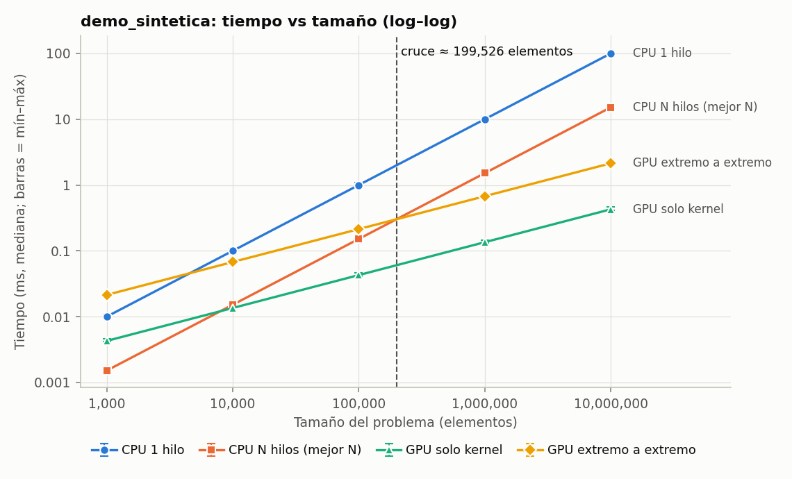
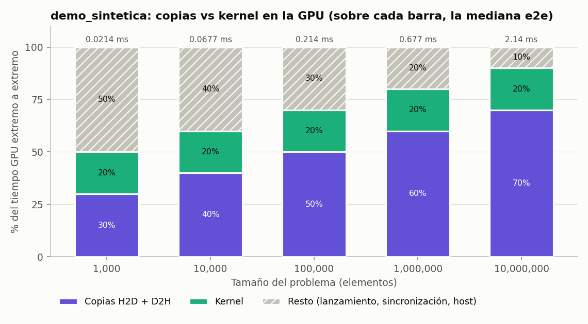
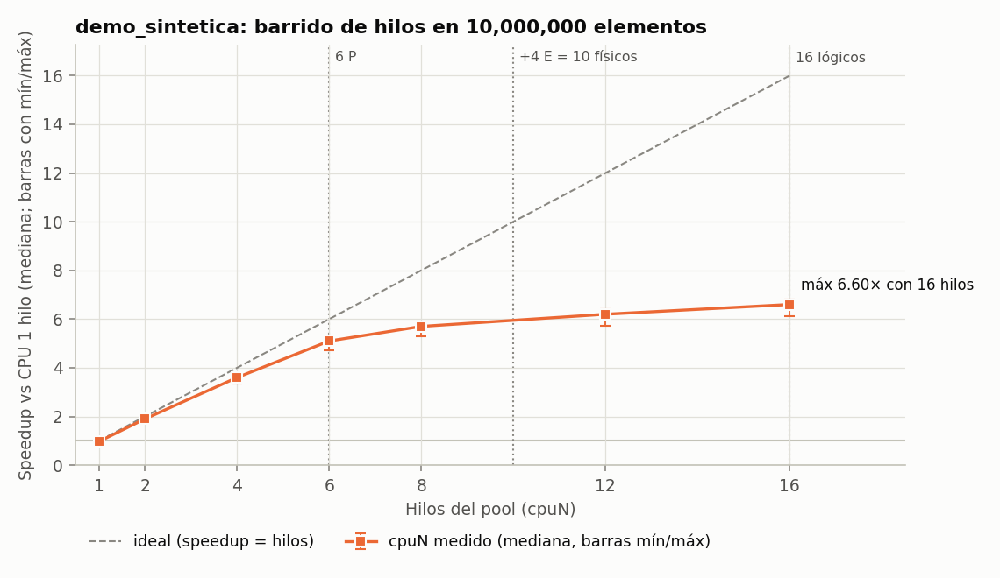
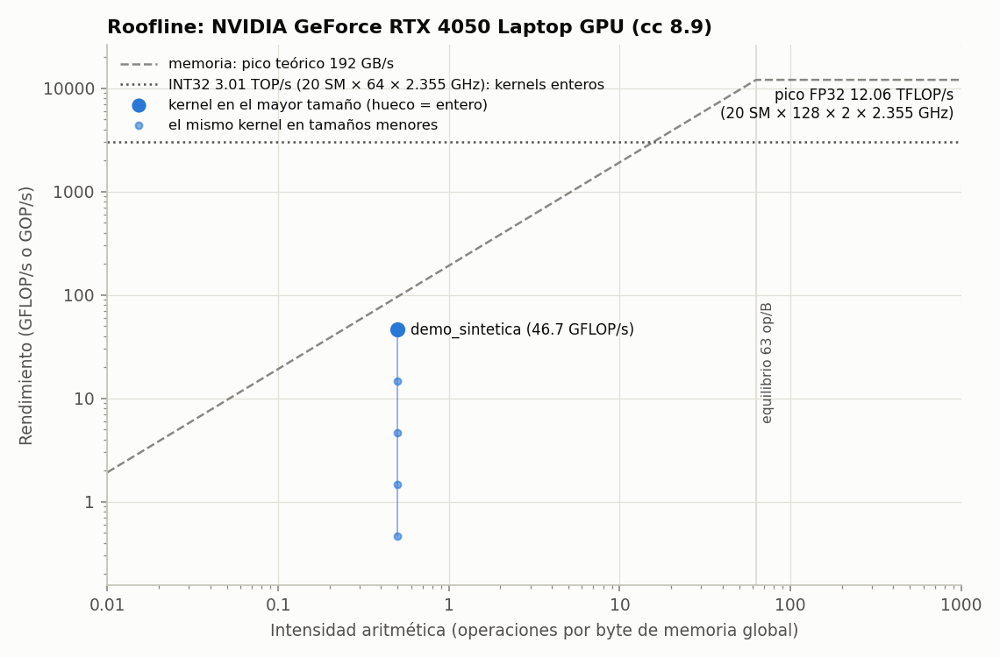

# Informe de benchmarking: tablas y figuras (generado)

Generado por `analysis/generar_informe.py` (o `analysis/informe.ipynb`) con `analysis/report_lib.py`.

- CSV: `analysis/data/sintetico/results.csv` (500 filas en total)
- Comando que lo produjo (reconstruido del env.json): `./delivery_sim config/ciudad.json --headless --bench results.csv --apps demo_sintetica --reps 10 --threads 1,2,4,6,8,12,16 --seed 12345`
- **Datos SINTÉTICOS** (solo para probar el pipeline; no son mediciones).

## Validación (sección 2.2)

- Sin incumplimientos: columnas exactas, ninguna fila `correct=no`, ≥ 10 repeticiones por grupo, ≥ 5 tamaños y ≥ 2 órdenes de magnitud por aplicación, build Release.

## Set-up (del env.json)

| Dato | Valor |
|---|---|
| CPU | 13th Gen Intel(R) Core(TM) i7-13620H |
| Hilos lógicos (hardware_concurrency) | 16 |
| Núcleos P / E | 6 P + 4 E (Intel ARK i7-13620H: 6 nucleos P (2 hilos c/u) + 4 nucleos E = 10 nucleos, 16 hilos) |
| Memoria visible | 9.7 GiB |
| Sistema operativo | Linux 6.6.87.2-microsoft-standard-WSL2 |
| GPU | NVIDIA GeForce RTX 4050 Laptop GPU |
| Compute capability / SMs | 8.9 / 20 |
| Memoria de la GPU | 6.00 GiB |
| Reloj SM (máx.) | 2.355 GHz |
| Memoria: reloj / bus | 8.001 GHz / 96 bits |
| Ancho de banda pico teórico | 192.0 GB/s |
| CUDA runtime / driver | 12.9 / 12.9 |
| Compilador | gcc 13.3.0 |
| Flags C++ | -std=c++17  -O3 -DNDEBUG -Wall -Wextra |
| Flags CUDA | -O3 -DNDEBUG -lineinfo archs=75;89 |
| Build / sanitizer | Release / none |
| Commit | sintetico |
| Semilla / repeticiones | 12345 / 10 |
| Barrido de hilos | 1, 2, 4, 6, 8, 12, 16 |

Máquina única: CPU y GPU se midieron en la misma laptop (el enunciado, 2.3, admite "your own computer if it has an NVIDIA GPU"). Donde 2.2 y 2.4 dicen Colab, se usa esta máquina; por eso la tabla "same-machine" de 2.4 coincide con la tabla de cada aplicación.

## Techos de la GPU (roofline)

- FP32: 20 SM × 128 núcleos × 2 (FMA) × 2.355 GHz = **12058 GFLOP/s**
- INT32: 20 SM × 64 op/ciclo × 2.355 GHz = **3014 GOP/s** (techo para kernels enteros: histograma, scan, radix...)
- Ancho de banda pico teórico (2 × reloj de memoria × bus / 8): **192.0 GB/s**

## Resumen (sección 2.6, punto 1)

| Aplicación | Concepto (carpeta ec2) | Aplicación del concepto | Crossover (GPU e2e < mejor CPU) | Mejor speedup e2e | Veredicto | Puntos |
|---|---|---|---|---|---|---|
| demo_sintetica | 99_sintetico | — | ≈ 199,526 elementos (entre 100,000 y 1,000,000) | 7.08× (10,000,000) | usar GPU sobre el umbral (≥ 199,526 elementos); brief (1,000): CPU; ciudad (1,000,000): GPU | no suma (synthetic) |

Puntos por concepto (máx. 3): 03_memory_tiling = 0, 04_performance = 0, 05_conv = 0, 06_stencil = 0, 07_histogram = 0, 08_reduction = 0, 09_scan = 0, 10_filter = 0, 11_merge = 0, 12_sorting = 0; total **0** → nota **0.0/100** (50 + 50 (p − 10) / 20 con p ≥ 10; 50 p / 10 si no). Conceptos sin aplicación medida (mínimo no cumplido): 03_memory_tiling, 04_performance, 05_conv, 06_stencil, 07_histogram, 08_reduction, 09_scan, 10_filter, 11_merge, 12_sorting.

## demo_sintetica: Aplicación ficticia (datos sintéticos para probar el pipeline)

Concepto: `99_sintetico`

Size = n = elementos (ficticio).

### Tabla (sección 2.4)

| Size | CPU 1 thread (ms) | CPU 16 threads (ms) | GPU kernel (ms) | GPU end to end (ms) | Speedup vs best CPU (kernel / end to end) | Correct? |
|---|---|---|---|---|---|---|
| 1,000 | 0.0100 | 0.00152 | 0.00428 | 0.0214 | 0.354× / 0.0708× | sí (100/100) |
| 10,000 | 0.100 | 0.0152 | 0.0135 | 0.0677 | 1.12× / 0.224× | sí (100/100) |
| 100,000 | 1.00 | 0.152 | 0.0428 | 0.214 | 3.54× / 0.708× | sí (100/100) |
| 1,000,000 | 10.0 | 1.52 | 0.135 | 0.677 | 11.2× / 2.24× | sí (100/100) |
| 10,000,000 | 100 | 15.2 | 0.428 | 2.14 | 35.4× / 7.08× | sí (100/100) |

N = 16: el mejor numero de hilos del barrido en todos los tamanos. Mejor CPU = min(CPU 1 thread, CPU N threads).

- Crossover extremo a extremo (GPU e2e < mejor CPU): ≈ 199,526 elementos (entre 100,000 y 1,000,000) → veredicto: **usar GPU sobre el umbral**.
- Crossover solo kernel (datos ya en la GPU): ≈ 7,981 elementos (entre 1,000 y 10,000).

### Dispersión (mediana, mín, máx, IQR)

| Size | Versión | Hilos | n | Mediana (ms) | Mín (ms) | Máx (ms) | IQR (ms) | (máx−mín)/mediana |
|---|---|---|---|---|---|---|---|---|
| 1,000 | cpu1 | 1 | 10 | 0.0100 | 0.00970 | 0.0108 | 0.000150 | 11% |
| 1,000 | cpuN | 16 | 10 | 0.00152 | 0.00147 | 0.00164 | 0.0000227 | 11% |
| 1,000 | gpu_kernel | 1 | 10 | 0.00428 | 0.00415 | 0.00462 | 0.0000642 | 11% |
| 1,000 | gpu_e2e | 1 | 10 | 0.0214 | 0.0208 | 0.0231 | 0.000321 | 11% |
| 10,000 | cpu1 | 1 | 10 | 0.100 | 0.0970 | 0.108 | 0.00150 | 11% |
| 10,000 | cpuN | 16 | 10 | 0.0152 | 0.0147 | 0.0164 | 0.000227 | 11% |
| 10,000 | gpu_kernel | 1 | 10 | 0.0135 | 0.0131 | 0.0146 | 0.000203 | 11% |
| 10,000 | gpu_e2e | 1 | 10 | 0.0677 | 0.0656 | 0.0731 | 0.00102 | 11% |
| 100,000 | cpu1 | 1 | 10 | 1.00 | 0.970 | 1.08 | 0.0150 | 11% |
| 100,000 | cpuN | 16 | 10 | 0.152 | 0.147 | 0.164 | 0.00227 | 11% |
| 100,000 | gpu_kernel | 1 | 10 | 0.0428 | 0.0415 | 0.0462 | 0.000642 | 11% |
| 100,000 | gpu_e2e | 1 | 10 | 0.214 | 0.208 | 0.231 | 0.00321 | 11% |
| 1,000,000 | cpu1 | 1 | 10 | 10.0 | 9.70 | 10.8 | 0.150 | 11% |
| 1,000,000 | cpuN | 16 | 10 | 1.52 | 1.47 | 1.64 | 0.0227 | 11% |
| 1,000,000 | gpu_kernel | 1 | 10 | 0.135 | 0.131 | 0.146 | 0.00203 | 11% |
| 1,000,000 | gpu_e2e | 1 | 10 | 0.677 | 0.656 | 0.731 | 0.0102 | 11% |
| 10,000,000 | cpu1 | 1 | 10 | 100 | 97.0 | 108 | 1.50 | 11% |
| 10,000,000 | cpuN | 16 | 10 | 15.2 | 14.7 | 16.4 | 0.227 | 11% |
| 10,000,000 | gpu_kernel | 1 | 10 | 0.428 | 0.415 | 0.462 | 0.00642 | 11% |
| 10,000,000 | gpu_e2e | 1 | 10 | 2.14 | 2.08 | 2.31 | 0.0321 | 11% |

### Barrido de hilos (10,000,000)

| Hilos | Mediana (ms) | Speedup vs CPU 1 thread | Rango (con mín/máx) | Eficiencia |
|---|---|---|---|---|
| 1 | 103 | 0.970× | 0.898–1.00 | 97% |
| 2 | 52.6 | 1.90× | 1.76–1.96 | 95% |
| 4 | 27.8 | 3.60× | 3.33–3.71 | 90% |
| 6 | 19.6 | 5.10× | 4.72–5.26 | 85% |
| 8 | 17.5 | 5.70× | 5.28–5.88 | 71% |
| 12 | 16.1 | 6.20× | 5.74–6.39 | 52% |
| 16 | 15.2 | 6.60× | 6.11–6.80 | 41% |

## Roofline

| Aplicación | Size | Ops | Bytes | Intensidad (op/B) | Kernel (ms) | Logrado (GOP/s) | Tráfico (GB/s) |
|---|---|---|---|---|---|---|---|
| demo_sintetica | 1000 | 2,000 | 4,000 | 0.500 | 0.00428 | 0.467 | 0.934 |
| demo_sintetica | 10000 | 20,000 | 40,000 | 0.500 | 0.0135 | 1.48 | 2.96 |
| demo_sintetica | 100000 | 200,000 | 400,000 | 0.500 | 0.0428 | 4.67 | 9.34 |
| demo_sintetica | 1000000 | 2,000,000 | 4,000,000 | 0.500 | 0.135 | 14.8 | 29.6 |
| demo_sintetica | 10000000 | 20,000,000 | 40,000,000 | 0.500 | 0.428 | 46.7 | 93.4 |

### Derivación de operaciones y bytes (de `kernels.json`)

- **demo_sintetica**: ops = `2*n`, bytes = `4*n` (fp32). Ficticio: 2 FLOP y 4 bytes por elemento.
