# Informe de benchmarking: aplicaciones GPU en Equipetrol Delivery

Segunda evaluación del proyecto final, bloque 1 (`GPU_additions_and_report_ec2.pdf`, parte 2). La estructura
sigue la sección 2.6 del enunciado: (1) resumen, (2) set-up, (3) una sección por aplicación, (4) roofline,
(5) efecto en la simulación completa y (6) conclusiones y amenazas a la validez.

Todos los números vienen de la **sesión final** del 2026-11-20 (20:33 a 20:50, commit `098eb41`, build Release con
CUDA, máquina libre, GPU fija en P0): `analysis/data/final/`. Las tablas y figuras marcadas como automáticas (bloques
`<!-- auto:... -->`) las escribe `analysis/actualizar_informe.py` desde esos CSV; nada se copió a mano. El resto
es el análisis.

---

## 1. Resumen

Una fila por aplicación: concepto (carpeta de `ec2/`), número de aplicación del concepto, tamaño de cruce (el primer
tamaño en que la GPU extremo a extremo le gana a la mejor CPU, interpolado en log-log), mejor speedup extremo a
extremo, veredicto y puntos. "Mejor CPU" = la más rápida entre CPU 1 hilo y el mejor N del barrido de hilos (y, en
la aplicación 03, también Dijkstra desde cada nodo, la alternativa honesta de CPU). Las filas de calibración no suman
puntos: miden los overheads que explican el resto.

<!-- auto:resumen -->
| Aplicación | Concepto (carpeta ec2) | Aplicación del concepto | Crossover (GPU e2e < mejor CPU) | Mejor speedup e2e | Veredicto | Puntos |
|---|---|---|---|---|---|---|
| apsp_floyd | 03_memory_tiling | 1ª | ≈ 312 nodos (entre 100 y 400); vuelve a perder desde ≈ 3,031 nodos | 1.31× (1,000) (mejor CPU incluye apsp_dijkstra) | usar GPU solo en el rango ganador (≈ 312 nodos a ≈ 3,031 nodos); brief (668): GPU; ciudad (3,741): CPU | 1 |
| eta_batch_soa | 04_performance | 1ª | no hay cruce (la GPU no gana en el rango medido) | 0.623× (5,000) | mantener CPU; brief (3): fuera del rango medido (50–5,000); ciudad (2,000): CPU | 1 |
| demand_heatmap | 05_conv | 1ª | ≈ 186 celdas por lado (entre 128 y 256) | 2.97× (1,024) | usar GPU sobre el umbral (≥ 186 celdas por lado); programa (grilla de la ventana) (128): CPU | 1 |
| coverage_field | 06_stencil | 1ª | ≈ 77.0 celdas por lado (entre 64 y 100) | 15.2× (1,024) | usar GPU sobre el umbral (≥ 77.0 celdas por lado); programa (grilla de la ventana) (128): GPU | 1 |
| delivery_histogram | 07_histogram | 1ª | no hay cruce (la GPU no gana en el rango medido) | 0.626× (1,000,000) | mantener CPU | 1 |
| best_courier | 08_reduction | 1ª | no hay cruce (la GPU no gana en el rango medido) | 0.425× (2,000) | mantener CPU; brief (3): fuera del rango medido (50–5,000); ciudad (2,000): CPU | 1 |
| orders_in_progress | 09_scan | 1ª | no hay cruce (la GPU no gana en el rango medido) | 0.761× (10,000,000) | mantener CPU | 1 |
| candidate_filter | 10_filter | 1ª | no hay cruce (la GPU no gana en el rango medido) | 0.153× (200,000) | mantener CPU; brief (3): fuera del rango medido (100–200,000); ciudad (2,000): CPU | 1 |
| delivery_timeline | 11_merge | 1ª | ≈ 5,565 entregas (entre 1,000 y 10,000) | 2.86× (1,000,000) | usar GPU sobre el umbral (≥ 5,565 entregas) | 1 |
| delivery_percentiles | 12_sorting | 1ª | ≈ 12,568 entregas (entre 10,000 y 100,000) | 4.47× (1,000,000) | usar GPU sobre el umbral (≥ 12,568 entregas) | 1 |
| calib_copy | — | — | no hay cruce (la GPU no gana en el rango medido) | 0.212× (64 MiB) | mantener CPU | no suma (calibración) |
| calib_launch | — | — | no hay cruce (la GPU no gana en el rango medido) | 0.000807× (1) | mantener CPU | no suma (calibración) |

Puntos por concepto (máx. 3): 03_memory_tiling = 1, 04_performance = 1, 05_conv = 1, 06_stencil = 1, 07_histogram = 1, 08_reduction = 1, 09_scan = 1, 10_filter = 1, 11_merge = 1, 12_sorting = 1. Total **10** → nota **50.0/100**.
<!-- /auto:resumen -->

Cómo se lee el veredicto: "usar GPU" si gana desde el menor tamaño medido; "mantener CPU" si no hay cruce en el
rango medido; "usar GPU sobre el umbral" si hay cruce (el umbral es el crossover); "solo en el rango ganador" si la
GPU gana y después vuelve a perder. Cuando la aplicación tiene tamaños de operación conocidos (escala del brief,
`config/equipetrol.json`, y de la ciudad, `config/ciudad.json`) se da quién gana en cada escala.

**En una frase:** cinco aplicaciones ganan extremo a extremo por encima de un umbral (03 en un rango, 05, 06, 11 y
12); las otras cinco (04, 07, 08, 09 y 10) son recorridos de una sola pasada con poca aritmética por byte, y copiar
sus datos a la GPU cuesta más que resolverlas en la CPU, aunque su kernel solo gane en casi todos los tamaños.

---

## 2. Set-up

### 2.1 Una sola máquina: por qué no hay Colab

El enunciado (2.2) separa dos máquinas porque supone que "no single machine available to you has both a strong
multicore CPU and an NVIDIA GPU". Aquí ese supuesto no se cumple: la laptop del equipo tiene un i7-13620H de 16 hilos
**y** una NVIDIA RTX 4050 Laptop. La sección 2.3 permite correr las herramientas de GPU en "your own computer if it has
an NVIDIA GPU". Por eso **todas** las versiones (CPU 1 hilo, CPU N hilos, GPU kernel y GPU extremo a extremo) se
midieron en la misma laptop, con el mismo binario y la misma entrada:

- donde el enunciado dice "Colab", este informe usa la RTX 4050 de la laptop;
- la comparación del veredicto es **en la misma máquina**, así que la "same-machine table" que pide 2.4 es la misma
  tabla principal de cada aplicación;
- desaparece la amenaza "comparar dos máquinas distintas" y aparece otra: una GPU de laptop con estados de energía y
  un controlador paravirtualizado por WSL2 (secciones 2.5 y 6).

### 2.2 Hardware (cada dato con el comando que lo produjo)

| Dato | Valor | Comando |
|---|---|---|
| Equipo | MSI Katana 15 B13VEK | `gcim Win32_ComputerSystem \| select Manufacturer, Model` (PowerShell) |
| CPU | 13th Gen Intel Core i7-13620H | `gcim Win32_Processor \| select Name, NumberOfCores, NumberOfLogicalProcessors` |
| Núcleos | **10 físicos = 6 P (con Hyper-Threading) + 4 E; 16 hilos lógicos** | mismo `gcim` (NumberOfCores = 10, NumberOfLogicalProcessors = 16); división P/E: ficha de Intel |
| Núcleos según WSL | 8 núcleos × 2 hilos = 16 CPU (ver nota) | `lscpu` en WSL ("Core(s) per socket: 8", "Thread(s) per core: 2") |
| Cachés (vistas por WSL) | L1d 384 KiB, L2 10 MiB, L3 24 MiB | `lscpu` |
| Memoria | 15,71 GB en la laptop; **WSL limitado a 10 GB** (9,7 GiB visibles) + 8 GB de swap | `gcim Win32_ComputerSystem` (TotalPhysicalMemory); `.wslconfig` (`memory=10GB`, `swap=8GB`, `processors=16`); `free -h` |
| GPU | NVIDIA GeForce RTX 4050 Laptop GPU, 6141 MiB, compute capability 8.9, 20 SM | `nvidia-smi --query-gpu=name,driver_version,clocks.max.sm,memory.total --format=csv`; cc y SM: `env.json` (`cudaGetDeviceProperties`) |
| Relojes de la GPU | SM 2355 MHz (`cudaDeviceProp::clockRate`, el del roofline, y el medido en toda la sesión final); 3105 MHz como máximo absoluto según `nvidia-smi`; memoria 8001 MHz, bus de 96 bits | `nvidia-smi`; `env.json` |
| Driver NVIDIA | 576.80 (Windows; WSL lo usa por paravirtualización) | `nvidia-smi --query-gpu=name,driver_version,clocks.max.sm,memory.total --format=csv` |
| Energía | Enchufada (BatteryStatus = 2), modo de energía de Windows "Mejor rendimiento" | `gcim Win32_Battery \| select BatteryStatus`; registro `HKLM:\SYSTEM\CurrentControlSet\Control\Power\User\PowerSchemes` (`ActiveOverlayAcPowerScheme = ded574b5-45a0-4f42-8737-46345c09c238`) |
| Sistema operativo | Windows 11 Home 10.0.26200; WSL 2.6.1.0, kernel 6.6.87.2-microsoft-standard-WSL2, Ubuntu 24.04.1 LTS | `gcim Win32_OperatingSystem`; `wsl --version`; `uname -r`; `/etc/os-release` |

**Nota sobre los núcleos.** Según la ficha de Intel, el i7-13620H tiene **6 núcleos P (con Hyper-Threading) + 4
núcleos E = 10 físicos y 16 lógicos** (6 × 2 + 4 × 1). WSL informa 8 físicos (`physical_cores: 8` en el `env.json`,
"Core(s) per socket: 8" en `lscpu`) por su topología virtual: Hyper-V presenta las 16 CPU como 8 núcleos × 2 hilos. WSL no ve la diferencia; Windows decide en
qué núcleo real corre cada CPU virtual. En los barridos de hilos se marcan 6 (núcleos P), 10 (todos los físicos) y
16 (lógicos): desde 7 hilos entran núcleos E o el segundo hilo de un núcleo P y el speedup deja de ser lineal.

### 2.3 Software y build

| Componente | Versión / valor | Comando |
|---|---|---|
| Compilador C++ | g++ 13.3.0 (Ubuntu 13.3.0-6ubuntu2~24.04.1) | `g++ --version` |
| CUDA | nvcc 12.9 (V12.9.86); runtime 12.9; CUDA máxima del driver 12.9 | `nvcc --version`; `env.json` |
| CMake | 3.28.3 | `cmake --version` |
| Profilers | Nsight Systems 2025.1.3, Nsight Compute 2025.2.1, compute-sanitizer 2025.2.1 | `nsys --version`; `ncu --version`; `compute-sanitizer --version` |
| Build | `cmake .. -DUSE_CUDA=ON -DCMAKE_BUILD_TYPE=Release` (WSL2, no MSVC) | `analysis/scripts/compilar_wsl.sh` |
| Flags C++ | `-std=c++17 -O3 -DNDEBUG -Wall -Wextra` (las mismas para todas las versiones) | `env.json` (`build.cxx_flags`) |
| Flags CUDA | `-O3 -DNDEBUG -lineinfo`, arquitecturas `75;89` | `env.json` (`build.cuda_flags`) |
| Análisis | Python 3.13 (Windows), pandas 2.3.3, matplotlib 3.10.7 | `analysis/report_lib.py` |

El modo bench se niega a medir un build que no sea Release o que tenga sanitizers (ADR 0003), y cada `env.json`
guarda el tipo de build, los flags, el commit y el comando exacto.

### 2.4 Escenarios

| Escenario | Archivo | Nodos | Calles | Restaurantes | Couriers | Pedidos pendientes máx. |
|---|---|---|---|---|---|---|
| Escala del brief (Equipetrol) | `config/equipetrol.json` | 668 | 1027 | 6 | 3 | 50 |
| Ciudad (Santa Cruz, OpenStreetMap) | `config/ciudad.json` | 3741 | 6058 | 150 | 2000 | 600 |

Los tamaños de grafo de la aplicación 03 son subgrafos conexos de la ciudad real que crecen desde Equipetrol
(25, 100, 400, 1000, 2000 y 3741 nodos). Las aplicaciones 04, 08 y 10 usan nodos reales de la ciudad y su tabla de
tiempos; el resto usa datos sintéticos con semilla fija (distribuciones descritas en cada sección).

### 2.5 Protocolo de medición

| Requisito (2.2) | Cómo se cumple |
|---|---|
| Enchufada, "Best performance", otras aplicaciones cerradas | Verificado con los comandos de 2.2; en la sesión final, carga media de 0,5 a 3 sobre 16 hilos y ningún otro proceso en la GPU (`analysis/data/final/sesion.txt`). |
| Build Release con los mismos flags para todas las versiones | Un solo binario (commit `098eb41`); el bench rechaza Debug y sanitizers. |
| Barrido de hilos 1, 2, 4 ... hasta los lógicos, con P y E indicados | `cpuN` con 1, 2, 4, 6, 8, 12 y 16 hilos; gráfico con 6 P, 10 físicos y 16 lógicos. |
| Calor: versiones intercaladas y mirar la dispersión | El orden de las versiones rota una posición por repetición; cada tabla de dispersión marca "(alta)" si (máx − mín) / mediana > 50 %. Temperatura de la GPU registrada (58-65 °C). |
| Calentamiento y ≥ 10 repeticiones; mediana y dispersión | Una corrida de calentamiento por versión y tamaño; 10 repeticiones medidas (30 en la corrida de robustez); mediana, mínimo, máximo e IQR en cada tabla; barras mín–máx en cada gráfico. |
| Reloj correcto | `cudaEvent` para kernel y copias; `steady_clock` con `cudaDeviceSynchronize()` antes de parar para extremo a extremo. |
| ≥ 5 tamaños y ≥ 2 órdenes de magnitud | Lo valida `report_lib.validate` en cada CSV (bloque "Validación" de 2.6). |
| Misma entrada, semilla fija y correctitud en cada corrida | Semilla 12345; cada corrida se compara con `cpu1` (exacto en enteros, tolerancia relativa documentada en float); 0 filas `correct=no` en toda la sesión. |

**Estados de energía de la GPU.** En una corrida preliminar la RTX 4050 bajó de P0 a P8 (≈ 210 MHz) cuando el bench
corría las versiones de CPU y los kernels de microsegundos no alcanzaban a subirla de nuevo. Para la sesión final se
aplicó el protocolo: enchufada, "Mejor rendimiento" en Windows, "Preferir rendimiento máximo" en el panel de NVIDIA,
`nvidia-smi -q -d PERFORMANCE` en P0 antes de empezar y registro continuo del estado:

<!-- auto:pstate -->
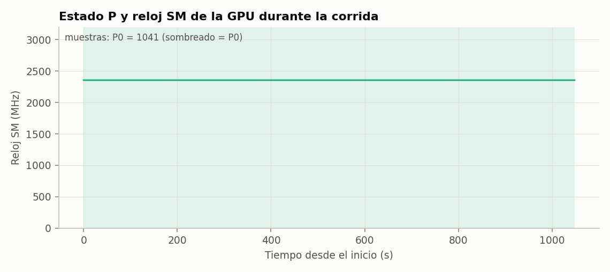

Registro `analysis/data/final/pstate_sesion.csv`: 1041 muestras de `nvidia-smi` en 1048 s; P0 = 1041; reloj SM 2355–2355 MHz; temperatura 58–65 °C.
<!-- /auto:pstate -->

### 2.6 Cómo reproducir cada número

En WSL (Ubuntu 24.04), desde la raíz del repositorio y con CUDA en el `PATH`:

```bash
bash analysis/scripts/compilar_wsl.sh ec2                     # clona el commit y compila Release + CUDA
bash analysis/scripts/correr_bench.sh <salida> --apps <apps>  # bench con registro del estado P de la GPU
bash tools/check_gpu_equivalence.sh build-cuda/delivery_sim   # GPU == CPU: 16 apps x 3 tamaños (49 OK, exit 0)
#   = cd build && ./delivery_sim config/ciudad.json --headless --bench bench.csv --force --apps <apps>
tools/sim_compare.sh                                          # sección 5: 3 corridas por backend, 30 s, valida cada log
```

En Windows (Python 3.13):

```powershell
C:\Python313\python.exe analysis\actualizar_informe.py   # tablas y figuras de este informe (docs/informe/img)
C:\Python313\python.exe analysis\generar_informe.py      # todas las tablas en analysis/informe_tablas.md
jupyter nbconvert --to notebook --execute --inplace analysis/informe.ipynb
C:\Python313\python.exe -m pytest analysis/test_report_lib.py -q
```

Profilers y correctitud de cada aplicación:

```bash
nsys profile --stats=true -o timeline ./delivery_sim config/ciudad.json --headless --bench-once --app <app> --size <n>
ncu --set full -k regex:<kernel> --launch-count 1 -o <app>_ncu ./delivery_sim config/ciudad.json --headless --bench-once --app <app> --size <n>
compute-sanitizer --tool memcheck  ./delivery_sim config/ciudad.json --headless --bench-once --app <app> --size <n>
compute-sanitizer --tool racecheck ./delivery_sim config/ciudad.json --headless --bench-once --app <app> --size <n>
```

Corridas de la sesión final, con commit y comando exacto (leídos de cada `env.json`), y validación automática:

<!-- auto:fuentes -->
- `analysis/data/final/apsp/bench.csv`: aplicaciones apsp_floyd, apsp_dijkstra; commit `098eb41-dirty`; comando `./delivery_sim config/ciudad.json --headless --bench bench.csv --force --apps apsp_floyd,apsp_dijkstra` (ejecutado en `build/` de la copia WSL).
- `analysis/data/final/best_courier/bench.csv`: aplicaciones best_courier, best_courier_divergent; commit `098eb41-dirty`; comando `./delivery_sim config/ciudad.json --headless --bench bench.csv --force --apps best_courier,best_courier_divergent` (ejecutado en `build/` de la copia WSL).
- `analysis/data/final/calib/bench.csv`: aplicaciones calib_copy, calib_launch; commit `098eb41-dirty`; comando `./delivery_sim config/ciudad.json --headless --bench bench.csv --force --apps calib_copy,calib_launch` (ejecutado en `build/` de la copia WSL).
- `analysis/data/final/candidate_filter/bench.csv`: aplicaciones candidate_filter, candidate_filter_naive; commit `098eb41-dirty`; comando `./delivery_sim config/ciudad.json --headless --bench bench.csv --force --apps candidate_filter,candidate_filter_naive` (ejecutado en `build/` de la copia WSL).
- `analysis/data/final/coverage_field/bench.csv`: aplicaciones coverage_field; commit `098eb41-dirty`; comando `./delivery_sim config/ciudad.json --headless --bench bench.csv --force --apps coverage_field` (ejecutado en `build/` de la copia WSL).
- `analysis/data/final/delivery_histogram/bench.csv`: aplicaciones delivery_histogram, histogram_naive; commit `098eb41-dirty`; comando `./delivery_sim config/ciudad.json --headless --bench bench.csv --force --apps delivery_histogram,histogram_naive` (ejecutado en `build/` de la copia WSL).
- `analysis/data/final/delivery_percentiles/bench.csv`: aplicaciones delivery_percentiles; commit `098eb41-dirty`; comando `./delivery_sim config/ciudad.json --headless --bench bench.csv --force --apps delivery_percentiles` (ejecutado en `build/` de la copia WSL).
- `analysis/data/final/delivery_timeline/bench.csv`: aplicaciones delivery_timeline; commit `098eb41-dirty`; comando `./delivery_sim config/ciudad.json --headless --bench bench.csv --force --apps delivery_timeline` (ejecutado en `build/` de la copia WSL).
- `analysis/data/final/demand_heatmap/bench.csv`: aplicaciones demand_heatmap, demand_heatmap_tiles; commit `098eb41-dirty`; comando `./delivery_sim config/ciudad.json --headless --bench bench.csv --force --apps demand_heatmap,demand_heatmap_tiles` (ejecutado en `build/` de la copia WSL).
- `analysis/data/final/eta_batch/bench.csv`: aplicaciones eta_batch_soa, eta_batch_aos; commit `098eb41-dirty`; comando `./delivery_sim config/ciudad.json --headless --bench bench.csv --force --apps eta_batch_soa,eta_batch_aos` (ejecutado en `build/` de la copia WSL).
- `analysis/data/final/orders_in_progress/bench.csv`: aplicaciones orders_in_progress; commit `098eb41-dirty`; comando `./delivery_sim config/ciudad.json --headless --bench bench.csv --force --apps orders_in_progress` (ejecutado en `build/` de la copia WSL).

Validación automática (2.2): 0 error(es); observaciones:
- AVISO: [apsp_dijkstra] faltan versiones ['gpu_kernel', 'gpu_e2e'] (la tabla de 2.4 queda incompleta) (esperado: CPU de referencia de apsp_floyd)
- AVISO: [best_courier_divergent] faltan versiones ['cpuN'] (la tabla de 2.4 queda incompleta) (esperado: variante de best_courier)
- INFO: [calib_launch] gpu_e2e sin h2d_ms/kernel_ms/d2h_ms: no se puede graficar el reparto copias/kernel
- AVISO: [candidate_filter_naive] faltan versiones ['cpuN'] (la tabla de 2.4 queda incompleta) (esperado: variante de candidate_filter)
- AVISO: [histogram_naive] faltan versiones ['cpu1', 'cpuN'] (la tabla de 2.4 queda incompleta) (esperado: variante de delivery_histogram)
- AVISO: [eta_batch_aos] faltan versiones ['cpuN'] (la tabla de 2.4 queda incompleta) (esperado: variante de eta_batch_soa)
<!-- /auto:fuentes -->

Hardware y build tal como los guardó el programa:

<!-- auto:setup -->
| Dato | Valor |
|---|---|
| CPU | 13th Gen Intel(R) Core(TM) i7-13620H |
| Hilos lógicos (hardware_concurrency) | 16 |
| Núcleos físicos (env.json, /proc/cpuinfo de WSL) | 8 |
| Núcleos P / E (fabricante) | 6 P + 4 E = 10 (Intel ARK i7-13620H: 6 nucleos P (2 hilos c/u) + 4 nucleos E = 10 nucleos, 16 hilos) |
| Memoria visible | 9.7 GiB |
| Sistema operativo | Linux 6.6.87.2-microsoft-standard-WSL2 |
| GPU | NVIDIA GeForce RTX 4050 Laptop GPU |
| Compute capability / SMs | 8.9 / 20 |
| Memoria de la GPU | 6.00 GiB |
| Reloj SM (máx.) | 2.355 GHz |
| Memoria: reloj / bus | 8.001 GHz / 96 bits |
| Ancho de banda pico teórico | 192.0 GB/s |
| CUDA runtime / driver NVIDIA (CUDA máx. del driver) | 12.9 / 576.80 (12.9) |
| Compilador | gcc 13.3.0 |
| Flags C++ | -std=c++17  -O3 -DNDEBUG -Wall -Wextra |
| Flags CUDA | -O3 -DNDEBUG -lineinfo archs=75;89 |
| Build / sanitizer | Release / none |
| Commit | 098eb41-dirty |
| Semilla / repeticiones | 12345 / 10 |
| Barrido de hilos | 1, 2, 4, 6, 8, 12, 16 |
<!-- /auto:setup -->

### 2.7 Calibración: latencia de lanzamiento y ancho de banda

Dos overheads deciden casi todos los veredictos (2.5: "launch latency and transfer cost against the computation").

- `calib_copy`: copia de `size` bytes. `cpu1` = `memcpy`; `cpuN` = `memcpy` repartido; `gpu_kernel` = copia dentro de
  la VRAM (2 × size de tráfico); `gpu_e2e` = ida y vuelta CPU→GPU→CPU con memoria paginable.
- `calib_launch`: N lanzamientos de un kernel de un hilo. `gpu_kernel` = encolados con una sola espera; `gpu_e2e` =
  cada uno seguido de `cudaDeviceSynchronize()`; `cpu1` = N llamadas triviales; `cpuN` = N despachos del pool.

#### Techos de la GPU

<!-- auto:techos -->
- Pico FP32 = 20 SM × 128 núcleos × 2 (FMA) × 2.355 GHz = **12058 GFLOP/s**.
- Pico INT32 = 20 SM × 64 op/ciclo × 2.355 GHz = **3014 GOP/s** (techo de los kernels enteros).
- Ancho de banda pico teórico = 2 × reloj de memoria × bus / 8 = **192.0 GB/s**.
- Ancho de banda medido (`calib_copy` gpu_kernel, 256 MiB, 2 × bytes / tiempo) = **171.6 GB/s** (89% del pico).
- Punto de equilibrio (FP32 / ancho de banda medido) = **70 FLOP/B**.
<!-- /auto:techos -->

#### calib_copy (size en bytes)

<!-- auto:tabla:calib_copy -->
| Size | CPU 1 thread (ms) | CPU N threads (ms) | GPU kernel (ms) | GPU end to end (ms) | Speedup vs best CPU (kernel / end to end) | Correct? |
|---|---|---|---|---|---|---|
| 4 KiB | 0.000148 | 0.000514 (N=1) | 0.00426 | 0.235 | 0.0347× / 0.000627× | sí (100/100) |
| 64 KiB | 0.00161 | 0.00200 (N=1) | 0.00461 | 0.195 | 0.350× / 0.00828× | sí (100/100) |
| 1 MiB | 0.0422 | 0.0399 (N=1) | 0.00584 | 0.424 | 6.83× / 0.0939× | sí (100/100) |
| 16 MiB | 0.893 | 0.600 (N=4) | 0.196 | 3.44 | 3.07× / 0.175× | sí (100/100) |
| 64 MiB | 3.68 | 2.61 (N=4) | 0.785 | 12.3 | 3.32× / 0.212× | sí (100/100) |
| 256 MiB | 13.1 | 9.74 (N=12) | 3.13 | 51.3 | 3.11× / 0.190× | sí (100/100) |

N = el mejor numero de hilos del barrido en cada tamano (entre parentesis). Mejor CPU = min(CPU 1 thread, CPU N threads).
<!-- /auto:tabla:calib_copy -->

<!-- auto:figuras:calib_copy -->
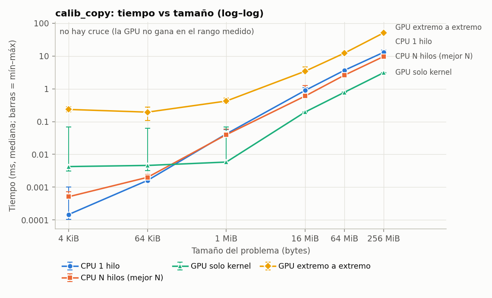

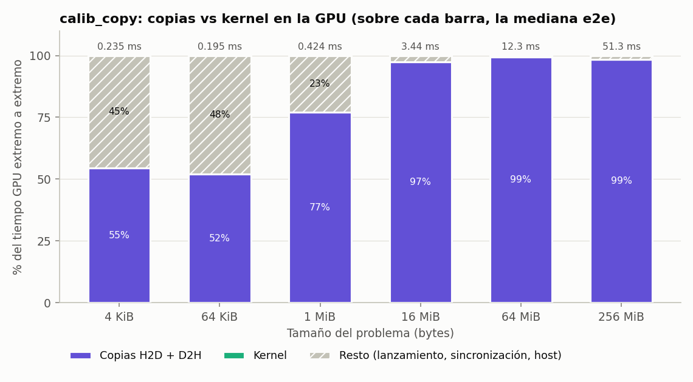

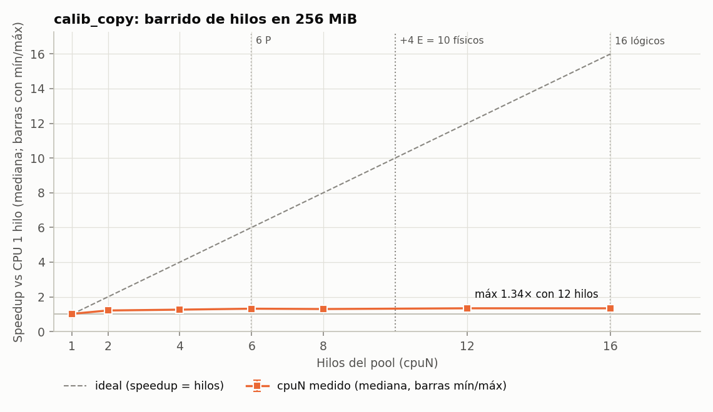
<!-- /auto:figuras:calib_copy -->

#### calib_launch (size = número de lanzamientos)

<!-- auto:tabla:calib_launch -->
| Size | CPU 1 thread (ms) | CPU 1 threads (ms) | GPU kernel (ms) | GPU end to end (ms) | Speedup vs best CPU (kernel / end to end) | Correct? |
|---|---|---|---|---|---|---|
| 1 | 0.0000690 | 0.000659 | 0.00410 | 0.0855 | 0.0168× / 0.000807× | sí (100/100) |
| 10 | 0.000175 | 0.00112 | 0.0769 | 0.325 | 0.00228× / 0.000540× | sí (100/100) |
| 100 | 0.000301 | 0.00536 | 0.686 | 2.67 | 0.000439× / 0.000113× | sí (100/100) |
| 1,000 | 0.00147 | 0.0458 | 7.60 | 20.9 | 0.000194× / 0.0000705× | sí (100/100) |
| 10,000 | 0.0137 | 0.478 | 61.9 | 250 | 0.000221× / 0.0000549× | sí (100/100) |

N = 1: el mejor numero de hilos del barrido en todos los tamanos. Mejor CPU = min(CPU 1 thread, CPU N threads).
<!-- /auto:tabla:calib_launch -->

<!-- auto:figuras:calib_launch -->
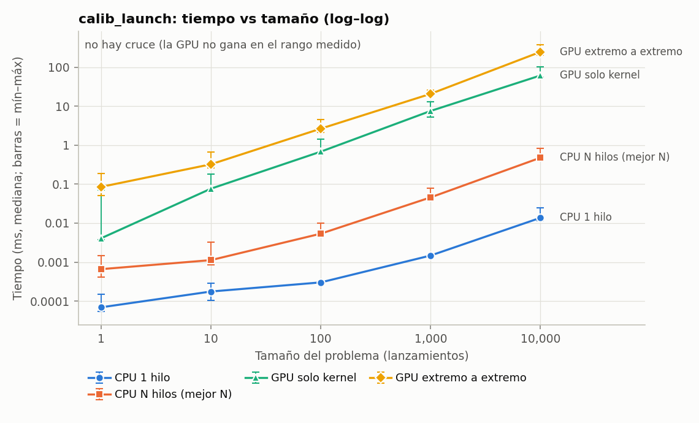

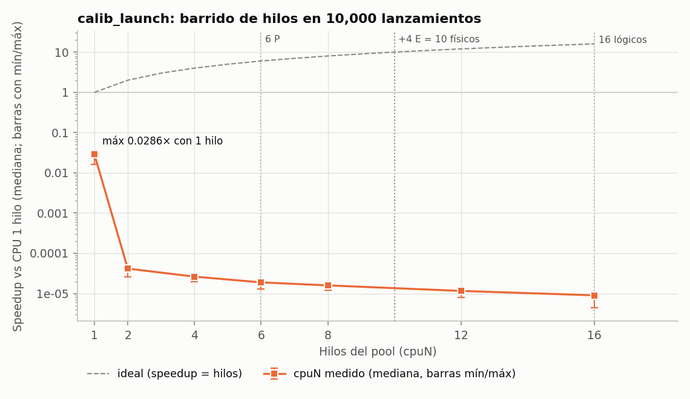
<!-- /auto:figuras:calib_launch -->

#### Qué dice la calibración

1. **Lanzar un kernel cuesta ~6 µs; lanzar y esperar, ~25 µs.** 10 000 lanzamientos encolados tardan 61,9 ms
   (6,2 µs cada uno) y con una sincronización después de cada uno 249,6 ms (25,0 µs). Un trabajo que en la CPU tarda
   menos que eso no puede ganar en la GPU, y una aplicación con muchos lanzamientos por llamada (la 06 hace 200, la 12
   más de cien) paga ese costo cada vez.
2. **Despertar al pool de hilos cuesta de 33 µs (2 hilos) a 152 µs (16 hilos) por despacho** (barrido de
   `calib_launch` en 10 000). Por eso, en tamaños chicos, el mejor "CPU N" es N = 1.
3. **Mover datos entre CPU y GPU es ~16 veces más lento que leerlos dentro de la GPU.** Con memoria paginable,
   256 MiB suben en 25,7 ms (10,5 GB/s) y bajan en 24,9 ms (10,8 GB/s); la VRAM entrega 171,6 GB/s (89 % de los
   192 GB/s teóricos) y la propia CPU copia a 20-28 GB/s (`memcpy` con 1 y 12 hilos). **Una tarea que recorre sus
   datos una sola vez y los trae de la CPU en cada llamada no puede ganar extremo a extremo**: o deja los datos en la
   GPU entre llamadas o hace mucho cálculo por byte.
4. **La caché L2 da cifras mayores al pico en tamaños chicos** (1 MiB: 359 GB/s); el techo del roofline se toma del
   mayor tamaño (256 MiB).
5. **Una ida y vuelta mínima cuesta ~0,2 ms** (4 KiB: 0,235 ms): ninguna versión GPU extremo a extremo con copias
   baja de esa cifra.

---

## 3. Aplicaciones

Cada sección: la tarea y por qué es data-parallel; el diseño (datos, movimientos, hilos; grid y bloque y por qué);
la correctitud; la tabla de 2.4 (medianas) y su dispersión (mín, máx, IQR); el barrido de hilos; los gráficos (tiempo
vs tamaño log-log con el cruce, reparto copias/kernel, barrido de hilos); el profiler; y el análisis de 2.5 en siete
puntos. La ocupación teórica usa los límites de cc 8.9: 1536 hilos y 24 bloques por SM, 20 SM = **30 720 hilos
residentes** en toda la GPU.

**Correctitud (común a todas).**

- *GPU == CPU:* cada una de las 9 320 corridas de la sesión final se comparó con la versión `cpu1` dentro del bench
  (columna `Correct?`): **0 incorrectas**. Es la prueba de equivalencia en todos los tamaños.
- *Script de equivalencia* (`tools/check_gpu_equivalence.sh`, commit `93fdcf6`, que no cambia `src/`, así que las
  mediciones siguen valiendo): corre `--bench-once` de 16 aplicaciones en 3 tamaños cada una (el mínimo, uno que no es
  múltiplo del bloque y uno mediano) y exige `gpu_kernel` y `gpu_e2e` con `correct=yes`. Las 16 son las 10 principales
  (apsp_floyd, eta_batch_soa, demand_heatmap, coverage_field, delivery_histogram, best_courier, orders_in_progress,
  candidate_filter, delivery_timeline, delivery_percentiles) y 6 variantes (eta_batch_aos, demand_heatmap_tiles,
  histogram_naive, best_courier_divergent, candidate_filter_naive y apsp_dijkstra, que es solo CPU y se acepta sin filas
  GPU); no incluye las calib_*. 49 = 16 × 3 tamaños + 1 control de que la lista cubre todas las aplicaciones
  registradas: **49 OK, 0 FALLA, exit 0, 19 s** con el build CUDA. Con un build sin CUDA se niega
  (exit 2), y QA comprobó que un binario falso con una fila `correct=no` da FALLA y exit ≠ 0.
- *compute-sanitizer:* memcheck y racecheck sobre `--bench-once` de las 18 aplicaciones de bench, **a tamaño 400**
  (no a los tamaños grandes: con la instrumentación tardarían demasiado); en ese tamaño ya hay varios bloques, bordes y
  tamaños que no son múltiplo del bloque.
- *ThreadSanitizer:* la simulación completa de la ciudad, con la GPU integrada por el hilo dueño, y el modo `--headless`.
- *Tests CPU:* `tests/test_<app>.cpp` (cpu1 == cpuN y casos borde) dentro de la suite.

Resultados de la CI completa sobre `098eb41` (sin volver a correrla):

<!-- auto:correctitud -->
| App de bench | Size | compute-sanitizer memcheck | compute-sanitizer racecheck |
|---|---|---|---|
| apsp_dijkstra | 400 | ERROR SUMMARY: 0 errors | RACECHECK SUMMARY: 0 hazards displayed (0 errors, 0 warnings) |
| apsp_floyd | 400 | ERROR SUMMARY: 0 errors | RACECHECK SUMMARY: 0 hazards displayed (0 errors, 0 warnings) |
| best_courier | 400 | ERROR SUMMARY: 0 errors | RACECHECK SUMMARY: 0 hazards displayed (0 errors, 0 warnings) |
| best_courier_divergent | 400 | ERROR SUMMARY: 0 errors | RACECHECK SUMMARY: 0 hazards displayed (0 errors, 0 warnings) |
| calib_copy | 400 | ERROR SUMMARY: 0 errors | RACECHECK SUMMARY: 0 hazards displayed (0 errors, 0 warnings) |
| calib_launch | 400 | ERROR SUMMARY: 0 errors | RACECHECK SUMMARY: 0 hazards displayed (0 errors, 0 warnings) |
| candidate_filter | 400 | ERROR SUMMARY: 0 errors | RACECHECK SUMMARY: 0 hazards displayed (0 errors, 0 warnings) |
| candidate_filter_naive | 400 | ERROR SUMMARY: 0 errors | RACECHECK SUMMARY: 0 hazards displayed (0 errors, 0 warnings) |
| coverage_field | 400 | ERROR SUMMARY: 0 errors | RACECHECK SUMMARY: 0 hazards displayed (0 errors, 0 warnings) |
| delivery_histogram | 400 | ERROR SUMMARY: 0 errors | RACECHECK SUMMARY: 0 hazards displayed (0 errors, 0 warnings) |
| delivery_percentiles | 400 | ERROR SUMMARY: 0 errors | RACECHECK SUMMARY: 0 hazards displayed (0 errors, 0 warnings) |
| delivery_timeline | 400 | ERROR SUMMARY: 0 errors | RACECHECK SUMMARY: 0 hazards displayed (0 errors, 0 warnings) |
| demand_heatmap | 400 | ERROR SUMMARY: 0 errors | RACECHECK SUMMARY: 0 hazards displayed (0 errors, 0 warnings) |
| demand_heatmap_tiles | 400 | ERROR SUMMARY: 0 errors | RACECHECK SUMMARY: 0 hazards displayed (0 errors, 0 warnings) |
| eta_batch_aos | 400 | ERROR SUMMARY: 0 errors | RACECHECK SUMMARY: 0 hazards displayed (0 errors, 0 warnings) |
| eta_batch_soa | 400 | ERROR SUMMARY: 0 errors | RACECHECK SUMMARY: 0 hazards displayed (0 errors, 0 warnings) |
| histogram_naive | 400 | ERROR SUMMARY: 0 errors | RACECHECK SUMMARY: 0 hazards displayed (0 errors, 0 warnings) |
| orders_in_progress | 400 | ERROR SUMMARY: 0 errors | RACECHECK SUMMARY: 0 hazards displayed (0 errors, 0 warnings) |

- Tests unitarios (`tests/run.sh`, sin CUDA): **40 PASS, 0 FAIL** (`unit.log`).
- ThreadSanitizer sobre la ciudad completa: tsan/ciudad: exit 0, cierre en 1253 ms (limite 10000 ms); tsan/ciudad: validate_log OK (TODO CORRECTO: el log es valido y el resumen coincide con el); tsan/ciudad: 0 reportes de sanitizers (`city-tsan.log`).
- `--headless` con TSan y con ASan: duración, SIGINT y SIGTERM sin reportes y con log válido (`headless-tsan.log`, `headless-asan.log`).
- CI completa sobre `098eb41`: 18/18 etapas en verde (`results.tsv`). Logs en `analysis/data/final/correctitud/`.
<!-- /auto:correctitud -->

**Cómo se ve la configuración de lanzamiento y la eficiencia en el hardware.** Métricas de Nsight Compute del kernel
principal de cada aplicación en su mayor tamaño (un lanzamiento; ncu fija el reloj en el base y vacía las cachés entre
repeticiones, así que mide el caso de datos fríos en DRAM; por eso sus tiempos no coinciden con los del bench):

<!-- auto:perfiles -->
| Aplicación | Size | Bloque × grid | Kernel (ms, ncu) | Ocupación lograda / teórica | Limitante de ocupación | SM | DRAM | L2 | L1/TEX | Eficiencia de warp | Eficiencia de saltos |
|---|---|---|---|---|---|---|---|---|---|---|---|
| apsp_floyd | 3,741 | (32, 32, 1) × (117, 117, 1) | 1.20 | 65 % / 67 % | Shared Mem, Warps | 83 % | 48 % | 10 % | 89 % | 100 % | — (0 saltos divergentes) |
| eta_batch_soa | 5,000 | (256, 1, 1) × (20, 600, 1) | 0.757 | 85 % / 100 % | Warps | 5 % | 37 % | 25 % | 21 % | 100 % | 100 % |
| eta_batch_aos | 5,000 | (256, 1, 1) × (20, 600, 1) | 0.760 | 84 % / 100 % | Warps | 5 % | 37 % | 30 % | 25 % | 100 % | — (0 saltos divergentes) |
| demand_heatmap | 2,048 | (16, 16, 1) × (128, 128, 1) | 0.743 | 82 % / 100 % | Warps | 82 % | 23 % | 8 % | 47 % | 100 % | 100 % |
| demand_heatmap_tiles | 2,048 | (16, 16, 1) × (128, 128, 1) | 0.477 | 95 % / 100 % | Registers, Warps | 91 % | 36 % | 11 % | 75 % | 99 % | 100 % |
| coverage_field | 1,024 | (16, 16, 1) × (64, 64, 1) | 0.0693 | 84 % / 100 % | Warps | 20 % | 93 % | 30 % | 33 % | 94 % | 55 % |
| delivery_histogram | 10,000,000 | (256, 1, 1) × (120, 1, 1) | 0.219 | 99 % / 100 % | Warps | 16 % | 96 % | 25 % | 14 % | 100 % | 100 % |
| histogram_naive | 10,000,000 | (256, 1, 1) × (39063, 1, 1) | 2.87 | 81 % / 100 % | Warps | 2 % | 9 % | 9 % | 10 % | 100 % | — (0 saltos divergentes) |
| best_courier | 5,000 | (256, 1, 1) × (600, 1, 1) | 0.0720 | 97 % / 100 % | Warps | 21 % | 89 % | 23 % | 22 % | 98 % | 97 % |
| best_courier_divergent | 5,000 | (256, 1, 1) × (600, 1, 1) | 0.0717 | 97 % / 100 % | Warps | 21 % | 88 % | 23 % | 22 % | 98 % | 97 % |
| orders_in_progress | 10,000,000 | (512, 1, 1) × (19532, 1, 1) | 0.565 | 92 % / 100 % | Warps | 86 % | 73 % | 12 % | 86 % | 100 % | 100 % |
| candidate_filter | 200,000 | (256, 1, 1) × (782, 1, 1) | 0.0185 | 92 % / 100 % | Warps | 19 % | 36 % | 31 % | 34 % | 69 % | 47 % |
| candidate_filter_naive | 200,000 | (256, 1, 1) × (782, 1, 1) | 0.0179 | 89 % / 100 % | Warps | 15 % | 39 % | 34 % | 38 % | 59 % | — (0 saltos divergentes) |
| delivery_timeline | 10,000,000 | (256, 1, 1) × (9766, 1, 1) | 1.24 | 90 % / 100 % | Registers, Warps | 78 % | 67 % | 72 % | 78 % | 70 % | 67 % |
| delivery_percentiles | 10,000,000 | (256, 1, 1) × (39063, 1, 1) | 0.865 | 93 % / 100 % | Warps | 10 % | 96 % | 19 % | 15 % | 100 % | — (0 saltos divergentes) |
<!-- /auto:perfiles -->

Nsight Systems: en WSL2 esta versión registra la API de CUDA del hilo de CPU pero no la actividad del lado de la GPU,
así que el reparto copias / lanzamientos / esperas se lee desde la API (con memoria paginable `cudaMemcpy` es
sincrónica y su duración es la de la copia). Los tiempos bajo nsys incluyen su propio overhead (p. ej. ~0,2 ms por
lanzamiento en vez de ~6 µs): sirven para ver el reparto y el orden, no como medición; las mediciones son las del bench.

<!-- auto:nsys -->
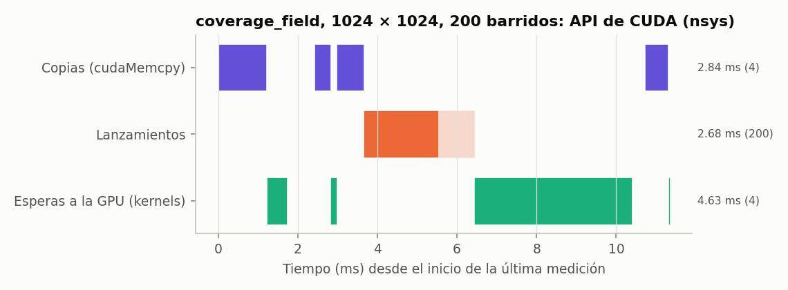

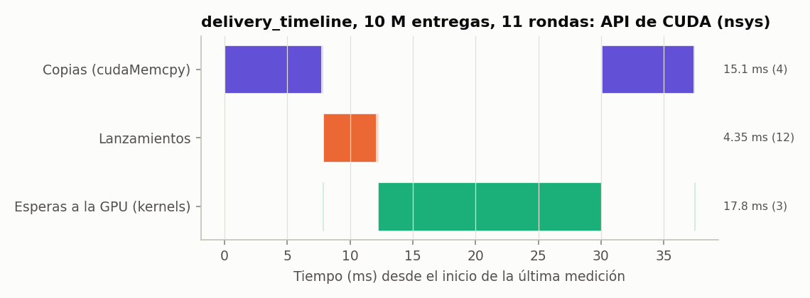
<!-- /auto:nsys -->

### 3.1 Tabla de tiempos entre todos los pares, Floyd-Warshall por tiles (`03_memory_tiling`, 1ª): `apsp_floyd`

**Tarea.** El despacho necesita el tiempo de viaje entre cualquier par de nodos para estimar ETA. Floyd-Warshall
actualiza, para cada nodo intermedio k, las n² celdas `t[i][j] = min(t[i][j], t[i][k] + t[k][j])`: con k fijo, las
n² actualizaciones son independientes (patrón de tiling de la carpeta 03, como la multiplicación de matrices).

**Diseño.** Tabla de enteros (ms) de n × n rellenada a N = ⌈n/32⌉·32. Tiles de 32 × 32 (bloques de 1024 hilos, un hilo
por celda). Por cada tile pivote, 3 lanzamientos: fase 1 (1 bloque, el tile pivote en shared), fase 2 (grid
`(N/32, 2)`: fila y columna del pivote) y fase 3 (grid `(N/32)²`: cada bloque carga en shared el tile de su fila y el
de su columna y actualiza su tile con 32 pasos). En 3741 nodos son 117 tiles y 351 lanzamientos. Tile de 32: cada
valor cargado en shared se reutiliza 32 veces (intensidad T/8 = 4 op/B frente a 1/8 sin tiles). La mejor CPU honesta
no es Floyd-Warshall sino **Dijkstra desde cada nodo** (`apsp_dijkstra`, grafo disperso: 6058 calles para 3741
nodos), así que la columna de speedup se calcula contra ella.

**Tabla (2.4).**

<!-- auto:tabla:apsp_floyd -->
| Size | CPU 1 thread (ms) | CPU N threads (ms) | GPU kernel (ms) | GPU end to end (ms) | Speedup vs best CPU (kernel / end to end) | Correct? |
|---|---|---|---|---|---|---|
| 25 | 0.0113 | 0.0127 (N=1) | 0.0317 | 0.258 | 0.356× / 0.0437× | sí (100/100) |
| 100 | 0.329 | 0.354 (N=1) | 0.125 | 0.371 | 1.54× / 0.521× | sí (100/100) |
| 400 | 11.8 | 11.9 (N=1) | 0.530 | 1.07 | 2.33× / 1.15× | sí (100/100) |
| 1,000 | 153 | 112 (N=4) | 3.64 | 6.11 | 2.20× / 1.31× | sí (100/100) |
| 2,000 | 1,170 | 587 (N=6) | 22.4 | 31.4 | 1.77× / 1.26× | sí (100/100) |
| 3,741 | 8,979 | 3,007 (N=16) | 134 | 196 | 1.30× / 0.888× | sí (100/100) |

N = el mejor numero de hilos del barrido en cada tamano (entre parentesis). Mejor CPU = min(CPU 1 thread, CPU N threads). La mejor CPU incluye apsp_dijkstra (misma tarea, solo CPU); en este barrido la mejor CPU fue: apsp_dijkstra:cpuN(12.0), apsp_dijkstra:cpuN(16.0), apsp_dijkstra:cpuN(6.0), cpu1.
<!-- /auto:tabla:apsp_floyd -->

<!-- auto:cruce:apsp_floyd -->
- Crossover extremo a extremo (GPU e2e < mejor CPU): ≈ 312 nodos (entre 100 y 400); vuelve a perder desde ≈ 3,031 nodos → **usar GPU solo en el rango ganador**.
- Crossover solo kernel (datos ya en la GPU): ≈ 66.5 nodos (entre 25 y 100).
<!-- /auto:cruce:apsp_floyd -->

Mejor CPU honesta (Dijkstra desde cada nodo, solo CPU):

<!-- auto:tabla:apsp_dijkstra -->
| Size | CPU 1 thread (ms) | CPU N threads (ms) | GPU kernel (ms) | GPU end to end (ms) | Speedup vs best CPU (kernel / end to end) | Correct? |
|---|---|---|---|---|---|---|
| 25 | 0.0164 | 0.0168 (N=1) | n/d | n/d | n/d / n/d | sí (80/80) |
| 100 | 0.346 | 0.193 (N=6) | n/d | n/d | n/d / n/d | sí (80/80) |
| 400 | 8.63 | 1.23 (N=12) | n/d | n/d | n/d / n/d | sí (80/80) |
| 1,000 | 61.0 | 8.02 (N=12) | n/d | n/d | n/d / n/d | sí (80/80) |
| 2,000 | 288 | 39.7 (N=16) | n/d | n/d | n/d / n/d | sí (80/80) |
| 3,741 | 1,061 | 174 (N=12) | n/d | n/d | n/d / n/d | sí (80/80) |

N = el mejor numero de hilos del barrido en cada tamano (entre parentesis). Mejor CPU = min(CPU 1 thread, CPU N threads).
<!-- /auto:tabla:apsp_dijkstra -->

<!-- auto:dispersion:apsp_floyd -->
| Size | Versión | Hilos | n | Mediana (ms) | Mín (ms) | Máx (ms) | IQR (ms) | (máx−mín)/mediana |
|---|---|---|---|---|---|---|---|---|
| 25 | cpu1 | 1 | 10 | 0.0113 | 0.0106 | 0.0123 | 0.000374 | 15% |
| 25 | cpuN | 1 | 10 | 0.0127 | 0.0116 | 0.0131 | 0.000449 | 12% |
| 25 | gpu_kernel | 1 | 10 | 0.0317 | 0.0164 | 0.0602 | 0.0196 | 138% (alta) |
| 25 | gpu_e2e | 1 | 10 | 0.258 | 0.185 | 0.578 | 0.117 | 152% (alta) |
| 100 | cpu1 | 1 | 10 | 0.329 | 0.309 | 0.355 | 0.0262 | 14% |
| 100 | cpuN | 1 | 10 | 0.354 | 0.317 | 0.383 | 0.0283 | 19% |
| 100 | gpu_kernel | 1 | 10 | 0.125 | 0.120 | 0.264 | 0.0133 | 115% (alta) |
| 100 | gpu_e2e | 1 | 10 | 0.371 | 0.290 | 0.582 | 0.0935 | 79% (alta) |
| 400 | cpu1 | 1 | 10 | 11.8 | 11.3 | 13.1 | 0.408 | 15% |
| 400 | cpuN | 1 | 10 | 11.9 | 11.2 | 12.6 | 0.284 | 11% |
| 400 | gpu_kernel | 1 | 10 | 0.530 | 0.511 | 0.621 | 0.0295 | 21% |
| 400 | gpu_e2e | 1 | 10 | 1.07 | 0.980 | 1.27 | 0.0850 | 27% |
| 1,000 | cpu1 | 1 | 10 | 153 | 143 | 189 | 13.4 | 30% |
| 1,000 | cpuN | 4 | 10 | 112 | 102 | 143 | 10.7 | 37% |
| 1,000 | gpu_kernel | 1 | 10 | 3.64 | 3.61 | 3.69 | 0.0486 | 2% |
| 1,000 | gpu_e2e | 1 | 10 | 6.11 | 5.75 | 7.58 | 0.543 | 30% |
| 2,000 | cpu1 | 1 | 10 | 1,170 | 1,107 | 1,391 | 67.7 | 24% |
| 2,000 | cpuN | 6 | 10 | 587 | 535 | 765 | 43.4 | 39% |
| 2,000 | gpu_kernel | 1 | 10 | 22.4 | 22.4 | 22.5 | 0.0234 | 0% |
| 2,000 | gpu_e2e | 1 | 10 | 31.4 | 30.6 | 34.7 | 0.580 | 13% |
| 3,741 | cpu1 | 1 | 10 | 8,979 | 8,319 | 9,204 | 179 | 10% |
| 3,741 | cpuN | 16 | 10 | 3,007 | 2,857 | 3,230 | 182 | 12% |
| 3,741 | gpu_kernel | 1 | 10 | 134 | 134 | 134 | 0.0423 | 0% |
| 3,741 | gpu_e2e | 1 | 10 | 196 | 191 | 234 | 7.93 | 22% |
<!-- /auto:dispersion:apsp_floyd -->

<!-- auto:hilos:apsp_floyd -->
Tamaño 3,741:

| Hilos | Mediana (ms) | Speedup vs CPU 1 thread | Rango (con mín/máx) | Eficiencia |
|---|---|---|---|---|
| 1 | 8,963 | 1.00× | 0.961–1.03 | 100% |
| 2 | 7,027 | 1.28× | 1.21–1.34 | 64% |
| 4 | 4,556 | 1.97× | 1.79–2.08 | 49% |
| 6 | 3,769 | 2.38× | 2.22–2.46 | 40% |
| 8 | 3,491 | 2.57× | 2.36–2.66 | 32% |
| 12 | 3,128 | 2.87× | 2.75–2.94 | 24% |
| 16 | 3,007 | 2.99× | 2.78–3.14 | 19% |
<!-- /auto:hilos:apsp_floyd -->

<!-- auto:figuras:apsp_floyd -->
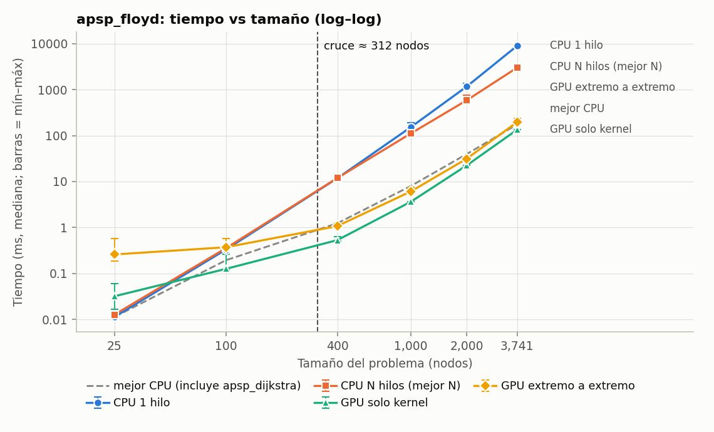

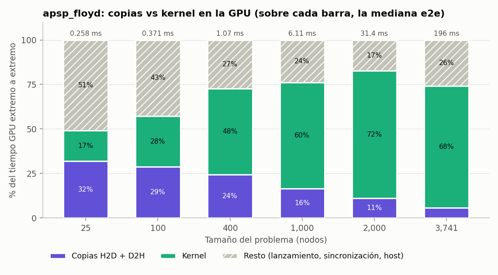

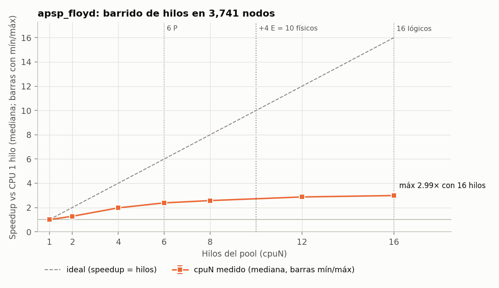
<!-- /auto:figuras:apsp_floyd -->

**Cómo se prueba que es correcta (columna del PDF).** Además de la columna `Correct?` del bench, la aplicación (y su variante) está entre las comprobadas por `tools/check_gpu_equivalence.sh` (3 tamaños, `gpu_kernel` y `gpu_e2e` iguales a cpu1). Tabla idéntica (enteros) a la de **Dijkstra desde cada nodo** con 1 hilo en cada corrida (el test `test_travel_time_table` demuestra Dijkstra == Floyd-Warshall de 1 hilo, incluidos nodos inalcanzables). memcheck y racecheck limpios en `apsp_floyd` y `apsp_dijkstra`.

**Profiler.**

<!-- auto:perfil:apsp_floyd -->
- **ncu** (`floydWarshallPhase3`, size 3,741, bloque (32, 32, 1), grid (117, 117, 1), 30 registros por hilo): ocupación lograda **65 %** de 67 % teórica, limitada por **Shared Mem, Warps** (bloques por SM: registros 2, shared 1, warps 1). Throughput: SM 83 %, memoria 83 % (DRAM 48 %, L2 10 %, L1/TEX 89 %; 91.8 GB/s; acierto en L2 68 %). Eficiencia de warp 100 % de hilos activos (99 % sin predicar), eficiencia de saltos — (0 saltos divergentes), 24.0 ciclos por instrucción emitida.
- **nsys** (API de CUDA del hilo de CPU, toda la corrida de `--bench-once --version gpu_e2e`): 2 `cudaMemcpy` = 80.3 ms; 351 lanzamientos = 72.6 ms; 4 esperas (`*Synchronize`) = 260 ms; reservas y liberaciones = 1.52 ms.
- Archivos versionados: `analysis/data/final/perfiles/apsp_floyd_ncu_details.csv`, `apsp_floyd_ncu.out`, `apsp_floyd_nsys.out` y `apsp_floyd_nsys_cuda_*_sum.csv`. Los binarios (`.ncu-rep`, `.nsys-rep`, `.sqlite`) no se suben: guardan el nombre y el entorno de la máquina; se regeneran con los comandos de arriba.
<!-- /auto:perfil:apsp_floyd -->

**Análisis (2.5).**
1. *Paralelismo.* n² celdas por pivote: 625 en 25 nodos (2 % de los 30 720 hilos residentes), 446 224 en el brief
   (668) y 14 M en la ciudad. La GPU se llena desde n ≈ 175.
2. *Overheads.* 3 lanzamientos por tile pivote (351 en la ciudad, ~2 ms a 6 µs). Extremo a extremo en 3741 nodos:
   196 ms = 134 ms de kernels + 5,6 ms de subida + 5,6 ms de bajada + 51 ms de relleno y recorte en el host. La tabla
   se calcula una vez por mapa: el costo de copia se paga una sola vez.
3. *Memoria o cómputo.* Intensidad 4 op/B (enteros). En 3741 nodos logra 784 GOP/s, el 26 % del techo INT32, con un
   tráfico modelado de 196 GB/s, algo por encima del techo de DRAM medido (172 GB/s): los tiles de fila y columna del
   pivote se releen desde la L2. ncu lo confirma: L1/TEX (shared) al 89 % y SM al 83 %, DRAM solo al 48 %; el cuello
   es la memoria compartida del tile, no la DRAM.
4. *Eficiencia.* Bloques de 1024 hilos: cabe 1 bloque por SM, ocupación teórica del 67 % limitada por warps y por
   la shared (8 KB por bloque con la configuración de 16 KB); ncu mide 65 % lograda y 100 % de eficiencia de warp. La fase 1 usa un solo bloque (19 SM ociosos durante ese lanzamiento). La fase 3, que domina, no diverge
   (`min` sin rama); las fases 1 y 2 tienen un `if` por paso, uniforme salvo en celdas que mejoran.
5. *Sincronización.* 32 `__syncthreads()` por bloque en las fases 1 y 2 (cada paso usa el anterior); el orden entre
   pivotes lo dan los límites de lanzamiento, sin atómicos.
6. *Correctitud.* Enteros: resultado exacto e idéntico a Dijkstra con 1 hilo en cada corrida; el relleno se inicializa
   como "inalcanzable" y no altera ningún camino.
7. *Veredicto.* Contra Dijkstra con 12-16 hilos la GPU gana extremo a extremo **solo en un rango** (desde ≈ 312
   nodos hasta ≈ 3000; ver el cruce automático): en el brief (668 nodos) gana; en la ciudad (3741) pierde, 196 ms
   contra 174 ms (0,89×), porque Floyd-Warshall hace n³ trabajo y Dijkstra en un grafo disperso ≈ n·E·log n. Con la
   tabla ya en la GPU el kernel solo gana desde ≈ 67 nodos (1,30× aun en 3741). Como se calcula una vez al arrancar,
   en la ciudad conviene **mantener la CPU** (Dijkstra en paralelo); la GPU solo vale en el rango ganador.

### 3.2 ETA en lote, SoA vs AoS (`04_performance`, 1ª): `eta_batch_soa` (variante `eta_batch_aos`)

**Tarea.** Para una ronda de despacho se necesita la ETA de cada par (pedido, courier): llegada al restaurante,
espera a que la comida esté lista y viaje al cliente, con la tabla de la aplicación 03. Los pares son independientes.

**Diseño.** Matriz de m pedidos × n couriers (m = 10 a 600). Grid `(⌈n/256⌉, m)`, bloques de 256 hilos: x recorre
couriers (lecturas y escrituras coalescidas), y recorre pedidos. Couriers en SoA (`courierNode[]`, `courierFreeAtMs[]`)
contra AoS (registros de 32 B de los que cada hilo usa 8). `gpu_e2e` sube la tabla de tiempos completa (56 MB en la
ciudad), los couriers y los pedidos, y baja la matriz.

<!-- auto:tabla:eta_batch_soa -->
| Size | CPU 1 thread (ms) | CPU N threads (ms) | GPU kernel (ms) | GPU end to end (ms) | Speedup vs best CPU (kernel / end to end) | Correct? |
|---|---|---|---|---|---|---|
| 50 | 0.00643 | 0.00571 (N=1) | 0.0145 | 5.77 | 0.393× / 0.000990× | sí (100/100) |
| 150 | 0.0395 | 0.0291 (N=1) | 0.0151 | 5.97 | 1.93× / 0.00487× | sí (100/100) |
| 500 | 0.448 | 0.162 (N=4) | 0.0665 | 6.42 | 2.44× / 0.0253× | sí (100/100) |
| 777 | 0.646 | 0.168 (N=4) | 0.0696 | 6.09 | 2.42× / 0.0277× | sí (100/100) |
| 2,000 | 6.55 | 0.923 (N=12) | 0.133 | 6.58 | 6.94× / 0.140× | sí (100/100) |
| 5,000 | 30.6 | 5.20 (N=16) | 0.803 | 8.34 | 6.47× / 0.623× | sí (100/100) |

N = el mejor numero de hilos del barrido en cada tamano (entre parentesis). Mejor CPU = min(CPU 1 thread, CPU N threads).
<!-- /auto:tabla:eta_batch_soa -->

<!-- auto:cruce:eta_batch_soa -->
- Crossover extremo a extremo (GPU e2e < mejor CPU): no hay cruce (la GPU no gana en el rango medido) → **mantener CPU**.
- Crossover solo kernel (datos ya en la GPU): ≈ 95.4 couriers (entre 50 y 150).
<!-- /auto:cruce:eta_batch_soa -->

<!-- auto:variante:eta_batch_soa -->
Variante `eta_batch_aos`: Variante de comparación: los mismos pares con couriers en arreglo de estructuras (AoS, registros de 32 B)

| Size | Kernel eta_batch_soa (ms) | Kernel eta_batch_aos (ms) | eta_batch_aos / eta_batch_soa (kernel) | E2E eta_batch_soa (ms) | E2E eta_batch_aos (ms) |
|---|---|---|---|---|---|
| 50 | 0.0145 | 0.0127 | 0.873× | 5.77 | 5.75 |
| 150 | 0.0151 | 0.0172 | 1.14× | 5.97 | 5.90 |
| 500 | 0.0665 | 0.0380 | 0.571× | 6.42 | 5.80 |
| 777 | 0.0696 | 0.0192 | 0.276× | 6.09 | 5.79 |
| 2,000 | 0.133 | 0.0838 | 0.630× | 6.58 | 6.16 |
| 5,000 | 0.803 | 0.807 | 1.00× | 8.34 | 9.24 |
<!-- /auto:variante:eta_batch_soa -->

<!-- auto:dispersion:eta_batch_soa -->
| Size | Versión | Hilos | n | Mediana (ms) | Mín (ms) | Máx (ms) | IQR (ms) | (máx−mín)/mediana |
|---|---|---|---|---|---|---|---|---|
| 50 | cpu1 | 1 | 10 | 0.00643 | 0.00564 | 0.0190 | 0.00109 | 208% (alta) |
| 50 | cpuN | 1 | 10 | 0.00571 | 0.00229 | 0.0131 | 0.00183 | 190% (alta) |
| 50 | gpu_kernel | 1 | 10 | 0.0145 | 0.0120 | 0.0827 | 0.0304 | 486% (alta) |
| 50 | gpu_e2e | 1 | 10 | 5.77 | 5.63 | 7.93 | 0.144 | 40% |
| 150 | cpu1 | 1 | 10 | 0.0395 | 0.0357 | 0.0494 | 0.00574 | 35% |
| 150 | cpuN | 1 | 10 | 0.0291 | 0.0211 | 0.0457 | 0.0126 | 85% (alta) |
| 150 | gpu_kernel | 1 | 10 | 0.0151 | 0.0114 | 0.0835 | 0.00858 | 477% (alta) |
| 150 | gpu_e2e | 1 | 10 | 5.97 | 5.53 | 6.38 | 0.351 | 14% |
| 500 | cpu1 | 1 | 10 | 0.448 | 0.364 | 0.843 | 0.144 | 107% (alta) |
| 500 | cpuN | 4 | 10 | 0.162 | 0.114 | 0.235 | 0.0479 | 75% (alta) |
| 500 | gpu_kernel | 1 | 10 | 0.0665 | 0.0172 | 0.101 | 0.0555 | 126% (alta) |
| 500 | gpu_e2e | 1 | 10 | 6.42 | 5.93 | 8.04 | 0.641 | 33% |
| 777 | cpu1 | 1 | 10 | 0.646 | 0.561 | 0.752 | 0.0928 | 30% |
| 777 | cpuN | 4 | 10 | 0.168 | 0.126 | 0.424 | 0.0469 | 177% (alta) |
| 777 | gpu_kernel | 1 | 10 | 0.0696 | 0.0227 | 0.115 | 0.0821 | 133% (alta) |
| 777 | gpu_e2e | 1 | 10 | 6.09 | 5.60 | 8.09 | 1.13 | 41% |
| 2,000 | cpu1 | 1 | 10 | 6.55 | 6.28 | 7.68 | 0.185 | 21% |
| 2,000 | cpuN | 12 | 10 | 0.923 | 0.814 | 1.09 | 0.100 | 30% |
| 2,000 | gpu_kernel | 1 | 10 | 0.133 | 0.115 | 0.139 | 0.00498 | 19% |
| 2,000 | gpu_e2e | 1 | 10 | 6.58 | 6.29 | 7.96 | 1.33 | 25% |
| 5,000 | cpu1 | 1 | 10 | 30.6 | 29.4 | 37.6 | 2.71 | 27% |
| 5,000 | cpuN | 16 | 10 | 5.20 | 4.50 | 7.63 | 0.798 | 60% (alta) |
| 5,000 | gpu_kernel | 1 | 10 | 0.803 | 0.783 | 0.813 | 0.00557 | 4% |
| 5,000 | gpu_e2e | 1 | 10 | 8.34 | 8.03 | 9.60 | 0.513 | 19% |
<!-- /auto:dispersion:eta_batch_soa -->

<!-- auto:hilos:eta_batch_soa -->
Tamaño 5,000:

| Hilos | Mediana (ms) | Speedup vs CPU 1 thread | Rango (con mín/máx) | Eficiencia |
|---|---|---|---|---|
| 1 | 30.4 | 1.01× | 0.904–1.09 | 101% |
| 2 | 15.1 | 2.02× | 1.91–2.12 | 101% |
| 4 | 8.35 | 3.67× | 3.48–3.96 | 92% |
| 6 | 6.79 | 4.51× | 3.16–5.39 | 75% |
| 8 | 7.21 | 4.25× | 3.54–5.56 | 53% |
| 12 | 5.63 | 5.43× | 4.86–5.98 | 45% |
| 16 | 5.20 | 5.89× | 4.01–6.80 | 37% |
<!-- /auto:hilos:eta_batch_soa -->

<!-- auto:figuras:eta_batch_soa -->
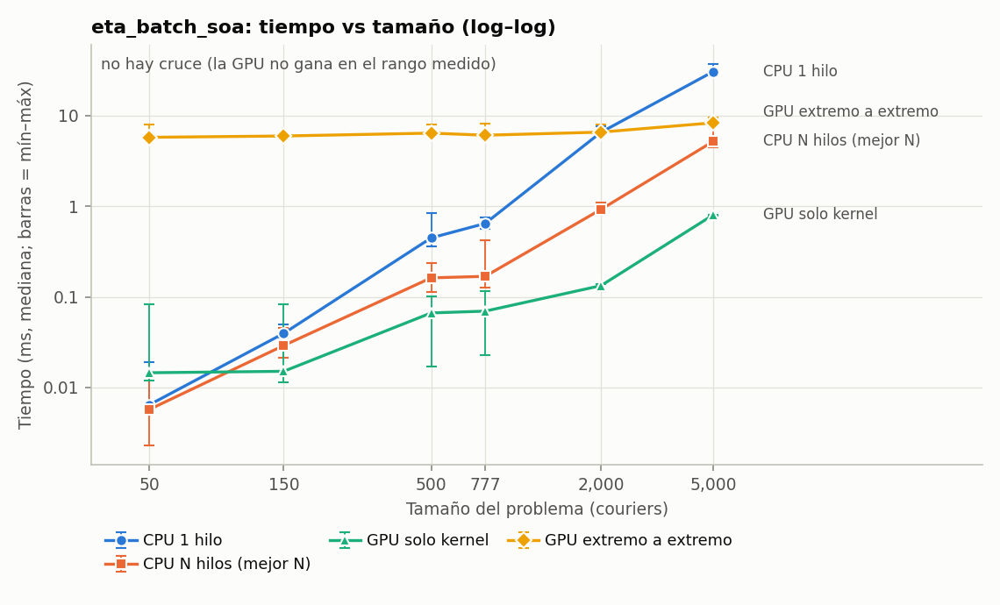

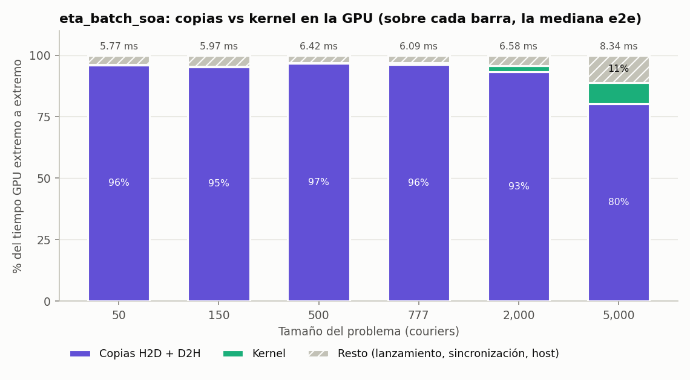

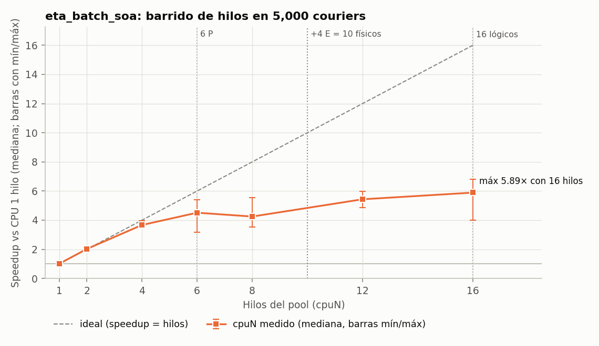
<!-- /auto:figuras:eta_batch_soa -->

**Cómo se prueba que es correcta (columna del PDF).** Además de la columna `Correct?` del bench, la aplicación (y su variante) está entre las comprobadas por `tools/check_gpu_equivalence.sh` (3 tamaños, `gpu_kernel` y `gpu_e2e` iguales a cpu1). La matriz de ETA es idéntica (enteros) a la de cpu1 en SoA y en AoS, y la evidencia de rendimiento que pide el PDF es la tabla de **bytes útiles y movidos y GB/s efectivos** de las dos disposiciones, por tamaño:

<!-- auto:eta_bytes -->
| Couriers | Pares (pedidos × couriers) | Bytes útiles (MB) | SoA: GB/s efectivos | AoS: bytes movidos, modelo (MB) | AoS: GB/s (modelo) | SoA kernel (ms) | AoS kernel (ms) |
|---|---|---|---|---|---|---|---|
| 50 | 10 × 50 | 0.0 | 0.41 | 0.0 | 1.42 | 0.014544 | 0.012704 |
| 150 | 30 × 150 | 0.1 | 3.58 | 0.2 | 9.41 | 0.015088 | 0.017216 |
| 500 | 100 × 500 | 0.6 | 9.02 | 1.8 | 47.41 | 0.066496 | 0.037968 |
| 777 | 97 × 777 | 0.9 | 13.00 | 2.7 | 141.08 | 0.069584 | 0.019232 |
| 2,000 | 300 × 2000 | 7.2 | 54.15 | 21.6 | 257.78 | 0.132976 | 0.083792 |
| 5,000 | 600 × 5000 | 36.0 | 44.83 | 108.0 | 133.84 | 0.802992 | 0.806960 |

Fuente: líneas `describe` de `analysis/data/final/eta_batch/bench.out` (mediana de gpu_kernel; útiles = 12 B por par, movidos AoS = 36 B por par).
<!-- /auto:eta_bytes -->

**Profiler.**

<!-- auto:perfil:eta_batch_soa -->
- **ncu** (`computeEtaSoA`, size 5,000, bloque (256, 1, 1), grid (20, 600, 1), 20 registros por hilo): ocupación lograda **85 %** de 100 % teórica, limitada por **Warps** (bloques por SM: registros 10, shared 16, warps 6). Throughput: SM 5 %, memoria 37 % (DRAM 37 %, L2 25 %, L1/TEX 21 %; 70.5 GB/s; acierto en L2 67 %). Eficiencia de warp 100 % de hilos activos (97 % sin predicar), eficiencia de saltos 100 %, 192 ciclos por instrucción emitida.
- **nsys** (API de CUDA del hilo de CPU, toda la corrida de `--bench-once --version gpu_e2e`): 13 `cudaMemcpy` = 23.1 ms; 1 lanzamientos = 82.6 ms; 6 esperas (`*Synchronize`) = 1.49 ms; reservas y liberaciones = 3.38 ms.
- Archivos versionados: `analysis/data/final/perfiles/eta_batch_soa_ncu_details.csv`, `eta_batch_soa_ncu.out`, `eta_batch_soa_nsys.out` y `eta_batch_soa_nsys_cuda_*_sum.csv`. Los binarios (`.ncu-rep`, `.nsys-rep`, `.sqlite`) no se suben: guardan el nombre y el entorno de la máquina; se regeneran con los comandos de arriba.
<!-- /auto:perfil:eta_batch_soa -->

<!-- auto:perfil:eta_batch_aos -->
- **ncu** (`computeEtaAoS`, size 5,000, bloque (256, 1, 1), grid (20, 600, 1), 20 registros por hilo): ocupación lograda **84 %** de 100 % teórica, limitada por **Warps** (bloques por SM: registros 10, shared 16, warps 6). Throughput: SM 5 %, memoria 37 % (DRAM 37 %, L2 30 %, L1/TEX 25 %; 70.5 GB/s; acierto en L2 84 %). Eficiencia de warp 100 % de hilos activos (98 % sin predicar), eficiencia de saltos — (0 saltos divergentes), 201 ciclos por instrucción emitida.
- **nsys** (API de CUDA del hilo de CPU, toda la corrida de `--bench-once --version gpu_e2e`): 11 `cudaMemcpy` = 23.1 ms; 1 lanzamientos = 3.98 ms; 6 esperas (`*Synchronize`) = 1.55 ms; reservas y liberaciones = 4.04 ms.
- Archivos versionados: `analysis/data/final/perfiles/eta_batch_aos_ncu_details.csv`, `eta_batch_aos_ncu.out`, `eta_batch_aos_nsys.out` y `eta_batch_aos_nsys_cuda_*_sum.csv`. Los binarios (`.ncu-rep`, `.nsys-rep`, `.sqlite`) no se suben: guardan el nombre y el entorno de la máquina; se regeneran con los comandos de arriba.
<!-- /auto:perfil:eta_batch_aos -->

**Análisis (2.5).**
1. *Paralelismo.* m·n pares: 500 en la escala chica, 600 000 en 5000 couriers; 3 en el brief (3 couriers).
2. *Overheads.* El `gpu_e2e` del bench tarda 5,8-8,3 ms en todos los tamaños porque **sube la tabla de 56 MB en cada
   llamada**: es el costo de la *primera* ronda (o de un uso aislado). *¿Pueden quedar los datos en la GPU entre rondas de
   despacho?* **Sí, y el programa ya lo hace**: `src/accel/EtaBatch.cpp:133-137` solo sube la tabla si cambió su puntero
   (`uploadedTable != tableCopy`), es decir una vez por ejecución; por ronda se suben solo couriers y pedidos. El bench
   no separa la tabla dentro de `h2d_ms`, pero la columna permite estimarla: con 50 couriers (couriers y pedidos
   despreciables) la subida tarda 5,50 ms, y con 5000 couriers 5,52 ms, así que la tabla son ≈ 5,5 ms. Restándolos, el
   costo por ronda con la tabla residente sería ≈ 1,1 ms en 2000 couriers (contra 0,92 ms de la mejor CPU: la CPU
   sigue ganando) y ≈ 2,8 ms en 5000 (contra 5,20 ms: la GPU ganaría ~1,8×). Es una **estimación por resta**, no una
   medición.
3. *Memoria o cómputo.* ≈ 8 operaciones enteras por par sobre 12 B (modelo del bench). ncu: SM al 5 % y DRAM al
   37 %: ni cómputo ni ancho de banda; lo limita la latencia de las lecturas dispersas de la tabla (el nodo de cada
   courier es distinto).
4. *Eficiencia (SoA vs AoS).* La diferencia esperada no aparece: AoS es igual o más rápido en varios tamaños (2000:
   0,084 ms contra 0,133 ms). Los couriers (≤ 160 KB en AoS) se releen en cada una de las m filas y quedan en L1/L2,
   así que el desperdicio de AoS no llega a DRAM; el tráfico que domina es la escritura de la matriz (coalescida en
   ambos) y las lecturas dispersas de la tabla. ncu lo confirma: SoA 0,757 ms y AoS 0,760 ms con el mismo uso de DRAM
   (37 %) y apenas más L2 en AoS (30 % contra 25 %). SoA importaría en un recorrido de una sola pasada sobre DRAM.
5. *Sincronización.* Ninguna dentro del kernel (cada hilo escribe su celda).
6. *Correctitud.* Enteros con saturación a "inalcanzable": matriz idéntica a cpu1.
7. *Veredicto.* **Mantener CPU** en la escala del proyecto: no hay cruce extremo a extremo en el bench (mejor 0,62× en
   5000) y, aun con la tabla residente como en el programa, en la flota de la ciudad (2000 couriers) la ronda costaría
   ≈ 1,1 ms contra 0,92 ms de la CPU; solo por encima de unos miles de couriers ganaría la GPU. El kernel solo gana desde
   ≈ 95 couriers (6,9× en 2000); en la escala del brief (3 couriers) la CPU es inmediata. En la simulación completa,
   además, cada ronda hace cola en el hilo dueño de la GPU (sección 5).

### 3.3 Mapa de calor de la demanda (`05_conv`, 1ª): `demand_heatmap` (variante `demand_heatmap_tiles`)

**Tarea.** Suavizar los pedidos por celda con un filtro gaussiano 7 × 7 para dibujar el mapa de calor: cada celda de
salida es una suma ponderada independiente de sus vecinas (convolución 2D, carpeta 05).

**Diseño.** Grilla de n × n celdas en float; bloques de 16 × 16 = 256 hilos (8 warps, ocupación teórica 100 %), un
hilo por celda; los 49 pesos en **memoria constante** (todos los hilos leen el mismo peso a la vez: difusión). La
variante carga un tile de 22 × 22 (16 + 2·3 de halo) en shared.

<!-- auto:tabla:demand_heatmap -->
| Size | CPU 1 thread (ms) | CPU N threads (ms) | GPU kernel (ms) | GPU end to end (ms) | Speedup vs best CPU (kernel / end to end) | Correct? |
|---|---|---|---|---|---|---|
| 16 | 0.00500 | 0.00530 (N=1) | 0.0133 | 0.235 | 0.376× / 0.0212× | sí (100/100) |
| 32 | 0.0196 | 0.0193 (N=1) | 0.0289 | 0.218 | 0.669× / 0.0885× | sí (100/100) |
| 64 | 0.0773 | 0.0784 (N=1) | 0.0247 | 0.208 | 3.13× / 0.372× | sí (100/100) |
| 100 | 0.203 | 0.149 (N=2) | 0.0252 | 0.237 | 5.91× / 0.629× | sí (100/100) |
| 128 | 0.365 | 0.228 (N=8) | 0.0266 | 0.297 | 8.59× / 0.770× | sí (100/100) |
| 256 | 1.64 | 0.487 (N=12) | 0.0659 | 0.390 | 7.38× / 1.25× | sí (100/100) |
| 512 | 6.30 | 1.27 (N=12) | 0.117 | 0.629 | 10.9× / 2.02× | sí (100/100) |
| 1,024 | 24.4 | 4.43 (N=12) | 0.244 | 1.49 | 18.1× / 2.97× | sí (100/100) |
| 2,048 | 97.1 | 17.4 (N=12) | 0.737 | 6.23 | 23.6× / 2.79× | sí (100/100) |

N = el mejor numero de hilos del barrido en cada tamano (entre parentesis). Mejor CPU = min(CPU 1 thread, CPU N threads).
<!-- /auto:tabla:demand_heatmap -->

<!-- auto:cruce:demand_heatmap -->
- Crossover extremo a extremo (GPU e2e < mejor CPU): ≈ 186 celdas por lado (entre 128 y 256) → **usar GPU sobre el umbral**.
- Crossover solo kernel (datos ya en la GPU): ≈ 38.3 celdas por lado (entre 32 y 64).
<!-- /auto:cruce:demand_heatmap -->

<!-- auto:variante:demand_heatmap -->
Variante `demand_heatmap_tiles`: Variante de comparación: el mismo filtro con tile de 16 × 16 + halo en memoria compartida

| Size | Kernel demand_heatmap (ms) | Kernel demand_heatmap_tiles (ms) | demand_heatmap_tiles / demand_heatmap (kernel) | E2E demand_heatmap (ms) | E2E demand_heatmap_tiles (ms) |
|---|---|---|---|---|---|
| 16 | 0.0133 | 0.0452 | 3.40× | 0.235 | 0.291 |
| 32 | 0.0289 | 0.0276 | 0.957× | 0.218 | 0.170 |
| 64 | 0.0247 | 0.0173 | 0.700× | 0.208 | 0.184 |
| 100 | 0.0252 | 0.0334 | 1.33× | 0.237 | 0.214 |
| 128 | 0.0266 | 0.0190 | 0.715× | 0.297 | 0.229 |
| 256 | 0.0659 | 0.0377 | 0.571× | 0.390 | 0.356 |
| 512 | 0.117 | 0.124 | 1.06× | 0.629 | 0.876 |
| 1,024 | 0.244 | 0.186 | 0.761× | 1.49 | 1.62 |
| 2,048 | 0.737 | 0.502 | 0.680× | 6.23 | 5.43 |
<!-- /auto:variante:demand_heatmap -->

<!-- auto:dispersion:demand_heatmap -->
| Size | Versión | Hilos | n | Mediana (ms) | Mín (ms) | Máx (ms) | IQR (ms) | (máx−mín)/mediana |
|---|---|---|---|---|---|---|---|---|
| 16 | cpu1 | 1 | 10 | 0.00500 | 0.00462 | 0.00552 | 0.000317 | 18% |
| 16 | cpuN | 1 | 10 | 0.00530 | 0.00496 | 0.00624 | 0.000420 | 24% |
| 16 | gpu_kernel | 1 | 10 | 0.0133 | 0.0115 | 0.0856 | 0.0242 | 556% (alta) |
| 16 | gpu_e2e | 1 | 10 | 0.235 | 0.164 | 0.340 | 0.0631 | 75% (alta) |
| 32 | cpu1 | 1 | 10 | 0.0196 | 0.0183 | 0.0403 | 0.00552 | 112% (alta) |
| 32 | cpuN | 1 | 10 | 0.0193 | 0.0186 | 0.0316 | 0.000631 | 68% (alta) |
| 32 | gpu_kernel | 1 | 10 | 0.0289 | 0.0129 | 0.0742 | 0.0416 | 213% (alta) |
| 32 | gpu_e2e | 1 | 10 | 0.218 | 0.160 | 0.319 | 0.0561 | 73% (alta) |
| 64 | cpu1 | 1 | 10 | 0.0773 | 0.0767 | 0.0932 | 0.00146 | 21% |
| 64 | cpuN | 1 | 10 | 0.0784 | 0.0749 | 0.0901 | 0.00518 | 19% |
| 64 | gpu_kernel | 1 | 10 | 0.0247 | 0.0125 | 0.0728 | 0.0312 | 244% (alta) |
| 64 | gpu_e2e | 1 | 10 | 0.208 | 0.149 | 0.252 | 0.0591 | 50% |
| 100 | cpu1 | 1 | 10 | 0.203 | 0.194 | 0.229 | 0.00591 | 18% |
| 100 | cpuN | 2 | 10 | 0.149 | 0.128 | 0.354 | 0.121 | 151% (alta) |
| 100 | gpu_kernel | 1 | 10 | 0.0252 | 0.0162 | 0.0639 | 0.0125 | 189% (alta) |
| 100 | gpu_e2e | 1 | 10 | 0.237 | 0.178 | 0.348 | 0.0783 | 72% (alta) |
| 128 | cpu1 | 1 | 10 | 0.365 | 0.340 | 0.388 | 0.0259 | 13% |
| 128 | cpuN | 8 | 10 | 0.228 | 0.192 | 0.289 | 0.0418 | 43% |
| 128 | gpu_kernel | 1 | 10 | 0.0266 | 0.0171 | 0.0991 | 0.0592 | 309% (alta) |
| 128 | gpu_e2e | 1 | 10 | 0.297 | 0.219 | 0.387 | 0.115 | 57% (alta) |
| 256 | cpu1 | 1 | 10 | 1.64 | 1.53 | 1.85 | 0.0638 | 20% |
| 256 | cpuN | 12 | 10 | 0.487 | 0.389 | 0.739 | 0.0805 | 72% (alta) |
| 256 | gpu_kernel | 1 | 10 | 0.0659 | 0.0296 | 0.103 | 0.0554 | 112% (alta) |
| 256 | gpu_e2e | 1 | 10 | 0.390 | 0.318 | 0.526 | 0.0550 | 53% (alta) |
| 512 | cpu1 | 1 | 10 | 6.30 | 6.12 | 6.60 | 0.141 | 8% |
| 512 | cpuN | 12 | 10 | 1.27 | 1.21 | 1.33 | 0.0584 | 9% |
| 512 | gpu_kernel | 1 | 10 | 0.117 | 0.102 | 0.185 | 0.0135 | 71% (alta) |
| 512 | gpu_e2e | 1 | 10 | 0.629 | 0.574 | 0.838 | 0.0855 | 42% |
| 1,024 | cpu1 | 1 | 10 | 24.4 | 23.6 | 28.5 | 1.11 | 20% |
| 1,024 | cpuN | 12 | 10 | 4.43 | 4.21 | 4.69 | 0.121 | 11% |
| 1,024 | gpu_kernel | 1 | 10 | 0.244 | 0.221 | 0.269 | 0.0122 | 20% |
| 1,024 | gpu_e2e | 1 | 10 | 1.49 | 1.45 | 1.79 | 0.0937 | 23% |
| 2,048 | cpu1 | 1 | 10 | 97.1 | 90.9 | 184 | 7.08 | 96% (alta) |
| 2,048 | cpuN | 12 | 10 | 17.4 | 16.7 | 24.2 | 2.89 | 43% |
| 2,048 | gpu_kernel | 1 | 10 | 0.737 | 0.708 | 0.759 | 0.0144 | 7% |
| 2,048 | gpu_e2e | 1 | 10 | 6.23 | 5.30 | 7.57 | 1.16 | 36% |
<!-- /auto:dispersion:demand_heatmap -->

<!-- auto:hilos:demand_heatmap -->
Tamaño 2,048:

| Hilos | Mediana (ms) | Speedup vs CPU 1 thread | Rango (con mín/máx) | Eficiencia |
|---|---|---|---|---|
| 1 | 91.2 | 1.06× | 0.952–1.10 | 106% |
| 2 | 49.1 | 1.98× | 1.07–2.09 | 99% |
| 4 | 26.9 | 3.61× | 2.34–3.89 | 90% |
| 6 | 24.5 | 3.96× | 2.72–4.64 | 66% |
| 8 | 22.6 | 4.29× | 3.75–5.02 | 54% |
| 12 | 17.4 | 5.58× | 4.02–5.83 | 47% |
| 16 | 17.9 | 5.43× | 4.34–6.00 | 34% |
<!-- /auto:hilos:demand_heatmap -->

<!-- auto:figuras:demand_heatmap -->
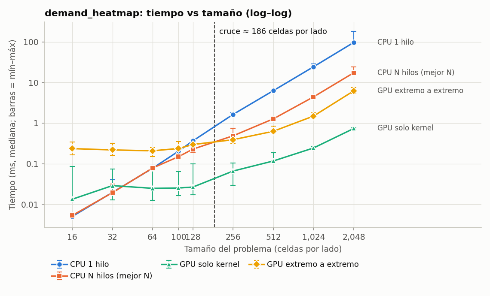

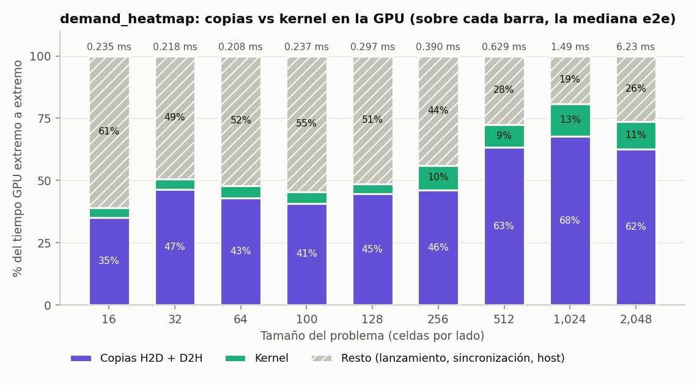

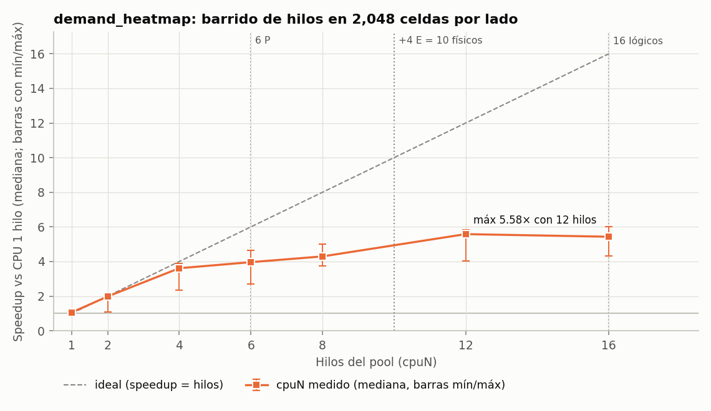
<!-- /auto:figuras:demand_heatmap -->

**Cómo se prueba que es correcta (columna del PDF).** Además de la columna `Correct?` del bench, la aplicación (y su variante) está entre las comprobadas por `tools/check_gpu_equivalence.sh` (3 tamaños, `gpu_kernel` y `gpu_e2e` iguales a cpu1). Mismo mapa que la CPU con la tolerancia declarada: |GPU − CPU| / (1 + |CPU|) ≤ 1e-5 por celda, porque la GPU fusiona a·b + c en una FMA (un redondeo en vez de dos) y cambia el último bit; los valores son conteos suavizados de magnitud ≤ ~10, así que 1e-5 relativo está muy por encima de ese error y muy por debajo de lo que se ve en el mapa. Todas las corridas dentro.

**Profiler.**

<!-- auto:perfil:demand_heatmap -->
- **ncu** (`smoothDemandKernel`, size 2,048, bloque (16, 16, 1), grid (128, 128, 1), 32 registros por hilo): ocupación lograda **82 %** de 100 % teórica, limitada por **Warps** (bloques por SM: registros 8, shared 16, warps 6). Throughput: SM 82 %, memoria 46 % (DRAM 23 %, L2 8 %, L1/TEX 47 %; 44.8 GB/s; acierto en L2 72 %). Eficiencia de warp 100 % de hilos activos (92 % sin predicar), eficiencia de saltos 100 %, 12.0 ciclos por instrucción emitida.
- **nsys** (API de CUDA del hilo de CPU, toda la corrida de `--bench-once --version gpu_e2e`): 4 `cudaMemcpy` = 9.30 ms; 1 lanzamientos = 1.19 ms; 4 esperas (`*Synchronize`) = 1.51 ms; reservas y liberaciones = 124 ms.
- Archivos versionados: `analysis/data/final/perfiles/demand_heatmap_ncu_details.csv`, `demand_heatmap_ncu.out`, `demand_heatmap_nsys.out` y `demand_heatmap_nsys_cuda_*_sum.csv`. Los binarios (`.ncu-rep`, `.nsys-rep`, `.sqlite`) no se suben: guardan el nombre y el entorno de la máquina; se regeneran con los comandos de arriba.
<!-- /auto:perfil:demand_heatmap -->

<!-- auto:perfil:demand_heatmap_tiles -->
- **ncu** (`smoothDemandTiledKernel`, size 2,048, bloque (16, 16, 1), grid (128, 128, 1), 40 registros por hilo): ocupación lograda **95 %** de 100 % teórica, limitada por **Registers, Warps** (bloques por SM: registros 6, shared 21, warps 6). Throughput: SM 91 %, memoria 74 % (DRAM 36 %, L2 11 %, L1/TEX 75 %; 69.7 GB/s; acierto en L2 73 %). Eficiencia de warp 99 % de hilos activos (91 % sin predicar), eficiencia de saltos 100 %, 12.5 ciclos por instrucción emitida.
- **nsys** (API de CUDA del hilo de CPU, toda la corrida de `--bench-once --version gpu_e2e`): 4 `cudaMemcpy` = 7.16 ms; 1 lanzamientos = 0.626 ms; 4 esperas (`*Synchronize`) = 0.917 ms; reservas y liberaciones = 150 ms.
- Archivos versionados: `analysis/data/final/perfiles/demand_heatmap_tiles_ncu_details.csv`, `demand_heatmap_tiles_ncu.out`, `demand_heatmap_tiles_nsys.out` y `demand_heatmap_tiles_nsys_cuda_*_sum.csv`. Los binarios (`.ncu-rep`, `.nsys-rep`, `.sqlite`) no se suben: guardan el nombre y el entorno de la máquina; se regeneran con los comandos de arriba.
<!-- /auto:perfil:demand_heatmap_tiles -->

**Análisis (2.5).**
1. *Paralelismo.* n² celdas: 256 en 16 × 16 (menos de un 1 % de la GPU), 4,2 M en 2048 × 2048.
2. *Overheads.* El kernel gana desde ≈ 38 celdas por lado, pero extremo a extremo hace falta ≈ 186: hasta ahí domina
   la ida y vuelta mínima (~0,2 ms). En 2048: 6,2 ms = 2,2 de subida + 0,7 de kernel + 1,7 de bajada + 1,6 de resto.
3. *Memoria o cómputo.* 98 FLOP por celda sobre 8 B: intensidad 12,25 FLOP/B. Logra 558 GFLOP/s en 2048 (4,6 % del
   pico FP32) con solo 46 GB/s de tráfico modelado. ncu: SM al 82 % y DRAM al 23 %: lo limita la emisión de
   instrucciones (49 lecturas con cálculo de índice y chequeo de bordes por celda), no la memoria.
4. *Eficiencia.* Con el tile en shared el kernel baja de 0,737 a 0,502 ms en 2048 (1,47×) y de 0,244 a 0,186 ms en
   1024: las lecturas repetidas pasan de L1 a shared y desaparece el chequeo de bordes del bucle (ncu: ocupación lograda
   95 % contra 82 %). La divergencia se limita a los bloques del borde.
5. *Sincronización.* Una barrera en la variante (tile completo antes de leer); ninguna en el kernel principal.
6. *Correctitud.* Float: la GPU fusiona a·b + c en una FMA, así que se compara con tolerancia relativa
   (|d| / (1 + |ref|) ≤ `kDemandTolerance`); todas las corridas dentro.
7. *Veredicto.* **Usar GPU sobre ≈ 186 celdas por lado**: 2,97× en 1024 × 1024 y 2,79× en 2048 × 2048 (3,20× con
   tiles). Para grillas de menos de ~186 × 186 la CPU es más rápida, y la grilla que usa hoy la ventana es de
   128 × 128: ahí la GPU pierde (0,30 ms contra 0,23 ms de la mejor CPU, 0,77×). En el programa conviene la CPU salvo que
   la grilla crezca por encima del umbral.

### 3.4 Campo de cobertura de la flota, Jacobi (`06_stencil`, 1ª): `coverage_field`

**Tarea.** Un campo que se difunde desde las celdas con couriers ociosos (fuentes fijas, borde en 0) para ver qué
zonas quedan cubiertas: 200 barridos de un stencil de 5 puntos; en cada barrido todas las celdas son independientes.

**Diseño.** Doble buffer en float; bloques de 16 × 16 (ocupación teórica 100 %); **un lanzamiento por barrido**
(el límite entre lanzamientos es la barrera global); la entrada se sube una vez por llamada.

<!-- auto:tabla:coverage_field -->
| Size | CPU 1 thread (ms) | CPU N threads (ms) | GPU kernel (ms) | GPU end to end (ms) | Speedup vs best CPU (kernel / end to end) | Correct? |
|---|---|---|---|---|---|---|
| 8 | 0.0118 | 0.0183 (N=1) | 2.16 | 3.12 | 0.00546× / 0.00378× | sí (100/100) |
| 16 | 0.0572 | 0.0570 (N=1) | 1.33 | 1.44 | 0.0428× / 0.0397× | sí (100/100) |
| 32 | 0.243 | 0.254 (N=1) | 1.29 | 1.44 | 0.189× / 0.169× | sí (100/100) |
| 64 | 0.973 | 0.987 (N=1) | 1.23 | 1.41 | 0.791× / 0.689× | sí (100/100) |
| 100 | 2.59 | 2.60 (N=1) | 1.32 | 1.53 | 1.96× / 1.69× | sí (100/100) |
| 128 | 4.44 | 4.41 (N=1) | 1.23 | 1.47 | 3.59× / 3.01× | sí (100/100) |
| 256 | 21.7 | 18.5 (N=4) | 1.58 | 1.75 | 11.7× / 10.6× | sí (100/100) |
| 512 | 88.7 | 35.2 (N=4) | 2.09 | 2.87 | 16.8× / 12.3× | sí (100/100) |
| 1,024 | 406 | 95.9 (N=12) | 4.70 | 6.32 | 20.4× / 15.2× | sí (100/100) |

N = el mejor numero de hilos del barrido en cada tamano (entre parentesis). Mejor CPU = min(CPU 1 thread, CPU N threads).
<!-- /auto:tabla:coverage_field -->

<!-- auto:cruce:coverage_field -->
- Crossover extremo a extremo (GPU e2e < mejor CPU): ≈ 77.0 celdas por lado (entre 64 y 100) → **usar GPU sobre el umbral**.
- Crossover solo kernel (datos ya en la GPU): ≈ 71.8 celdas por lado (entre 64 y 100).
<!-- /auto:cruce:coverage_field -->

<!-- auto:dispersion:coverage_field -->
| Size | Versión | Hilos | n | Mediana (ms) | Mín (ms) | Máx (ms) | IQR (ms) | (máx−mín)/mediana |
|---|---|---|---|---|---|---|---|---|
| 8 | cpu1 | 1 | 10 | 0.0118 | 0.0105 | 0.0248 | 0.00130 | 121% (alta) |
| 8 | cpuN | 1 | 10 | 0.0183 | 0.0167 | 0.0283 | 0.00109 | 63% (alta) |
| 8 | gpu_kernel | 1 | 10 | 2.16 | 1.22 | 3.02 | 1.55 | 84% (alta) |
| 8 | gpu_e2e | 1 | 10 | 3.12 | 1.26 | 3.44 | 0.387 | 70% (alta) |
| 16 | cpu1 | 1 | 10 | 0.0572 | 0.0481 | 0.0590 | 0.00389 | 19% |
| 16 | cpuN | 1 | 10 | 0.0570 | 0.0537 | 0.0814 | 0.00823 | 49% |
| 16 | gpu_kernel | 1 | 10 | 1.33 | 1.23 | 2.88 | 0.129 | 124% (alta) |
| 16 | gpu_e2e | 1 | 10 | 1.44 | 1.37 | 3.08 | 0.181 | 119% (alta) |
| 32 | cpu1 | 1 | 10 | 0.243 | 0.197 | 0.408 | 0.0498 | 87% (alta) |
| 32 | cpuN | 1 | 10 | 0.254 | 0.210 | 0.278 | 0.0305 | 27% |
| 32 | gpu_kernel | 1 | 10 | 1.29 | 1.25 | 2.85 | 0.263 | 124% (alta) |
| 32 | gpu_e2e | 1 | 10 | 1.44 | 1.35 | 3.93 | 0.805 | 178% (alta) |
| 64 | cpu1 | 1 | 10 | 0.973 | 0.816 | 1.11 | 0.0929 | 31% |
| 64 | cpuN | 1 | 10 | 0.987 | 0.828 | 1.10 | 0.0444 | 28% |
| 64 | gpu_kernel | 1 | 10 | 1.23 | 1.19 | 2.76 | 0.0636 | 127% (alta) |
| 64 | gpu_e2e | 1 | 10 | 1.41 | 1.30 | 1.74 | 0.102 | 31% |
| 100 | cpu1 | 1 | 10 | 2.59 | 2.30 | 3.09 | 0.403 | 30% |
| 100 | cpuN | 1 | 10 | 2.60 | 2.11 | 2.83 | 0.210 | 28% |
| 100 | gpu_kernel | 1 | 10 | 1.32 | 1.24 | 1.82 | 0.0712 | 44% |
| 100 | gpu_e2e | 1 | 10 | 1.53 | 1.37 | 3.83 | 0.109 | 161% (alta) |
| 128 | cpu1 | 1 | 10 | 4.44 | 4.12 | 4.72 | 0.109 | 14% |
| 128 | cpuN | 1 | 10 | 4.41 | 4.23 | 4.84 | 0.288 | 14% |
| 128 | gpu_kernel | 1 | 10 | 1.23 | 1.15 | 3.04 | 0.0632 | 154% (alta) |
| 128 | gpu_e2e | 1 | 10 | 1.47 | 1.31 | 2.71 | 0.318 | 95% (alta) |
| 256 | cpu1 | 1 | 10 | 21.7 | 19.8 | 35.6 | 4.74 | 73% (alta) |
| 256 | cpuN | 4 | 10 | 18.5 | 15.7 | 43.7 | 6.31 | 152% (alta) |
| 256 | gpu_kernel | 1 | 10 | 1.58 | 1.28 | 3.81 | 1.55 | 160% (alta) |
| 256 | gpu_e2e | 1 | 10 | 1.75 | 1.47 | 3.55 | 0.908 | 119% (alta) |
| 512 | cpu1 | 1 | 10 | 88.7 | 85.2 | 91.3 | 2.88 | 7% |
| 512 | cpuN | 4 | 10 | 35.2 | 33.6 | 54.0 | 1.64 | 58% (alta) |
| 512 | gpu_kernel | 1 | 10 | 2.09 | 1.88 | 3.74 | 1.47 | 89% (alta) |
| 512 | gpu_e2e | 1 | 10 | 2.87 | 2.35 | 4.35 | 1.47 | 70% (alta) |
| 1,024 | cpu1 | 1 | 10 | 406 | 392 | 560 | 17.4 | 41% |
| 1,024 | cpuN | 12 | 10 | 95.9 | 92.3 | 136 | 15.1 | 46% |
| 1,024 | gpu_kernel | 1 | 10 | 4.70 | 4.65 | 6.55 | 0.202 | 40% |
| 1,024 | gpu_e2e | 1 | 10 | 6.32 | 6.09 | 8.33 | 0.923 | 35% |
<!-- /auto:dispersion:coverage_field -->

<!-- auto:hilos:coverage_field -->
Tamaño 1,024:

| Hilos | Mediana (ms) | Speedup vs CPU 1 thread | Rango (con mín/máx) | Eficiencia |
|---|---|---|---|---|
| 1 | 372 | 1.09× | 0.759–1.12 | 109% |
| 2 | 206 | 1.97× | 1.63–2.14 | 98% |
| 4 | 127 | 3.18× | 2.03–3.51 | 80% |
| 6 | 126 | 3.21× | 1.76–3.51 | 53% |
| 8 | 116 | 3.50× | 1.90–3.60 | 44% |
| 12 | 95.9 | 4.23× | 2.98–4.39 | 35% |
| 16 | 105 | 3.86× | 2.59–4.12 | 24% |
<!-- /auto:hilos:coverage_field -->

<!-- auto:figuras:coverage_field -->
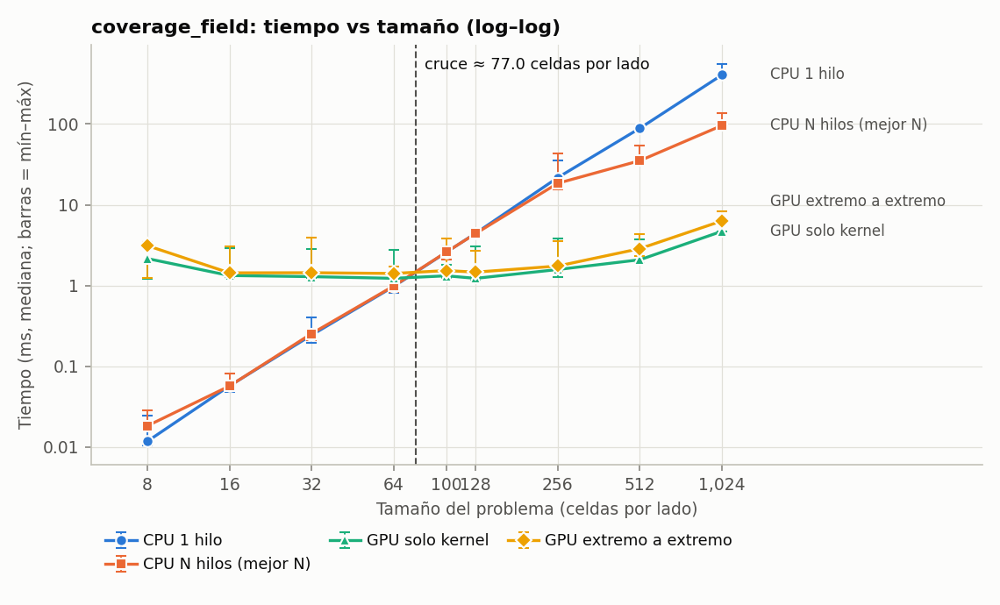

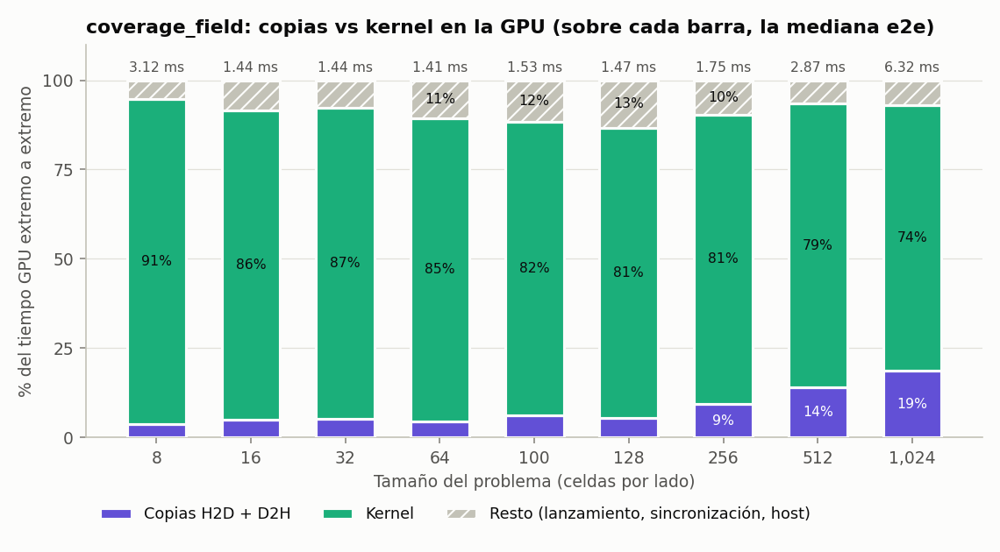

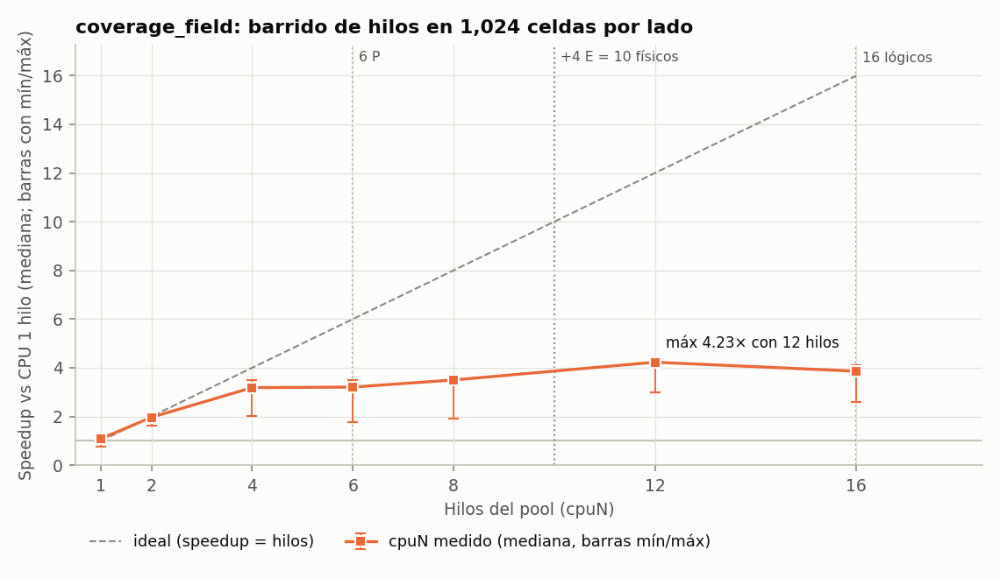
<!-- /auto:figuras:coverage_field -->

**Cómo se prueba que es correcta (columna del PDF).** Además de la columna `Correct?` del bench, la aplicación (y su variante) está entre las comprobadas por `tools/check_gpu_equivalence.sh` (3 tamaños, `gpu_kernel` y `gpu_e2e` iguales a cpu1). Después del mismo número de barridos (200) el campo es igual al de la CPU con tolerancia |d| / (1 + |ref|) ≤ 1e-5 (en la práctica idéntico: la suma de 4 vecinos por 0,25 no se fusiona en FMA de forma distinta); borde en 0 y fuentes fijas en los dos.

**Profiler.**

<!-- auto:perfil:coverage_field -->
- **ncu** (`coverageJacobiStep`, size 1,024, bloque (16, 16, 1), grid (64, 64, 1), 16 registros por hilo): ocupación lograda **84 %** de 100 % teórica, limitada por **Warps** (bloques por SM: registros 16, shared 16, warps 6). Throughput: SM 20 %, memoria 93 % (DRAM 93 %, L2 30 %, L1/TEX 33 %; 178 GB/s; acierto en L2 54 %). Eficiencia de warp 94 % de hilos activos (89 % sin predicar), eficiencia de saltos 55 %, 63.0 ciclos por instrucción emitida.
- **nsys** (API de CUDA del hilo de CPU, toda la corrida de `--bench-once --version gpu_e2e`): 4 `cudaMemcpy` = 2.84 ms; 200 lanzamientos = 2.68 ms; 4 esperas (`*Synchronize`) = 4.63 ms; reservas y liberaciones = 130 ms.
- Archivos versionados: `analysis/data/final/perfiles/coverage_field_ncu_details.csv`, `coverage_field_ncu.out`, `coverage_field_nsys.out` y `coverage_field_nsys_cuda_*_sum.csv`. Los binarios (`.ncu-rep`, `.nsys-rep`, `.sqlite`) no se suben: guardan el nombre y el entorno de la máquina; se regeneran con los comandos de arriba.
<!-- /auto:perfil:coverage_field -->

**Análisis (2.5).**
1. *Paralelismo.* n² celdas por barrido: 64 en 8 × 8, 1 M en 1024 × 1024.
2. *Overheads.* Los 200 lanzamientos ponen un piso de ~1,2 ms (6 µs cada uno, como en la calibración): de 8 a 128
   celdas por lado el kernel tarda 1,2-1,3 ms haga lo que haga. Por eso cruza recién en ≈ 77 celdas por lado.
3. *Memoria o cómputo.* 4 FLOP por celda y barrido sobre 12 B (1/3 FLOP/B). En 1024 logra 178 GFLOP/s con 535 GB/s de
   tráfico modelado, el triple del techo de DRAM: las tres grillas (12 MB) quedan en la L2 entre barridos. Con las
   cachés vacías (ncu) el barrido usa la DRAM al 93 %: es un kernel limitado por memoria.
4. *Eficiencia.* La divergencia viene de las ramas de borde y de fuente (≈ 1 de cada 16 celdas interiores, salteadas):
   ncu mide 55 % de eficiencia de saltos y 94 % de hilos activos por warp; ocupación lograda 84 %.
5. *Sincronización.* En la GPU, el fin de cada lanzamiento; en la CPU, 200 vueltas del pool por llamada: con 33-152 µs
   por despacho eso explica que la mejor CPU N llegue solo a 4,2× con 12 hilos en 1024.
6. *Correctitud.* Float sin FMA que cambie el orden: tolerancia `kCoverageTolerance`, en la práctica idéntico.
7. *Veredicto.* **Usar GPU sobre ≈ 77 celdas por lado**: 15,2× en 1024 × 1024 (6,3 ms contra 95,9 ms) y 10,6× en
   256 × 256. En la grilla de 128 × 128 que usa la ventana gana 3,0× (1,47 ms contra 4,41 ms). Es la aplicación donde
   más gana la GPU: muchos barridos sobre datos que no salen de la GPU.

### 3.5 Histograma de tiempos de entrega (`07_histogram`, 1ª): `delivery_histogram` (variante `histogram_naive`)

**Tarea.** Contar las entregas por minuto (61 barras, la última de desborde) para el resumen: cada entrega se
clasifica de forma independiente y se suma a su barra (histograma con atómicos, carpeta 07).

**Diseño.** Bloques de 256 con bucle de rejilla; cada bloque cuenta en **su propia copia de las 61 barras en shared**
(privatización) y al final suma su copia a la global con 61 atómicos. La variante hace un `atomicAdd` global por
entrega. Tiempos sintéticos log-normales (mediana 28 min).

<!-- auto:tabla:delivery_histogram -->
| Size | CPU 1 thread (ms) | CPU N threads (ms) | GPU kernel (ms) | GPU end to end (ms) | Speedup vs best CPU (kernel / end to end) | Correct? |
|---|---|---|---|---|---|---|
| 1,000 | 0.00155 | 0.00219 (N=1) | 0.00448 | 0.198 | 0.346× / 0.00782× | sí (100/100) |
| 10,000 | 0.0104 | 0.0108 (N=1) | 0.00461 | 0.258 | 2.26× / 0.0404× | sí (100/100) |
| 100,000 | 0.0965 | 0.0949 (N=1) | 0.00498 | 0.208 | 19.1× / 0.457× | sí (100/100) |
| 1,000,000 | 1.59 | 0.578 (N=16) | 0.00968 | 0.923 | 59.7× / 0.626× | sí (100/100) |
| 10,000,000 | 11.1 | 1.82 (N=12) | 0.221 | 4.35 | 8.25× / 0.419× | sí (100/100) |

N = el mejor numero de hilos del barrido en cada tamano (entre parentesis). Mejor CPU = min(CPU 1 thread, CPU N threads).
<!-- /auto:tabla:delivery_histogram -->

<!-- auto:cruce:delivery_histogram -->
- Crossover extremo a extremo (GPU e2e < mejor CPU): no hay cruce (la GPU no gana en el rango medido) → **mantener CPU**.
- Crossover solo kernel (datos ya en la GPU): ≈ 3,671 entregas (entre 1,000 y 10,000).
<!-- /auto:cruce:delivery_histogram -->

<!-- auto:variante:delivery_histogram -->
Variante `histogram_naive`: Variante de comparación: un atomicAdd GLOBAL por entrega sobre las mismas 61 barras

| Size | Kernel delivery_histogram (ms) | Kernel histogram_naive (ms) | histogram_naive / delivery_histogram (kernel) | E2E delivery_histogram (ms) | E2E histogram_naive (ms) |
|---|---|---|---|---|---|
| 1,000 | 0.00448 | 0.00501 | 1.12× | 0.198 | 0.178 |
| 10,000 | 0.00461 | 0.00717 | 1.56× | 0.258 | 0.184 |
| 100,000 | 0.00498 | 0.0304 | 6.12× | 0.208 | 0.247 |
| 1,000,000 | 0.00968 | 0.268 | 27.7× | 0.923 | 0.846 |
| 10,000,000 | 0.221 | 2.63 | 11.9× | 4.35 | 6.98 |
<!-- /auto:variante:delivery_histogram -->

<!-- auto:dispersion:delivery_histogram -->
| Size | Versión | Hilos | n | Mediana (ms) | Mín (ms) | Máx (ms) | IQR (ms) | (máx−mín)/mediana |
|---|---|---|---|---|---|---|---|---|
| 1,000 | cpu1 | 1 | 10 | 0.00155 | 0.00126 | 0.00200 | 0.000131 | 48% |
| 1,000 | cpuN | 1 | 10 | 0.00219 | 0.00172 | 0.00251 | 0.000272 | 36% |
| 1,000 | gpu_kernel | 1 | 10 | 0.00448 | 0.00307 | 0.100 | 0.00486 | 2168% (alta) |
| 1,000 | gpu_e2e | 1 | 10 | 0.198 | 0.142 | 0.336 | 0.108 | 98% (alta) |
| 10,000 | cpu1 | 1 | 10 | 0.0104 | 0.00972 | 0.0110 | 0.000840 | 12% |
| 10,000 | cpuN | 1 | 10 | 0.0108 | 0.00889 | 0.0118 | 0.000216 | 27% |
| 10,000 | gpu_kernel | 1 | 10 | 0.00461 | 0.00307 | 0.00819 | 0.00282 | 111% (alta) |
| 10,000 | gpu_e2e | 1 | 10 | 0.258 | 0.161 | 0.329 | 0.0918 | 65% (alta) |
| 100,000 | cpu1 | 1 | 10 | 0.0965 | 0.0913 | 0.152 | 0.0209 | 62% (alta) |
| 100,000 | cpuN | 1 | 10 | 0.0949 | 0.0917 | 0.179 | 0.0134 | 92% (alta) |
| 100,000 | gpu_kernel | 1 | 10 | 0.00498 | 0.00410 | 0.0526 | 0.000864 | 974% (alta) |
| 100,000 | gpu_e2e | 1 | 10 | 0.208 | 0.198 | 0.480 | 0.0670 | 136% (alta) |
| 1,000,000 | cpu1 | 1 | 10 | 1.59 | 1.48 | 2.14 | 0.0746 | 42% |
| 1,000,000 | cpuN | 16 | 10 | 0.578 | 0.404 | 0.872 | 0.135 | 81% (alta) |
| 1,000,000 | gpu_kernel | 1 | 10 | 0.00968 | 0.00906 | 0.100 | 0.0120 | 943% (alta) |
| 1,000,000 | gpu_e2e | 1 | 10 | 0.923 | 0.775 | 1.34 | 0.292 | 61% (alta) |
| 10,000,000 | cpu1 | 1 | 10 | 11.1 | 10.5 | 12.2 | 0.423 | 16% |
| 10,000,000 | cpuN | 12 | 10 | 1.82 | 1.76 | 1.93 | 0.0509 | 9% |
| 10,000,000 | gpu_kernel | 1 | 10 | 0.221 | 0.220 | 0.356 | 0.000832 | 61% (alta) |
| 10,000,000 | gpu_e2e | 1 | 10 | 4.35 | 4.27 | 5.45 | 0.249 | 27% |
<!-- /auto:dispersion:delivery_histogram -->

<!-- auto:hilos:delivery_histogram -->
Tamaño 10,000,000:

| Hilos | Mediana (ms) | Speedup vs CPU 1 thread | Rango (con mín/máx) | Eficiencia |
|---|---|---|---|---|
| 1 | 11.2 | 0.986× | 0.915–1.04 | 99% |
| 2 | 5.72 | 1.94× | 1.56–2.01 | 97% |
| 4 | 2.97 | 3.73× | 2.36–4.01 | 93% |
| 6 | 2.83 | 3.92× | 3.19–4.09 | 65% |
| 8 | 2.43 | 4.57× | 3.70–5.06 | 57% |
| 12 | 1.82 | 6.08× | 5.73–6.29 | 51% |
| 16 | 2.14 | 5.18× | 3.94–7.72 | 32% |
<!-- /auto:hilos:delivery_histogram -->

<!-- auto:figuras:delivery_histogram -->
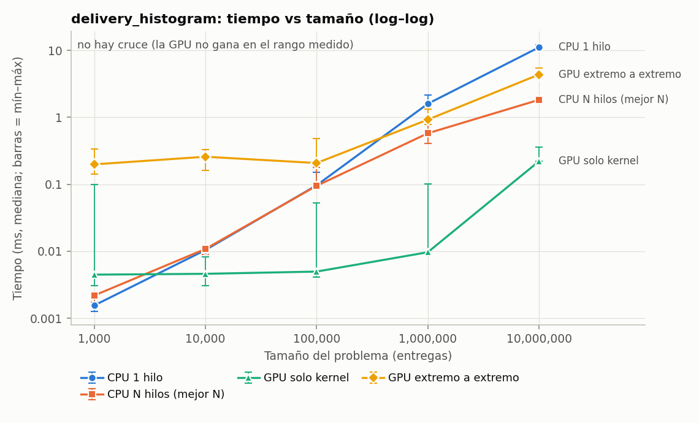

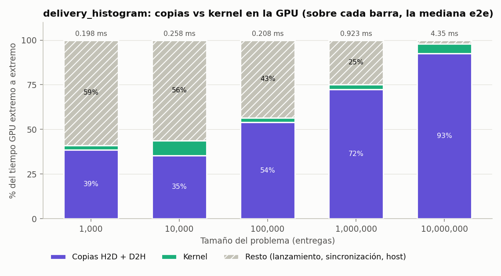

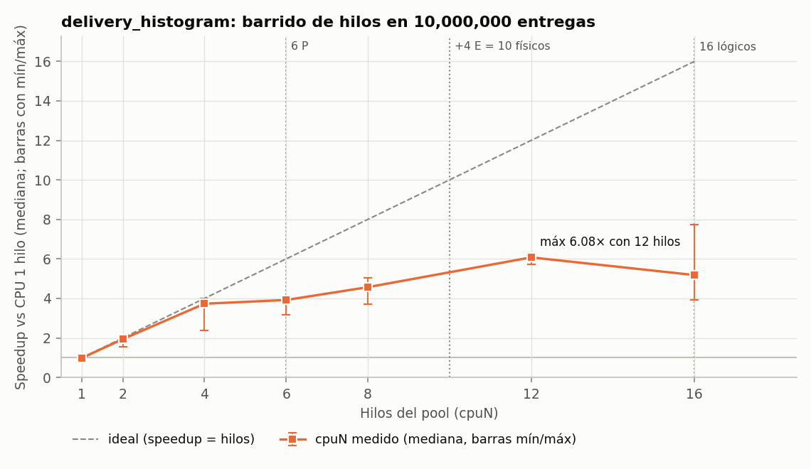
<!-- /auto:figuras:delivery_histogram -->

**Cómo se prueba que es correcta (columna del PDF).** Además de la columna `Correct?` del bench, la aplicación (y su variante) está entre las comprobadas por `tools/check_gpu_equivalence.sh` (3 tamaños, `gpu_kernel` y `gpu_e2e` iguales a cpu1). Barras **idénticas** a las de la CPU (enteros, exacto) y la suma de las barras igual a la cantidad de entregas: un atómico perdido se vería en la suma. Incluye una entrega cada 1024 exactamente en un borde de minuto para probar los bordes y el desborde.

**Profiler.**

<!-- auto:perfil:delivery_histogram -->
- **ncu** (`histogramPrivatizedKernel`, size 10,000,000, bloque (256, 1, 1), grid (120, 1, 1), 16 registros por hilo): ocupación lograda **99 %** de 100 % teórica, limitada por **Warps** (bloques por SM: registros 16, shared 12, warps 6). Throughput: SM 16 %, memoria 96 % (DRAM 96 %, L2 25 %, L1/TEX 14 %; 184 GB/s; acierto en L2 0 %). Eficiencia de warp 100 % de hilos activos (100 % sin predicar), eficiencia de saltos 100 %, 79.5 ciclos por instrucción emitida.
- **nsys** (API de CUDA del hilo de CPU, toda la corrida de `--bench-once --version gpu_e2e`): 3 `cudaMemcpy` = 9.10 ms; 1 lanzamientos = 4.91 ms; 4 esperas (`*Synchronize`) = 2.76 ms; reservas y liberaciones = 1.45 ms.
- Archivos versionados: `analysis/data/final/perfiles/delivery_histogram_ncu_details.csv`, `delivery_histogram_ncu.out`, `delivery_histogram_nsys.out` y `delivery_histogram_nsys_cuda_*_sum.csv`. Los binarios (`.ncu-rep`, `.nsys-rep`, `.sqlite`) no se suben: guardan el nombre y el entorno de la máquina; se regeneran con los comandos de arriba.
<!-- /auto:perfil:delivery_histogram -->

<!-- auto:perfil:histogram_naive -->
- **ncu** (`histogramGlobalAtomicsKernel`, size 10,000,000, bloque (256, 1, 1), grid (39063, 1, 1), 16 registros por hilo): ocupación lograda **81 %** de 100 % teórica, limitada por **Warps** (bloques por SM: registros 16, shared 16, warps 6). Throughput: SM 2 %, memoria 9 % (DRAM 9 %, L2 9 %, L1/TEX 10 %; 18.0 GB/s; acierto en L2 76 %). Eficiencia de warp 100 % de hilos activos (95 % sin predicar), eficiencia de saltos — (0 saltos divergentes), 671 ciclos por instrucción emitida.
- **nsys** (API de CUDA del hilo de CPU, toda la corrida de `--bench-once --version gpu_e2e`): 3 `cudaMemcpy` = 7.68 ms; 1 lanzamientos = 0.987 ms; 4 esperas (`*Synchronize`) = 3.32 ms; reservas y liberaciones = 1.26 ms.
- Archivos versionados: `analysis/data/final/perfiles/histogram_naive_ncu_details.csv`, `histogram_naive_ncu.out`, `histogram_naive_nsys.out` y `histogram_naive_nsys_cuda_*_sum.csv`. Los binarios (`.ncu-rep`, `.nsys-rep`, `.sqlite`) no se suben: guardan el nombre y el entorno de la máquina; se regeneran con los comandos de arriba.
<!-- /auto:perfil:histogram_naive -->

**Análisis (2.5).**
1. *Paralelismo.* Una entrega por hilo: de 1000 a 10 M.
2. *Overheads.* En 10 M: 4,35 ms extremo a extremo = **3,98 ms de subida** (40 MB) + 0,24 de kernel. La CPU lee esos
   40 MB de su propia memoria a ~22 GB/s (1,82 ms con 12 hilos): la copia sola ya cuesta el doble que la CPU entera.
3. *Memoria o cómputo.* 4 operaciones por 4 B (1 op/B). En 10 M el kernel mueve 181 GB/s, el techo de DRAM medido
   (ncu: DRAM al 96 %): limitado por memoria. En 1 M (4 MB) da 413 GB/s porque los datos están en la L2.
4. *Eficiencia.* Ocupación completa (256 hilos, bucle de rejilla); sin divergencia salvo el tope de desborde.
5. *Contención.* La privatización es la clave: con 61 contadores globales para 10 M entregas el kernel ingenuo tarda
   2,63 ms y el privatizado 0,24 ms (11×); ncu muestra al ingenuo con DRAM al 9 % y SM al 2 %: espera a los
   atómicos serializados en la L2, no a la memoria.
6. *Correctitud.* Conteos enteros, idénticos a cpu1 y con suma igual a la cantidad (los atómicos no pierden sumas).
7. *Veredicto.* **Mantener CPU** (mejor 0,63× extremo a extremo). Solo conviene si los tiempos ya estuvieran en la GPU:
   el kernel es 8× más rápido que la mejor CPU en 10 M.

### 3.6 Mejor courier por pedido, argmin (`08_reduction`, 1ª): `best_courier` (variante `best_courier_divergent`)

**Tarea.** Con la matriz de ETA (aplicación 04), elegir para cada pedido el courier de menor ETA (empates: el de
menor id): una reducción argmin por fila, independiente entre filas.

**Diseño.** Un bloque de 256 por pedido; cada hilo recorre su franja de columnas y se queda con la menor clave
(ETA, id) empaquetada en 64 bits; después un árbol en shared con **hilos activos contiguos** (convergente). La variante
empareja vecinos (`threadIdx % 2·stride`), que deja warps a medio usar.

<!-- auto:tabla:best_courier -->
| Size | CPU 1 thread (ms) | CPU N threads (ms) | GPU kernel (ms) | GPU end to end (ms) | Speedup vs best CPU (kernel / end to end) | Correct? |
|---|---|---|---|---|---|---|
| 50 | 0.000553 | 0.00109 (N=1) | 0.0253 | 0.222 | 0.0219× / 0.00250× | sí (100/100) |
| 150 | 0.00339 | 0.00398 (N=1) | 0.0300 | 0.227 | 0.113× / 0.0149× | sí (100/100) |
| 500 | 0.0338 | 0.0341 (N=1) | 0.0146 | 0.260 | 2.32× / 0.130× | sí (100/100) |
| 777 | 0.0506 | 0.0516 (N=1) | 0.0133 | 0.272 | 3.79× / 0.186× | sí (100/100) |
| 2,000 | 0.430 | 0.204 (N=4) | 0.0194 | 0.481 | 10.5× / 0.425× | sí (100/100) |
| 5,000 | 2.18 | 0.530 (N=16) | 0.0759 | 1.35 | 6.98× / 0.392× | sí (100/100) |

N = el mejor numero de hilos del barrido en cada tamano (entre parentesis). Mejor CPU = min(CPU 1 thread, CPU N threads).
<!-- /auto:tabla:best_courier -->

<!-- auto:cruce:best_courier -->
- Crossover extremo a extremo (GPU e2e < mejor CPU): no hay cruce (la GPU no gana en el rango medido) → **mantener CPU**.
- Crossover solo kernel (datos ya en la GPU): ≈ 358 couriers (entre 150 y 500).
<!-- /auto:cruce:best_courier -->

<!-- auto:variante:best_courier -->
Variante `best_courier_divergent`: Variante de comparación: árbol que empareja vecinos (threadIdx % 2·stride: warps divergentes)

| Size | Kernel best_courier (ms) | Kernel best_courier_divergent (ms) | best_courier_divergent / best_courier (kernel) | E2E best_courier (ms) | E2E best_courier_divergent (ms) |
|---|---|---|---|---|---|
| 50 | 0.0253 | 0.0590 | 2.33× | 0.222 | 0.346 |
| 150 | 0.0300 | 0.0388 | 1.29× | 0.227 | 0.357 |
| 500 | 0.0146 | 0.0198 | 1.36× | 0.260 | 0.263 |
| 777 | 0.0133 | 0.0317 | 2.37× | 0.272 | 0.288 |
| 2,000 | 0.0194 | 0.0331 | 1.70× | 0.481 | 0.466 |
| 5,000 | 0.0759 | 0.0450 | 0.593× | 1.35 | 1.42 |
<!-- /auto:variante:best_courier -->

<!-- auto:dispersion:best_courier -->
| Size | Versión | Hilos | n | Mediana (ms) | Mín (ms) | Máx (ms) | IQR (ms) | (máx−mín)/mediana |
|---|---|---|---|---|---|---|---|---|
| 50 | cpu1 | 1 | 10 | 0.000553 | 0.000517 | 0.000737 | 0.0000975 | 40% |
| 50 | cpuN | 1 | 10 | 0.00109 | 0.000850 | 0.00143 | 0.000267 | 53% (alta) |
| 50 | gpu_kernel | 1 | 10 | 0.0253 | 0.0111 | 0.0816 | 0.0401 | 279% (alta) |
| 50 | gpu_e2e | 1 | 10 | 0.222 | 0.190 | 0.388 | 0.103 | 89% (alta) |
| 150 | cpu1 | 1 | 10 | 0.00339 | 0.00324 | 0.00393 | 0.000318 | 21% |
| 150 | cpuN | 1 | 10 | 0.00398 | 0.00359 | 0.00492 | 0.000420 | 34% |
| 150 | gpu_kernel | 1 | 10 | 0.0300 | 0.0111 | 0.0855 | 0.0352 | 248% (alta) |
| 150 | gpu_e2e | 1 | 10 | 0.227 | 0.180 | 0.272 | 0.0304 | 40% |
| 500 | cpu1 | 1 | 10 | 0.0338 | 0.0322 | 0.0527 | 0.00189 | 61% (alta) |
| 500 | cpuN | 1 | 10 | 0.0341 | 0.0330 | 0.0423 | 0.00203 | 27% |
| 500 | gpu_kernel | 1 | 10 | 0.0146 | 0.0110 | 0.0855 | 0.0304 | 511% (alta) |
| 500 | gpu_e2e | 1 | 10 | 0.260 | 0.212 | 0.348 | 0.0405 | 53% (alta) |
| 777 | cpu1 | 1 | 10 | 0.0506 | 0.0494 | 0.0642 | 0.00168 | 29% |
| 777 | cpuN | 1 | 10 | 0.0516 | 0.0503 | 0.0583 | 0.00192 | 15% |
| 777 | gpu_kernel | 1 | 10 | 0.0133 | 0.0115 | 0.0820 | 0.0320 | 529% (alta) |
| 777 | gpu_e2e | 1 | 10 | 0.272 | 0.242 | 0.297 | 0.0245 | 20% |
| 2,000 | cpu1 | 1 | 10 | 0.430 | 0.401 | 0.477 | 0.0413 | 18% |
| 2,000 | cpuN | 4 | 10 | 0.204 | 0.172 | 0.352 | 0.0253 | 88% (alta) |
| 2,000 | gpu_kernel | 1 | 10 | 0.0194 | 0.0156 | 0.106 | 0.0389 | 465% (alta) |
| 2,000 | gpu_e2e | 1 | 10 | 0.481 | 0.423 | 0.712 | 0.0648 | 60% (alta) |
| 5,000 | cpu1 | 1 | 10 | 2.18 | 2.13 | 3.00 | 0.0538 | 40% |
| 5,000 | cpuN | 16 | 10 | 0.530 | 0.462 | 0.627 | 0.101 | 31% |
| 5,000 | gpu_kernel | 1 | 10 | 0.0759 | 0.0341 | 0.0853 | 0.0361 | 67% (alta) |
| 5,000 | gpu_e2e | 1 | 10 | 1.35 | 1.28 | 1.84 | 0.113 | 42% |
<!-- /auto:dispersion:best_courier -->

<!-- auto:hilos:best_courier -->
Tamaño 5,000:

| Hilos | Mediana (ms) | Speedup vs CPU 1 thread | Rango (con mín/máx) | Eficiencia |
|---|---|---|---|---|
| 1 | 2.17 | 1.00× | 0.784–1.02 | 100% |
| 2 | 1.18 | 1.84× | 1.48–1.90 | 92% |
| 4 | 0.718 | 3.04× | 1.29–3.57 | 76% |
| 6 | 0.801 | 2.72× | 1.90–3.55 | 45% |
| 8 | 0.660 | 3.30× | 2.14–3.56 | 41% |
| 12 | 0.543 | 4.02× | 2.87–4.73 | 34% |
| 16 | 0.530 | 4.12× | 3.48–4.72 | 26% |
<!-- /auto:hilos:best_courier -->

<!-- auto:figuras:best_courier -->
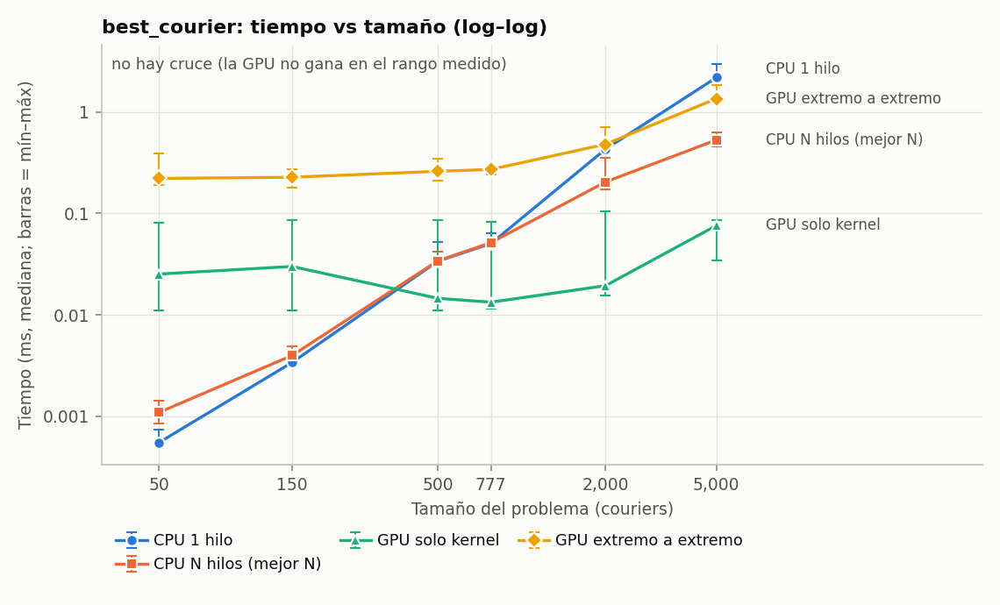

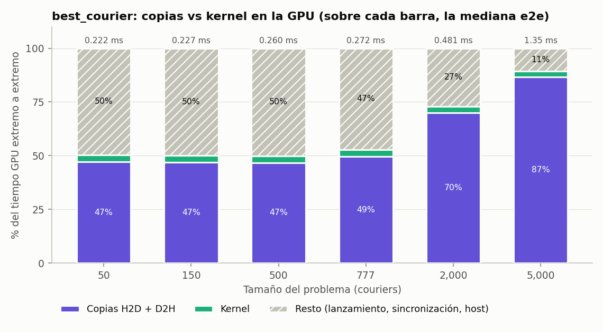

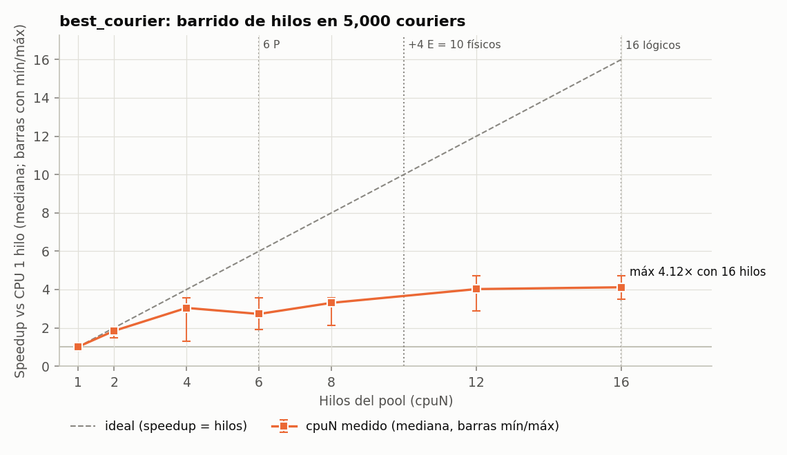
<!-- /auto:figuras:best_courier -->

**Cómo se prueba que es correcta (columna del PDF).** Además de la columna `Correct?` del bench, la aplicación (y su variante) está entre las comprobadas por `tools/check_gpu_equivalence.sh` (3 tamaños, `gpu_kernel` y `gpu_e2e` iguales a cpu1). El **mismo courier y la misma ETA** que la CPU en cada pedido, también con empates: la matriz de prueba tiene filas con todos los valores iguales, empates triples en el mínimo, ~5 % inalcanzables e ids desordenados, y la clave (ETA, id) desempata por el menor id como la CPU.

**Profiler.**

<!-- auto:perfil:best_courier -->
- **ncu** (`bestCourierConvergent`, size 5,000, bloque (256, 1, 1), grid (600, 1, 1), 24 registros por hilo): ocupación lograda **97 %** de 100 % teórica, limitada por **Warps** (bloques por SM: registros 10, shared 21, warps 6). Throughput: SM 21 %, memoria 89 % (DRAM 89 %, L2 23 %, L1/TEX 22 %; 170 GB/s; acierto en L2 17 %). Eficiencia de warp 98 % de hilos activos (82 % sin predicar), eficiencia de saltos 97 %, 86.9 ciclos por instrucción emitida.
- **nsys** (API de CUDA del hilo de CPU, toda la corrida de `--bench-once --version gpu_e2e`): 5 `cudaMemcpy` = 3.61 ms; 1 lanzamientos = 3.17 ms; 5 esperas (`*Synchronize`) = 0.996 ms; reservas y liberaciones = 5.59 ms.
- Archivos versionados: `analysis/data/final/perfiles/best_courier_ncu_details.csv`, `best_courier_ncu.out`, `best_courier_nsys.out` y `best_courier_nsys_cuda_*_sum.csv`. Los binarios (`.ncu-rep`, `.nsys-rep`, `.sqlite`) no se suben: guardan el nombre y el entorno de la máquina; se regeneran con los comandos de arriba.
<!-- /auto:perfil:best_courier -->

<!-- auto:perfil:best_courier_divergent -->
- **ncu** (`bestCourierDivergent`, size 5,000, bloque (256, 1, 1), grid (600, 1, 1), 24 registros por hilo): ocupación lograda **97 %** de 100 % teórica, limitada por **Warps** (bloques por SM: registros 10, shared 21, warps 6). Throughput: SM 21 %, memoria 88 % (DRAM 88 %, L2 23 %, L1/TEX 22 %; 169 GB/s; acierto en L2 17 %). Eficiencia de warp 98 % de hilos activos (82 % sin predicar), eficiencia de saltos 97 %, 86.5 ciclos por instrucción emitida.
- **nsys** (API de CUDA del hilo de CPU, toda la corrida de `--bench-once --version gpu_e2e`): 5 `cudaMemcpy` = 3.53 ms; 1 lanzamientos = 0.788 ms; 5 esperas (`*Synchronize`) = 0.530 ms; reservas y liberaciones = 1.31 ms.
- Archivos versionados: `analysis/data/final/perfiles/best_courier_divergent_ncu_details.csv`, `best_courier_divergent_ncu.out`, `best_courier_divergent_nsys.out` y `best_courier_divergent_nsys_cuda_*_sum.csv`. Los binarios (`.ncu-rep`, `.nsys-rep`, `.sqlite`) no se suben: guardan el nombre y el entorno de la máquina; se regeneran con los comandos de arriba.
<!-- /auto:perfil:best_courier_divergent -->

**Análisis (2.5).**
1. *Paralelismo.* m bloques (10 a 600) de 256 hilos: 600 bloques en 5000 couriers superan los 480 bloques residentes
   (20 SM × 24); con 10 pedidos se usa la mitad de los SM.
2. *Overheads.* En 5000: 1,35 ms extremo a extremo, de los que **1,14 ms son subir la matriz** (12 MB) y 0,04 ms el
   kernel. En el programa la matriz la produce la aplicación 04 en la misma tarea de GPU, así que esa subida no existe
   y vale la columna de solo kernel.
3. *Memoria o cómputo.* 4 operaciones por 8 B leídos; limitado por memoria (la matriz recién subida queda en L2).
4. *Eficiencia.* El árbol es de 8 pasos sobre 256 claves, frente a ~20 lecturas por hilo en 5000 couriers: la
   diferencia entre árbol convergente y divergente queda dentro del jitter (convergente 0,076 ms y divergente 0,045 ms
   en 5000; al revés en 50). ncu lo confirma: 0,0720 contra 0,0717 ms, la misma eficiencia de saltos (97 %) y DRAM
   al 89 % en los dos. La divergencia del árbol no es lo que pesa en este kernel: lo limita la lectura de la matriz.
5. *Sincronización.* 8 barreras por bloque; ningún atómico (un bloque por fila).
6. *Correctitud.* Clave (ETA, id) de 64 bits: el empate se resuelve igual que en la CPU (menor id), aun en filas con
   todos los valores iguales; idéntico a cpu1.
7. *Veredicto.* **Mantener CPU** extremo a extremo (mejor 0,43× en 2000). Solo kernel gana desde ≈ 358 couriers
   (10,5× en 2000): vale **dentro de la tarea de GPU que ya tiene la matriz** (despacho en lote), no como paso suelto.

### 3.7 Pedidos en curso a lo largo del tiempo, scan (`09_scan`, 1ª): `orders_in_progress`

**Tarea.** Con la secuencia de eventos (+1 pedido creado, −1 entregado o rechazado), la curva de pedidos abiertos es
la suma acumulada (scan inclusivo) y su pico, una reducción máximo.

**Diseño.** Scan jerárquico: Kogge-Stone dentro de bloques de 512 (doble buffer en shared), scan de los totales de
bloque y corrección; después el pico con una reducción en shared y un `atomicMax` por bloque.

<!-- auto:tabla:orders_in_progress -->
| Size | CPU 1 thread (ms) | CPU N threads (ms) | GPU kernel (ms) | GPU end to end (ms) | Speedup vs best CPU (kernel / end to end) | Correct? |
|---|---|---|---|---|---|---|
| 1,000 | 0.00148 | 0.00245 (N=1) | 0.0138 | 0.220 | 0.107× / 0.00674× | sí (100/100) |
| 10,000 | 0.0207 | 0.0206 (N=1) | 0.0153 | 0.274 | 1.35× / 0.0751× | sí (100/100) |
| 100,000 | 0.0810 | 0.0801 (N=1) | 0.0229 | 0.366 | 3.49× / 0.219× | sí (100/100) |
| 1,000,000 | 0.677 | 0.497 (N=2) | 0.0818 | 1.37 | 6.08× / 0.364× | sí (100/100) |
| 10,000,000 | 19.3 | 16.7 (N=12) | 1.21 | 22.0 | 13.8× / 0.761× | sí (100/100) |

N = el mejor numero de hilos del barrido en cada tamano (entre parentesis). Mejor CPU = min(CPU 1 thread, CPU N threads).
<!-- /auto:tabla:orders_in_progress -->

<!-- auto:cruce:orders_in_progress -->
- Crossover extremo a extremo (GPU e2e < mejor CPU): no hay cruce (la GPU no gana en el rango medido) → **mantener CPU**.
- Crossover solo kernel (datos ya en la GPU): ≈ 7,633 eventos (entre 1,000 y 10,000).
<!-- /auto:cruce:orders_in_progress -->

<!-- auto:dispersion:orders_in_progress -->
| Size | Versión | Hilos | n | Mediana (ms) | Mín (ms) | Máx (ms) | IQR (ms) | (máx−mín)/mediana |
|---|---|---|---|---|---|---|---|---|
| 1,000 | cpu1 | 1 | 10 | 0.00148 | 0.00126 | 0.00214 | 0.000281 | 60% (alta) |
| 1,000 | cpuN | 1 | 10 | 0.00245 | 0.00192 | 0.00337 | 0.000494 | 59% (alta) |
| 1,000 | gpu_kernel | 1 | 10 | 0.0138 | 0.0113 | 0.0696 | 0.0313 | 422% (alta) |
| 1,000 | gpu_e2e | 1 | 10 | 0.220 | 0.182 | 0.329 | 0.0307 | 67% (alta) |
| 10,000 | cpu1 | 1 | 10 | 0.0207 | 0.0196 | 0.0283 | 0.000863 | 42% |
| 10,000 | cpuN | 1 | 10 | 0.0206 | 0.0168 | 0.0362 | 0.00416 | 94% (alta) |
| 10,000 | gpu_kernel | 1 | 10 | 0.0153 | 0.0113 | 0.0809 | 0.00582 | 456% (alta) |
| 10,000 | gpu_e2e | 1 | 10 | 0.274 | 0.218 | 0.411 | 0.0382 | 70% (alta) |
| 100,000 | cpu1 | 1 | 10 | 0.0810 | 0.0760 | 0.208 | 0.00971 | 163% (alta) |
| 100,000 | cpuN | 1 | 10 | 0.0801 | 0.0764 | 0.112 | 0.0113 | 44% |
| 100,000 | gpu_kernel | 1 | 10 | 0.0229 | 0.0174 | 0.0643 | 0.0202 | 205% (alta) |
| 100,000 | gpu_e2e | 1 | 10 | 0.366 | 0.307 | 0.411 | 0.0433 | 28% |
| 1,000,000 | cpu1 | 1 | 10 | 0.677 | 0.527 | 0.786 | 0.0655 | 38% |
| 1,000,000 | cpuN | 2 | 10 | 0.497 | 0.440 | 0.574 | 0.0692 | 27% |
| 1,000,000 | gpu_kernel | 1 | 10 | 0.0818 | 0.0778 | 0.200 | 0.0560 | 149% (alta) |
| 1,000,000 | gpu_e2e | 1 | 10 | 1.37 | 1.29 | 1.62 | 0.166 | 24% |
| 10,000,000 | cpu1 | 1 | 10 | 19.3 | 17.5 | 32.7 | 3.53 | 79% (alta) |
| 10,000,000 | cpuN | 12 | 10 | 16.7 | 16.2 | 35.8 | 1.01 | 117% (alta) |
| 10,000,000 | gpu_kernel | 1 | 10 | 1.21 | 1.21 | 1.21 | 0.00266 | 0% |
| 10,000,000 | gpu_e2e | 1 | 10 | 22.0 | 20.4 | 35.4 | 2.51 | 68% (alta) |
<!-- /auto:dispersion:orders_in_progress -->

<!-- auto:hilos:orders_in_progress -->
Tamaño 10,000,000:

| Hilos | Mediana (ms) | Speedup vs CPU 1 thread | Rango (con mín/máx) | Eficiencia |
|---|---|---|---|---|
| 1 | 22.3 | 0.866× | 0.567–0.951 | 87% |
| 2 | 18.3 | 1.05× | 0.641–1.11 | 53% |
| 4 | 17.1 | 1.13× | 0.896–1.20 | 28% |
| 6 | 16.9 | 1.14× | 0.704–1.18 | 19% |
| 8 | 17.3 | 1.12× | 0.620–1.16 | 14% |
| 12 | 16.7 | 1.15× | 0.540–1.19 | 10% |
| 16 | 16.9 | 1.14× | 0.558–1.21 | 7% |
<!-- /auto:hilos:orders_in_progress -->

<!-- auto:figuras:orders_in_progress -->
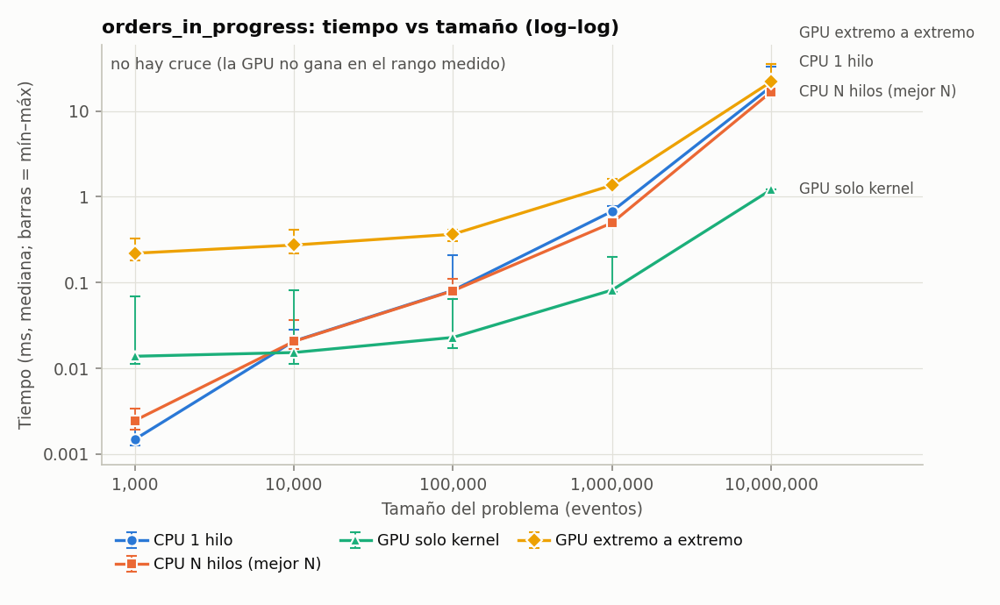

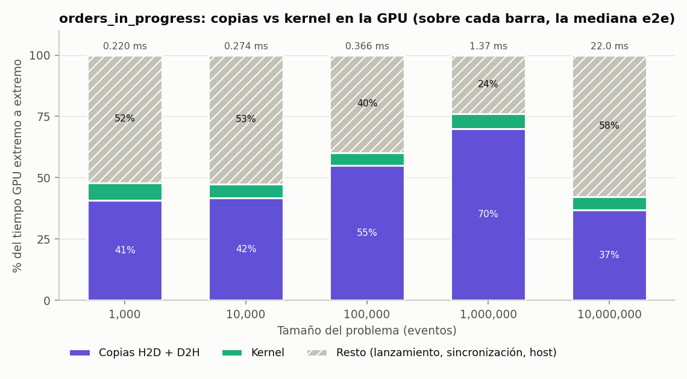

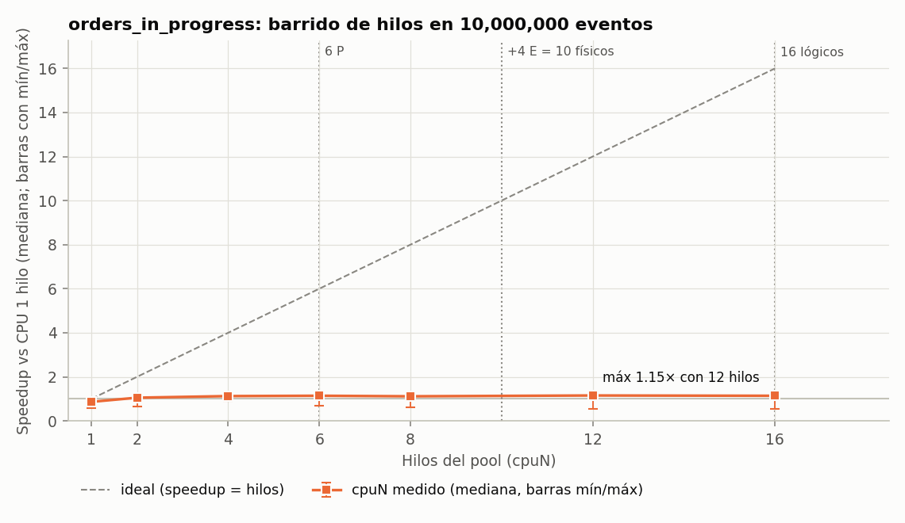
<!-- /auto:figuras:orders_in_progress -->

**Cómo se prueba que es correcta (columna del PDF).** Además de la columna `Correct?` del bench, la aplicación (y su variante) está entre las comprobadas por `tools/check_gpu_equivalence.sh` (3 tamaños, `gpu_kernel` y `gpu_e2e` iguales a cpu1). La idea de ejemplo del PDF para el scan es otra (agrupar pedidos por restaurante); el enunciado permite otra aplicación ("the idea in the table is only an example"). La prueba de la nuestra es que la **curva de pedidos abiertos y su pico** (valor y evento) son idénticos a los de la CPU (enteros, exacto), con eventos que suben y bajan por olas y nunca dejan la cuenta en negativo.

**Profiler.**

<!-- auto:perfil:orders_in_progress -->
- **ncu** (`scanBlockKoggeStone`, size 10,000,000, bloque (512, 1, 1), grid (19532, 1, 1), 16 registros por hilo): ocupación lograda **92 %** de 100 % teórica, limitada por **Warps** (bloques por SM: registros 8, shared 6, warps 3). Throughput: SM 86 %, memoria 86 % (DRAM 73 %, L2 12 %, L1/TEX 86 %; 140 GB/s; acierto en L2 50 %). Eficiencia de warp 100 % de hilos activos (96 % sin predicar), eficiencia de saltos 100 %, 21.8 ciclos por instrucción emitida.
- **nsys** (API de CUDA del hilo de CPU, toda la corrida de `--bench-once --version gpu_e2e`): 4 `cudaMemcpy` = 14.1 ms; 6 lanzamientos = 1.32 ms; 4 esperas (`*Synchronize`) = 1.84 ms; reservas y liberaciones = 117 ms.
- Archivos versionados: `analysis/data/final/perfiles/orders_in_progress_ncu_details.csv`, `orders_in_progress_ncu.out`, `orders_in_progress_nsys.out` y `orders_in_progress_nsys_cuda_*_sum.csv`. Los binarios (`.ncu-rep`, `.nsys-rep`, `.sqlite`) no se suben: guardan el nombre y el entorno de la máquina; se regeneran con los comandos de arriba.
<!-- /auto:perfil:orders_in_progress -->

**Análisis (2.5).**
1. *Paralelismo.* Un evento por hilo: hasta 10 M (19 532 bloques de 512).
2. *Overheads.* En 10 M: 22,0 ms extremo a extremo = 4,07 de subida + 1,22 de kernel + **4,01 de bajada (la curva
   completa)** + 12,7 de resto en el host. Si solo hiciera falta el pico, la bajada desaparecería.
3. *Memoria o cómputo.* Kogge-Stone hace ≈ 9 sumas por elemento (trabajo O(n log n) por bloque) sobre 20 B: 99 GOP/s
   con 165 GB/s de tráfico, cerca del techo de DRAM. ncu del kernel de bloque: SM y L1/shared al 86 % y DRAM al 73 %:
   aquí el trabajo extra de Kogge-Stone sí se nota; un scan de Blelloch (O(n)) aliviaría el SM.
4. *Eficiencia.* Bloques de 512 (3 por SM); la mitad de los hilos queda inactiva en los últimos pasos de Kogge-Stone.
5. *Sincronización.* 9 barreras por bloque en el scan; un atómico por bloque en el pico.
6. *Correctitud.* Enteros: curva, pico y evento del pico idénticos (empate de picos: el primero, por la clave).
7. *Veredicto.* **Mantener CPU** (mejor 0,76× en 10 M). La CPU es la mejor rival posible para un scan: una pasada
   secuencial a velocidad de memoria (CPU N apenas mejora, 1,15×). El kernel solo gana desde ≈ 7600 eventos.

### 3.8 Filtro de candidatos (`10_filter`, 1ª): `candidate_filter` (variante `candidate_filter_naive`)

**Tarea.** Antes de cotizar, quedarse solo con los couriers disponibles a menos de un radio del restaurante: un
predicado independiente por courier y una compactación de los que pasan (carpeta 10).

**Diseño.** Bloques de 256: cada bloque arma su lista en shared (atómico en shared), reserva su tramo de salida con
**un atómico global por bloque** y escribe en posiciones consecutivas. La variante usa un atómico global por
candidato. `gpu_e2e` sube la tabla de tiempos de 56 MB y la flota.

<!-- auto:tabla:candidate_filter -->
| Size | CPU 1 thread (ms) | CPU N threads (ms) | GPU kernel (ms) | GPU end to end (ms) | Speedup vs best CPU (kernel / end to end) | Correct? |
|---|---|---|---|---|---|---|
| 100 | 0.00396 | 0.00505 (N=1) | 0.0261 | 6.15 | 0.152× / 0.000644× | sí (100/100) |
| 500 | 0.0120 | 0.00864 (N=1) | 0.115 | 6.26 | 0.0751× / 0.00138× | sí (100/100) |
| 2,000 | 0.0371 | 0.0354 (N=1) | 0.102 | 6.52 | 0.347× / 0.00543× | sí (100/100) |
| 10,000 | 0.155 | 0.131 (N=1) | 0.0584 | 6.22 | 2.24× / 0.0211× | sí (100/100) |
| 50,000 | 0.537 | 0.360 (N=4) | 0.0531 | 6.37 | 6.78× / 0.0565× | sí (100/100) |
| 200,000 | 2.11 | 0.978 (N=16) | 0.0768 | 6.41 | 12.7× / 0.153× | sí (100/100) |

N = el mejor numero de hilos del barrido en cada tamano (entre parentesis). Mejor CPU = min(CPU 1 thread, CPU N threads).
<!-- /auto:tabla:candidate_filter -->

<!-- auto:cruce:candidate_filter -->
- Crossover extremo a extremo (GPU e2e < mejor CPU): no hay cruce (la GPU no gana en el rango medido) → **mantener CPU**.
- Crossover solo kernel (datos ya en la GPU): ≈ 4,980 couriers (entre 2,000 y 10,000).
<!-- /auto:cruce:candidate_filter -->

<!-- auto:variante:candidate_filter -->
Variante `candidate_filter_naive`: Variante de comparación: un atomicAdd GLOBAL por candidato sobre un único contador

| Size | Kernel candidate_filter (ms) | Kernel candidate_filter_naive (ms) | candidate_filter_naive / candidate_filter (kernel) | E2E candidate_filter (ms) | E2E candidate_filter_naive (ms) |
|---|---|---|---|---|---|
| 100 | 0.0261 | 0.0633 | 2.42× | 6.15 | 7.23 |
| 500 | 0.115 | 0.0305 | 0.266× | 6.26 | 6.28 |
| 2,000 | 0.102 | 0.0184 | 0.181× | 6.52 | 5.62 |
| 10,000 | 0.0584 | 0.0310 | 0.531× | 6.22 | 5.97 |
| 50,000 | 0.0531 | 0.0439 | 0.827× | 6.37 | 5.85 |
| 200,000 | 0.0768 | 0.0386 | 0.503× | 6.41 | 6.25 |
<!-- /auto:variante:candidate_filter -->

<!-- auto:dispersion:candidate_filter -->
| Size | Versión | Hilos | n | Mediana (ms) | Mín (ms) | Máx (ms) | IQR (ms) | (máx−mín)/mediana |
|---|---|---|---|---|---|---|---|---|
| 100 | cpu1 | 1 | 10 | 0.00396 | 0.00342 | 0.00808 | 0.00126 | 117% (alta) |
| 100 | cpuN | 1 | 10 | 0.00505 | 0.00391 | 0.00905 | 0.00206 | 102% (alta) |
| 100 | gpu_kernel | 1 | 10 | 0.0261 | 0.0182 | 0.281 | 0.0403 | 1005% (alta) |
| 100 | gpu_e2e | 1 | 10 | 6.15 | 5.63 | 7.50 | 0.787 | 31% |
| 500 | cpu1 | 1 | 10 | 0.0120 | 0.0105 | 0.0412 | 0.00349 | 255% (alta) |
| 500 | cpuN | 1 | 10 | 0.00864 | 0.00636 | 0.0378 | 0.00426 | 364% (alta) |
| 500 | gpu_kernel | 1 | 10 | 0.115 | 0.0180 | 0.146 | 0.0300 | 111% (alta) |
| 500 | gpu_e2e | 1 | 10 | 6.26 | 5.59 | 8.13 | 0.957 | 41% |
| 2,000 | cpu1 | 1 | 10 | 0.0371 | 0.0341 | 0.0548 | 0.00719 | 56% (alta) |
| 2,000 | cpuN | 1 | 10 | 0.0354 | 0.0225 | 0.0436 | 0.0180 | 60% (alta) |
| 2,000 | gpu_kernel | 1 | 10 | 0.102 | 0.0425 | 0.118 | 0.0265 | 74% (alta) |
| 2,000 | gpu_e2e | 1 | 10 | 6.52 | 5.61 | 7.75 | 1.30 | 33% |
| 10,000 | cpu1 | 1 | 10 | 0.155 | 0.119 | 0.173 | 0.0363 | 35% |
| 10,000 | cpuN | 1 | 10 | 0.131 | 0.108 | 0.186 | 0.0401 | 59% (alta) |
| 10,000 | gpu_kernel | 1 | 10 | 0.0584 | 0.0199 | 0.175 | 0.0862 | 265% (alta) |
| 10,000 | gpu_e2e | 1 | 10 | 6.22 | 5.57 | 8.40 | 0.673 | 45% |
| 50,000 | cpu1 | 1 | 10 | 0.537 | 0.509 | 0.595 | 0.0403 | 16% |
| 50,000 | cpuN | 4 | 10 | 0.360 | 0.313 | 0.458 | 0.0195 | 40% |
| 50,000 | gpu_kernel | 1 | 10 | 0.0531 | 0.0203 | 0.129 | 0.0634 | 204% (alta) |
| 50,000 | gpu_e2e | 1 | 10 | 6.37 | 5.46 | 7.24 | 0.998 | 28% |
| 200,000 | cpu1 | 1 | 10 | 2.11 | 1.99 | 2.23 | 0.0907 | 11% |
| 200,000 | cpuN | 16 | 10 | 0.978 | 0.921 | 1.06 | 0.0533 | 14% |
| 200,000 | gpu_kernel | 1 | 10 | 0.0768 | 0.0324 | 0.0884 | 0.0224 | 73% (alta) |
| 200,000 | gpu_e2e | 1 | 10 | 6.41 | 5.86 | 8.31 | 0.721 | 38% |
<!-- /auto:dispersion:candidate_filter -->

<!-- auto:hilos:candidate_filter -->
Tamaño 200,000:

| Hilos | Mediana (ms) | Speedup vs CPU 1 thread | Rango (con mín/máx) | Eficiencia |
|---|---|---|---|---|
| 1 | 2.06 | 1.02× | 0.929–1.08 | 102% |
| 2 | 1.45 | 1.46× | 1.000–1.52 | 73% |
| 4 | 1.20 | 1.76× | 1.31–1.94 | 44% |
| 6 | 1.21 | 1.75× | 1.42–1.87 | 29% |
| 8 | 1.04 | 2.02× | 1.92–2.08 | 25% |
| 12 | 1.01 | 2.10× | 2.01–2.26 | 17% |
| 16 | 0.978 | 2.16× | 1.98–2.29 | 13% |
<!-- /auto:hilos:candidate_filter -->

<!-- auto:figuras:candidate_filter -->
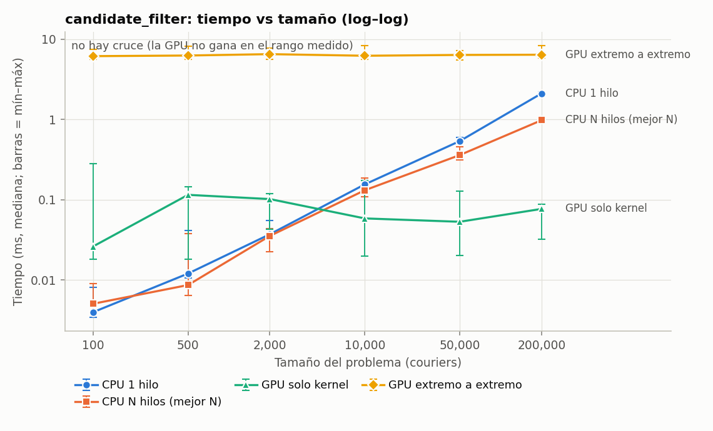

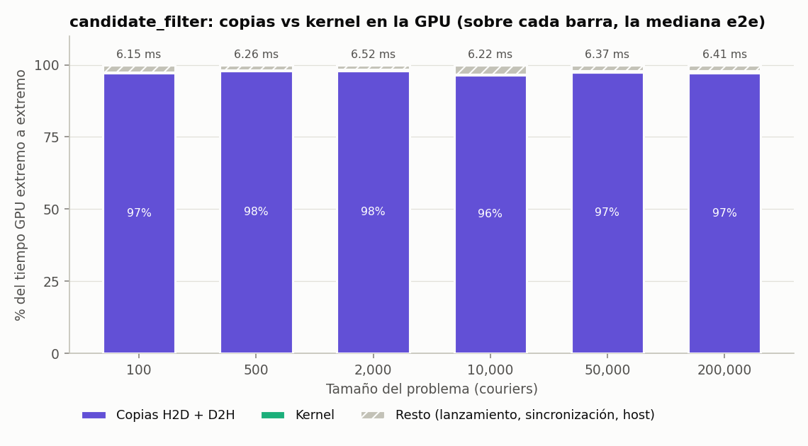

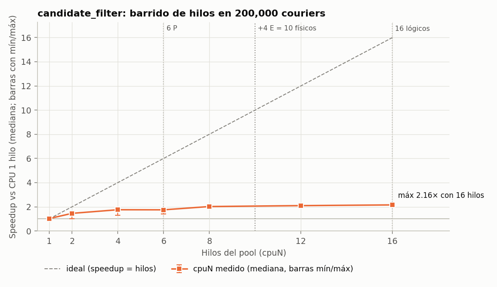
<!-- /auto:figuras:candidate_filter -->

**Cómo se prueba que es correcta (columna del PDF).** Además de la columna `Correct?` del bench, la aplicación (y su variante) está entre las comprobadas por `tools/check_gpu_equivalence.sh` (3 tamaños, `gpu_kernel` y `gpu_e2e` iguales a cpu1). Nuestra compactación **no es estable**: el orden en que los bloques reservan su tramo con el atómico global depende de la planificación. Por eso la prueba compara el **conjunto** de candidatos (ambas listas ordenadas) con el de la CPU, no el orden; el despacho no depende del orden de los candidatos (los rankea después por ETA).

**Profiler.**

<!-- auto:perfil:candidate_filter -->
- **ncu** (`filterCandidatesBlockPrivate`, size 200,000, bloque (256, 1, 1), grid (782, 1, 1), 16 registros por hilo): ocupación lograda **92 %** de 100 % teórica, limitada por **Warps** (bloques por SM: registros 16, shared 15, warps 6). Throughput: SM 19 %, memoria 36 % (DRAM 36 %, L2 31 %, L1/TEX 34 %; 69.8 GB/s; acierto en L2 77 %). Eficiencia de warp 69 % de hilos activos (64 % sin predicar), eficiencia de saltos 47 %, 81.5 ciclos por instrucción emitida.
- **nsys** (API de CUDA del hilo de CPU, toda la corrida de `--bench-once --version gpu_e2e`): 8 `cudaMemcpy` = 15.0 ms; 1 lanzamientos = 3.87 ms; 5 esperas (`*Synchronize`) = 0.621 ms; reservas y liberaciones = 2.42 ms.
- Archivos versionados: `analysis/data/final/perfiles/candidate_filter_ncu_details.csv`, `candidate_filter_ncu.out`, `candidate_filter_nsys.out` y `candidate_filter_nsys_cuda_*_sum.csv`. Los binarios (`.ncu-rep`, `.nsys-rep`, `.sqlite`) no se suben: guardan el nombre y el entorno de la máquina; se regeneran con los comandos de arriba.
<!-- /auto:perfil:candidate_filter -->

<!-- auto:perfil:candidate_filter_naive -->
- **ncu** (`filterCandidatesNaive`, size 200,000, bloque (256, 1, 1), grid (782, 1, 1), 16 registros por hilo): ocupación lograda **89 %** de 100 % teórica, limitada por **Warps** (bloques por SM: registros 16, shared 16, warps 6). Throughput: SM 15 %, memoria 39 % (DRAM 39 %, L2 34 %, L1/TEX 38 %; 73.7 GB/s; acierto en L2 78 %). Eficiencia de warp 59 % de hilos activos (55 % sin predicar), eficiencia de saltos — (0 saltos divergentes), 96.3 ciclos por instrucción emitida.
- **nsys** (API de CUDA del hilo de CPU, toda la corrida de `--bench-once --version gpu_e2e`): 8 `cudaMemcpy` = 16.5 ms; 1 lanzamientos = 1.01 ms; 5 esperas (`*Synchronize`) = 0.619 ms; reservas y liberaciones = 2.45 ms.
- Archivos versionados: `analysis/data/final/perfiles/candidate_filter_naive_ncu_details.csv`, `candidate_filter_naive_ncu.out`, `candidate_filter_naive_nsys.out` y `candidate_filter_naive_nsys_cuda_*_sum.csv`. Los binarios (`.ncu-rep`, `.nsys-rep`, `.sqlite`) no se suben: guardan el nombre y el entorno de la máquina; se regeneran con los comandos de arriba.
<!-- /auto:perfil:candidate_filter_naive -->

**Análisis (2.5).**
1. *Paralelismo.* Un courier por hilo: 2000 en la ciudad (7 % de los hilos residentes), hasta 200 000 en el barrido.
2. *Overheads.* El `gpu_e2e` del bench tarda ~6,2 ms en todos los tamaños porque **sube la tabla de 56 MB en cada
   llamada** (costo de la primera ronda o de un uso aislado). En el programa la tabla queda residente:
   `src/accel/CandidateFilter.cpp:101-105` solo la sube si cambió su puntero (una vez por ejecución), y por ronda se sube
   solo la flota. Estimación por resta (no medida) a partir de `h2d_ms`: con 100 couriers la subida es 5,90 ms (≈ la
   tabla), así que por ronda quedarían ≈ 0,6 ms en 2000 couriers (contra 0,035 ms de la CPU) y ≈ 0,5 ms en 200 000
   (contra 0,98 ms: ahí la GPU ganaría ~2×).
3. *Memoria o cómputo.* ≈ 3 operaciones por 9 B, con una lectura dispersa de la tabla por courier: limitado por la
   latencia de esas lecturas (8 GOP/s).
4. *Eficiencia.* Divergencia en el predicado (disponible o no, dentro del radio o no) y en la escritura: ncu mide
   69 % de hilos activos por warp y 47 % de eficiencia de saltos (59 % de hilos activos en el ingenuo).
5. *Contención.* Con ≈ 17,5 % de candidatos, el atómico global único no es el cuello de botella: la variante ingenua es
   igual o más rápida (0,039 ms contra 0,077 ms en 200 000), porque la lista privada agrega 3 barreras por bloque.
6. *Correctitud.* En la GPU el orden de salida no es fijo: se compara el **conjunto** de candidatos (ordenado); el
   despacho no depende del orden.
7. *Veredicto.* **Mantener CPU**. En la flota de la ciudad (2000 couriers) la CPU filtra en 37 µs con un hilo; aun con
   la tabla residente la ronda en GPU costaría ≈ 0,6 ms, y el kernel solo tarda 0,10 ms y gana recién desde ≈ 5000
   couriers, más que la flota de la ciudad.

### 3.9 Línea de tiempo global de entregas, merge (`11_merge`, 1ª): `delivery_timeline`

**Tarea.** Cada courier tiene su lista de entregas ordenada por hora; la línea de tiempo global (y las entregas por
hora) sale de fusionar las 2000 listas. Fusionar por pares es data-parallel con co-rank: cada hilo calcula, con una
búsqueda binaria, qué tramo de cada lista le toca (carpeta 11).

**Diseño.** ⌈log2 2000⌉ = 11 rondas de fusión por pares (un lanzamiento por ronda, todos los pares a la vez); cada
hilo produce 4 salidas (medido como el mejor valor entre 1 y 64); registros de 8 B (hora, pedido); al final un hilo
por hora cuenta con dos búsquedas binarias.

<!-- auto:tabla:delivery_timeline -->
| Size | CPU 1 thread (ms) | CPU N threads (ms) | GPU kernel (ms) | GPU end to end (ms) | Speedup vs best CPU (kernel / end to end) | Correct? |
|---|---|---|---|---|---|---|
| 1,000 | 0.115 | 0.118 (N=1) | 0.130 | 0.331 | 0.885× / 0.348× | sí (100/100) |
| 10,000 | 0.537 | 0.536 (N=1) | 0.156 | 0.374 | 3.43× / 1.43× | sí (100/100) |
| 100,000 | 5.04 | 2.46 (N=8) | 0.289 | 0.921 | 8.50× / 2.67× | sí (100/100) |
| 1,000,000 | 46.5 | 11.6 (N=16) | 1.59 | 4.08 | 7.34× / 2.86× | sí (100/100) |
| 10,000,000 | 372 | 109 (N=12) | 18.0 | 40.5 | 6.07× / 2.70× | sí (100/100) |

N = el mejor numero de hilos del barrido en cada tamano (entre parentesis). Mejor CPU = min(CPU 1 thread, CPU N threads).
<!-- /auto:tabla:delivery_timeline -->

<!-- auto:cruce:delivery_timeline -->
- Crossover extremo a extremo (GPU e2e < mejor CPU): ≈ 5,565 entregas (entre 1,000 y 10,000) → **usar GPU sobre el umbral**.
- Crossover solo kernel (datos ya en la GPU): ≈ 1,230 entregas (entre 1,000 y 10,000).
<!-- /auto:cruce:delivery_timeline -->

<!-- auto:dispersion:delivery_timeline -->
| Size | Versión | Hilos | n | Mediana (ms) | Mín (ms) | Máx (ms) | IQR (ms) | (máx−mín)/mediana |
|---|---|---|---|---|---|---|---|---|
| 1,000 | cpu1 | 1 | 10 | 0.115 | 0.112 | 0.137 | 0.00707 | 22% |
| 1,000 | cpuN | 1 | 10 | 0.118 | 0.106 | 0.143 | 0.0141 | 31% |
| 1,000 | gpu_kernel | 1 | 10 | 0.130 | 0.103 | 0.188 | 0.0251 | 65% (alta) |
| 1,000 | gpu_e2e | 1 | 10 | 0.331 | 0.259 | 0.396 | 0.0592 | 41% |
| 10,000 | cpu1 | 1 | 10 | 0.537 | 0.528 | 0.592 | 0.00930 | 12% |
| 10,000 | cpuN | 1 | 10 | 0.536 | 0.517 | 0.565 | 0.0229 | 9% |
| 10,000 | gpu_kernel | 1 | 10 | 0.156 | 0.114 | 0.234 | 0.0348 | 77% (alta) |
| 10,000 | gpu_e2e | 1 | 10 | 0.374 | 0.320 | 0.440 | 0.0419 | 32% |
| 100,000 | cpu1 | 1 | 10 | 5.04 | 4.48 | 7.22 | 0.608 | 54% (alta) |
| 100,000 | cpuN | 8 | 10 | 2.46 | 2.28 | 11.9 | 0.339 | 394% (alta) |
| 100,000 | gpu_kernel | 1 | 10 | 0.289 | 0.269 | 0.321 | 0.0231 | 18% |
| 100,000 | gpu_e2e | 1 | 10 | 0.921 | 0.713 | 1.23 | 0.313 | 56% (alta) |
| 1,000,000 | cpu1 | 1 | 10 | 46.5 | 45.1 | 69.1 | 6.86 | 52% (alta) |
| 1,000,000 | cpuN | 16 | 10 | 11.6 | 8.71 | 27.2 | 0.739 | 159% (alta) |
| 1,000,000 | gpu_kernel | 1 | 10 | 1.59 | 1.56 | 1.64 | 0.0118 | 5% |
| 1,000,000 | gpu_e2e | 1 | 10 | 4.08 | 3.93 | 5.26 | 0.155 | 32% |
| 10,000,000 | cpu1 | 1 | 10 | 372 | 363 | 394 | 12.7 | 8% |
| 10,000,000 | cpuN | 12 | 10 | 109 | 104 | 124 | 6.26 | 18% |
| 10,000,000 | gpu_kernel | 1 | 10 | 18.0 | 17.9 | 18.0 | 0.0322 | 1% |
| 10,000,000 | gpu_e2e | 1 | 10 | 40.5 | 39.3 | 41.3 | 0.923 | 5% |
<!-- /auto:dispersion:delivery_timeline -->

<!-- auto:hilos:delivery_timeline -->
Tamaño 10,000,000:

| Hilos | Mediana (ms) | Speedup vs CPU 1 thread | Rango (con mín/máx) | Eficiencia |
|---|---|---|---|---|
| 1 | 364 | 1.02× | 0.874–1.05 | 102% |
| 2 | 229 | 1.62× | 1.57–1.66 | 81% |
| 4 | 152 | 2.45× | 2.23–2.62 | 61% |
| 6 | 133 | 2.81× | 2.65–2.95 | 47% |
| 8 | 123 | 3.02× | 2.82–3.12 | 38% |
| 12 | 109 | 3.41× | 3.01–3.57 | 28% |
| 16 | 111 | 3.34× | 3.00–3.44 | 21% |
<!-- /auto:hilos:delivery_timeline -->

<!-- auto:figuras:delivery_timeline -->
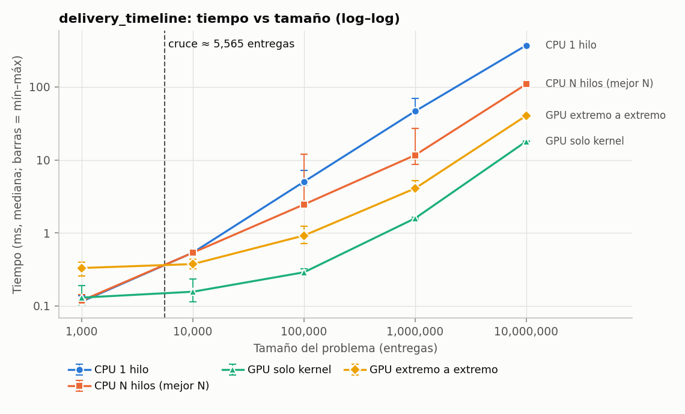

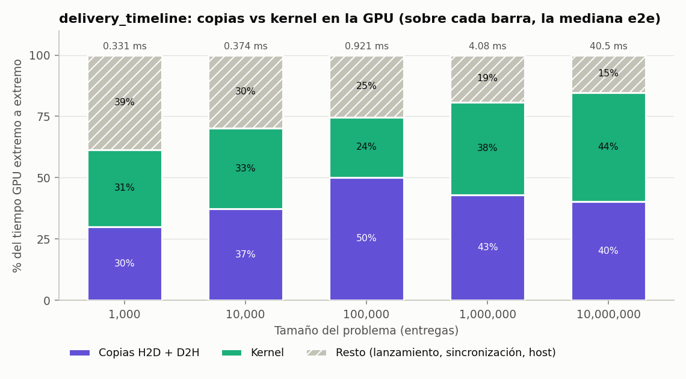

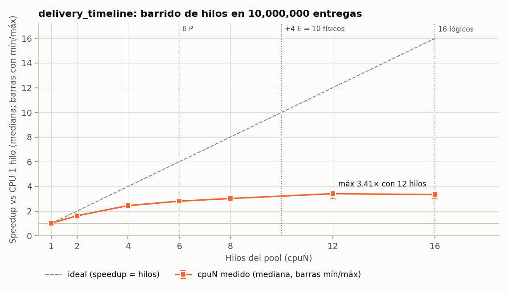
<!-- /auto:figuras:delivery_timeline -->

**Cómo se prueba que es correcta (columna del PDF).** Además de la columna `Correct?` del bench, la aplicación (y su variante) está entre las comprobadas por `tools/check_gpu_equivalence.sh` (3 tamaños, `gpu_kernel` y `gpu_e2e` iguales a cpu1). La línea de tiempo (hora y orden de empates entre couriers) y las entregas por hora son idénticas a `std::stable_sort` sobre las listas concatenadas. La comprobación del PDF ("los estados nunca retroceden") en nuestra aplicación se reduce a esto: hay **un solo evento por pedido** (su entrega), así que equivale a que **cada pedido aparezca exactamente una vez y la línea sea no decreciente en el tiempo**. Esa comprobación está en `tests/test_delivery_timeline.cpp` (commit `93fdcf6`): sobre cpu1 y cpuN (1, 3 y 16 hilos;
de 1 a 1999 listas; pasos de 1 ms con casi todo empatado) verifica que la línea fusionada **nunca retrocede**, que **cada
pedido aparece una sola vez** (un evento por pedido: sus estados no retroceden) y que se **conserva el orden de cada
courier**, con un caso negativo para cada control; el test pasa sin warnings. La GPU queda atada a esa referencia porque
su resultado es idéntico al de cpu1 en cada corrida del bench y en `tools/check_gpu_equivalence.sh`.

**Profiler.**

<!-- auto:perfil:delivery_timeline -->
- **ncu** (`mergeRound`, size 10,000,000, bloque (256, 1, 1), grid (9766, 1, 1), 40 registros por hilo): ocupación lograda **90 %** de 100 % teórica, limitada por **Registers, Warps** (bloques por SM: registros 6, shared 16, warps 6). Throughput: SM 78 %, memoria 72 % (DRAM 67 %, L2 72 %, L1/TEX 78 %; 129 GB/s; acierto en L2 89 %). Eficiencia de warp 70 % de hilos activos (63 % sin predicar), eficiencia de saltos 67 %, 17.5 ciclos por instrucción emitida.
- **nsys** (API de CUDA del hilo de CPU, toda la corrida de `--bench-once --version gpu_e2e`): 6 `cudaMemcpy` = 32.3 ms; 12 lanzamientos = 4.35 ms; 4 esperas (`*Synchronize`) = 18.3 ms; reservas y liberaciones = 126 ms.
- Archivos versionados: `analysis/data/final/perfiles/delivery_timeline_ncu_details.csv`, `delivery_timeline_ncu.out`, `delivery_timeline_nsys.out` y `delivery_timeline_nsys_cuda_*_sum.csv`. Los binarios (`.ncu-rep`, `.nsys-rep`, `.sqlite`) no se suben: guardan el nombre y el entorno de la máquina; se regeneran con los comandos de arriba.
<!-- /auto:perfil:delivery_timeline -->

**Análisis (2.5).**
1. *Paralelismo.* n/4 hilos por ronda (2,5 M en 10 M entregas).
2. *Overheads.* En 10 M: 40,5 ms = 8,2 de subida + 17,9 de kernels + 8,1 de bajada + 6,2 de resto; el cómputo se
   reparte en 11 rondas y las copias ya no dominan.
3. *Memoria o cómputo.* El modelo (cota superior: búsquedas co-rank de log2 n pasos) da 0,12 op/B y 668 GB/s, más que
   la DRAM: las búsquedas leen de la L2. En la práctica, limitado por memoria y latencia.
4. *Eficiencia.* Las búsquedas binarias divergen dentro del warp (cada hilo termina en otra iteración): ncu mide 70 %
   de hilos activos por warp y 67 % de eficiencia de saltos, con L2 al 72 %.
5. *Sincronización.* El fin de cada ronda es la barrera; sin atómicos.
6. *Correctitud.* Fusión estable: la línea de tiempo (hora y orden de empates entre couriers) es idéntica a
   `std::stable_sort` sobre las listas concatenadas, y las cuentas por hora también.
7. *Veredicto.* **Usar GPU sobre ≈ 5600 entregas**: 2,86× en 1 M y 2,70× en 10 M (40,5 ms contra 109 ms). La CPU N
   escala poco (3,4×) porque cada ronda es una vuelta del pool.

### 3.10 Percentiles de tiempo de entrega, radix sort (`12_sorting`, 1ª): `delivery_percentiles`

**Tarea.** p50, p90 y p99 del tiempo de entrega salen del arreglo ordenado. Radix sort LSD de 1 bit por pasada:
marcar el bit, scan de las marcas y reubicar; cada paso es data-parallel (carpeta 12).

**Diseño.** Por cada bit significativo del máximo (≈ 25 pasadas con estos datos): `markZeroBit`, el scan de la
aplicación 09 y `radixScatter` (destino = ceros antes / unos después, estable). Bloques de 256.

<!-- auto:tabla:delivery_percentiles -->
| Size | CPU 1 thread (ms) | CPU N threads (ms) | GPU kernel (ms) | GPU end to end (ms) | Speedup vs best CPU (kernel / end to end) | Correct? |
|---|---|---|---|---|---|---|
| 1,000 | 0.0897 | 0.0937 (N=1) | 0.845 | 1.80 | 0.106× / 0.0500× | sí (100/100) |
| 10,000 | 0.954 | 0.956 (N=1) | 0.894 | 1.06 | 1.07× / 0.896× | sí (100/100) |
| 100,000 | 8.34 | 5.03 (N=4) | 1.11 | 1.85 | 4.54× / 2.71× | sí (100/100) |
| 1,000,000 | 90.1 | 19.4 (N=16) | 2.83 | 4.34 | 6.84× / 4.47× | sí (100/100) |
| 10,000,000 | 1,309 | 167 (N=12) | 57.9 | 70.6 | 2.89× / 2.37× | sí (100/100) |

N = el mejor numero de hilos del barrido en cada tamano (entre parentesis). Mejor CPU = min(CPU 1 thread, CPU N threads).
<!-- /auto:tabla:delivery_percentiles -->

<!-- auto:cruce:delivery_percentiles -->
- Crossover extremo a extremo (GPU e2e < mejor CPU): ≈ 12,568 entregas (entre 10,000 y 100,000) → **usar GPU sobre el umbral**.
- Crossover solo kernel (datos ya en la GPU): ≈ 9,376 entregas (entre 1,000 y 10,000).
<!-- /auto:cruce:delivery_percentiles -->

<!-- auto:dispersion:delivery_percentiles -->
| Size | Versión | Hilos | n | Mediana (ms) | Mín (ms) | Máx (ms) | IQR (ms) | (máx−mín)/mediana |
|---|---|---|---|---|---|---|---|---|
| 1,000 | cpu1 | 1 | 10 | 0.0897 | 0.0831 | 0.161 | 0.00613 | 87% (alta) |
| 1,000 | cpuN | 1 | 10 | 0.0937 | 0.0876 | 0.114 | 0.0127 | 28% |
| 1,000 | gpu_kernel | 1 | 10 | 0.845 | 0.771 | 1.83 | 0.579 | 125% (alta) |
| 1,000 | gpu_e2e | 1 | 10 | 1.80 | 0.911 | 2.06 | 0.837 | 64% (alta) |
| 10,000 | cpu1 | 1 | 10 | 0.954 | 0.874 | 1.10 | 0.0712 | 23% |
| 10,000 | cpuN | 1 | 10 | 0.956 | 0.880 | 1.05 | 0.0356 | 18% |
| 10,000 | gpu_kernel | 1 | 10 | 0.894 | 0.747 | 1.85 | 0.695 | 123% (alta) |
| 10,000 | gpu_e2e | 1 | 10 | 1.06 | 0.883 | 2.23 | 0.512 | 126% (alta) |
| 100,000 | cpu1 | 1 | 10 | 8.34 | 7.89 | 11.0 | 0.555 | 38% |
| 100,000 | cpuN | 4 | 10 | 5.03 | 4.56 | 5.47 | 0.216 | 18% |
| 100,000 | gpu_kernel | 1 | 10 | 1.11 | 0.818 | 1.76 | 0.556 | 85% (alta) |
| 100,000 | gpu_e2e | 1 | 10 | 1.85 | 1.15 | 2.37 | 0.545 | 66% (alta) |
| 1,000,000 | cpu1 | 1 | 10 | 90.1 | 83.4 | 131 | 5.84 | 53% (alta) |
| 1,000,000 | cpuN | 16 | 10 | 19.4 | 18.2 | 26.1 | 4.08 | 41% |
| 1,000,000 | gpu_kernel | 1 | 10 | 2.83 | 2.77 | 2.95 | 0.0598 | 6% |
| 1,000,000 | gpu_e2e | 1 | 10 | 4.34 | 4.17 | 4.53 | 0.171 | 8% |
| 10,000,000 | cpu1 | 1 | 10 | 1,309 | 1,282 | 1,337 | 25.0 | 4% |
| 10,000,000 | cpuN | 12 | 10 | 167 | 159 | 231 | 16.2 | 43% |
| 10,000,000 | gpu_kernel | 1 | 10 | 57.9 | 57.9 | 58.0 | 0.0250 | 0% |
| 10,000,000 | gpu_e2e | 1 | 10 | 70.6 | 69.4 | 72.9 | 1.16 | 5% |
<!-- /auto:dispersion:delivery_percentiles -->

<!-- auto:hilos:delivery_percentiles -->
Tamaño 10,000,000:

| Hilos | Mediana (ms) | Speedup vs CPU 1 thread | Rango (con mín/máx) | Eficiencia |
|---|---|---|---|---|
| 1 | 950 | 1.38× | 1.19–1.40 | 138% |
| 2 | 536 | 2.44× | 2.22–2.65 | 122% |
| 4 | 305 | 4.29× | 3.94–4.65 | 107% |
| 6 | 249 | 5.26× | 4.06–5.65 | 88% |
| 8 | 218 | 6.00× | 5.52–6.49 | 75% |
| 12 | 167 | 7.83× | 5.66–8.22 | 65% |
| 16 | 181 | 7.23× | 4.90–7.62 | 45% |
<!-- /auto:hilos:delivery_percentiles -->

<!-- auto:figuras:delivery_percentiles -->
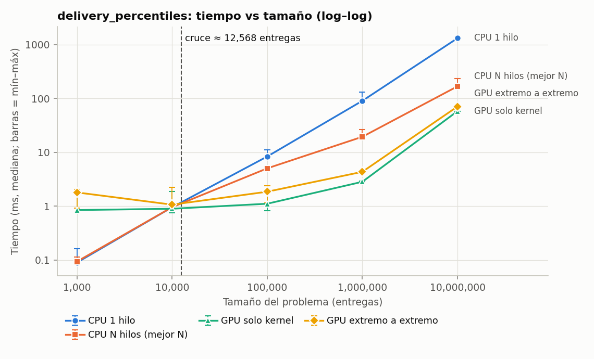

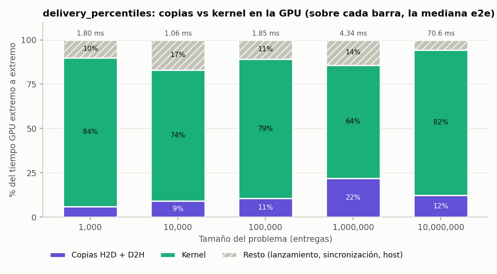

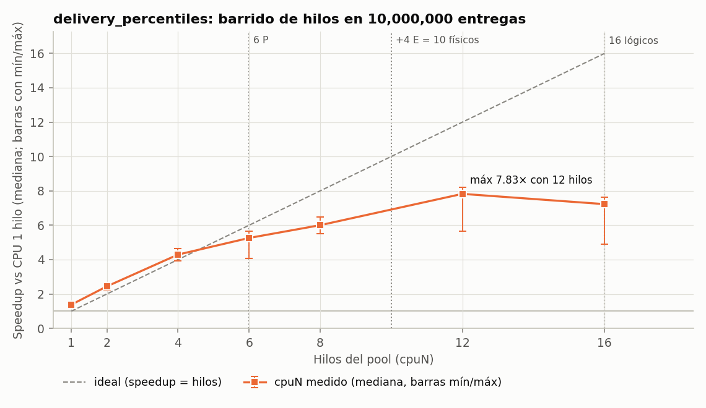
<!-- /auto:figuras:delivery_percentiles -->

**Cómo se prueba que es correcta (columna del PDF).** Además de la columna `Correct?` del bench, la aplicación (y su variante) está entre las comprobadas por `tools/check_gpu_equivalence.sh` (3 tamaños, `gpu_kernel` y `gpu_e2e` iguales a cpu1). El arreglo ordenado y los tres percentiles son **idénticos a los de `std::sort`** (enteros) en cada corrida.

**Profiler.**

<!-- auto:perfil:delivery_percentiles -->
- **ncu** (`radixScatter`, size 10,000,000, bloque (256, 1, 1), grid (39063, 1, 1), 16 registros por hilo): ocupación lograda **93 %** de 100 % teórica, limitada por **Warps** (bloques por SM: registros 16, shared 16, warps 6). Throughput: SM 10 %, memoria 96 % (DRAM 96 %, L2 19 %, L1/TEX 15 %; 185 GB/s; acierto en L2 30 %). Eficiencia de warp 100 % de hilos activos (97 % sin predicar), eficiencia de saltos — (0 saltos divergentes), 129 ciclos por instrucción emitida.
- **nsys** (API de CUDA del hilo de CPU, toda la corrida de `--bench-once --version gpu_e2e`): 3 `cudaMemcpy` = 12.2 ms; 175 lanzamientos = 3.94 ms; 4 esperas (`*Synchronize`) = 56.4 ms; reservas y liberaciones = 107 ms.
- Archivos versionados: `analysis/data/final/perfiles/delivery_percentiles_ncu_details.csv`, `delivery_percentiles_ncu.out`, `delivery_percentiles_nsys.out` y `delivery_percentiles_nsys_cuda_*_sum.csv`. Los binarios (`.ncu-rep`, `.nsys-rep`, `.sqlite`) no se suben: guardan el nombre y el entorno de la máquina; se regeneran con los comandos de arriba.
<!-- /auto:perfil:delivery_percentiles -->

**Análisis (2.5).**
1. *Paralelismo.* Una clave por hilo en cada pasada: hasta 10 M.
2. *Overheads.* Más de 100 lanzamientos por llamada (≈ 25 pasadas × marcar, scan y reubicar) ponen un piso de
   ~0,85 ms: por eso la GPU pierde en 1000 claves. En 10 M: 70,6 ms = 4,4 de subida + 57,9 de kernels + 4,3 de bajada.
3. *Memoria o cómputo.* ≈ 17 operaciones por 40 B por pasada: en 10 M el tráfico modelado es 173 GB/s, exactamente el
   techo de DRAM medido (ncu de la reubicación: DRAM al 96 %). Limitado por memoria; un radix de 4 u 8 bits por pasada haría 4-8 veces menos pasadas.
4. *Eficiencia.* La reubicación escribe en posiciones dispersas (ceros adelante, unos atrás): no coalescida.
5. *Sincronización.* Entre pasos, los límites de lanzamiento; dentro del scan, 9 barreras por bloque.
6. *Correctitud.* Arreglo ordenado y percentiles idénticos a `std::sort` en cada corrida.
7. *Veredicto.* **Usar GPU sobre ≈ 12 600 entregas**: 4,47× en 1 M (4,3 ms contra 19,4 ms) y 2,37× en 10 M. La CPU N
   escala bien aquí (7,8× con 12 hilos), y aun así la GPU gana.

---

## 4. Roofline

Techos: ancho de banda teórico (192 GB/s) y medido por `calib_copy` (171,6 GB/s); pico FP32 (20 SM × 128 × 2 ×
2,355 GHz = 12 058 GFLOP/s) y, para los kernels enteros, el techo INT32 (64 operaciones por ciclo y SM: 3014 GOP/s).
Cada kernel se ubica por su intensidad aritmética (operaciones / bytes de memoria global, con las fórmulas derivadas
del código en `analysis/kernels.json`) y su rendimiento logrado en el mayor tamaño (operaciones / mediana de
`gpu_kernel`), rotulado con el número de su concepto; la tabla de abajo da todos los tamaños y las variantes.

<!-- auto:roofline -->
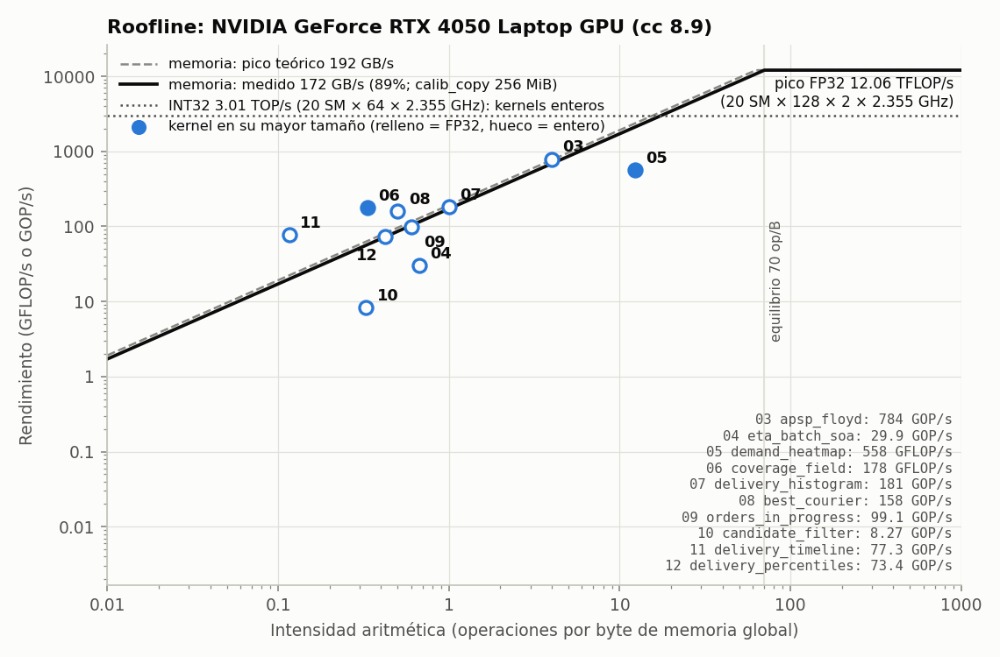

| Aplicación | Size | Ops | Bytes | Intensidad (op/B) | Kernel (ms) | Logrado (GOP/s) | Tráfico (GB/s) |
|---|---|---|---|---|---|---|---|
| apsp_floyd | 25 | 65,536 | 16,384 | 4.00 | 0.0317 | 2.06 | 0.516 |
| apsp_floyd | 100 | 4,194,304 | 1,048,576 | 4.00 | 0.125 | 33.4 | 8.36 |
| apsp_floyd | 400 | 143,982,592 | 35,995,648 | 4.00 | 0.530 | 272 | 68.0 |
| apsp_floyd | 1000 | 2,147,483,648 | 536,870,912 | 4.00 | 3.64 | 589 | 147 |
| apsp_floyd | 2000 | 16,387,080,192 | 4,096,770,048 | 4.00 | 22.4 | 730 | 183 |
| apsp_floyd | 3741 | 104,963,309,568 | 26,240,827,392 | 4.00 | 134 | 784 | 196 |
| best_courier | 50 | 2,000 | 4,080 | 0.490 | 0.0253 | 0.0791 | 0.161 |
| best_courier | 150 | 18,000 | 36,240 | 0.497 | 0.0300 | 0.599 | 1.21 |
| best_courier | 500 | 200,000 | 400,800 | 0.499 | 0.0146 | 13.7 | 27.5 |
| best_courier | 777 | 301,476 | 603,728 | 0.499 | 0.0133 | 22.6 | 45.2 |
| best_courier | 2000 | 2,400,000 | 4,802,400 | 0.500 | 0.0194 | 124 | 247 |
| best_courier | 5000 | 12,000,000 | 24,004,800 | 0.500 | 0.0759 | 158 | 316 |
| best_courier_divergent | 50 | 2,000 | 4,080 | 0.490 | 0.0590 | 0.0339 | 0.0692 |
| best_courier_divergent | 150 | 18,000 | 36,240 | 0.497 | 0.0388 | 0.463 | 0.933 |
| best_courier_divergent | 500 | 200,000 | 400,800 | 0.499 | 0.0198 | 10.1 | 20.3 |
| best_courier_divergent | 777 | 301,476 | 603,728 | 0.499 | 0.0317 | 9.52 | 19.1 |
| best_courier_divergent | 2000 | 2,400,000 | 4,802,400 | 0.500 | 0.0331 | 72.6 | 145 |
| best_courier_divergent | 5000 | 12,000,000 | 24,004,800 | 0.500 | 0.0450 | 266 | 533 |
| candidate_filter | 100 | 318 | 970 | 0.327 | 0.0261 | 0.0121 | 0.0371 |
| candidate_filter | 500 | 1,588 | 4,850 | 0.327 | 0.115 | 0.0138 | 0.0422 |
| candidate_filter | 2000 | 6,350 | 19,400 | 0.327 | 0.102 | 0.0624 | 0.190 |
| candidate_filter | 10000 | 31,750 | 97,000 | 0.327 | 0.0584 | 0.543 | 1.66 |
| candidate_filter | 50000 | 158,750 | 485,000 | 0.327 | 0.0531 | 2.99 | 9.14 |
| candidate_filter | 200000 | 635,000 | 1,940,000 | 0.327 | 0.0768 | 8.27 | 25.3 |
| candidate_filter_naive | 100 | 318 | 970 | 0.327 | 0.0633 | 0.00501 | 0.0153 |
| candidate_filter_naive | 500 | 1,588 | 4,850 | 0.327 | 0.0305 | 0.0520 | 0.159 |
| candidate_filter_naive | 2000 | 6,350 | 19,400 | 0.327 | 0.0184 | 0.345 | 1.05 |
| candidate_filter_naive | 10000 | 31,750 | 97,000 | 0.327 | 0.0310 | 1.02 | 3.12 |
| candidate_filter_naive | 50000 | 158,750 | 485,000 | 0.327 | 0.0439 | 3.62 | 11.1 |
| candidate_filter_naive | 200000 | 635,000 | 1,940,000 | 0.327 | 0.0386 | 16.4 | 50.2 |
| coverage_field | 8 | 51,200 | 153,600 | 0.333 | 2.16 | 0.0237 | 0.0712 |
| coverage_field | 16 | 204,800 | 614,400 | 0.333 | 1.33 | 0.154 | 0.462 |
| coverage_field | 32 | 819,200 | 2,457,600 | 0.333 | 1.29 | 0.635 | 1.91 |
| coverage_field | 64 | 3,276,800 | 9,830,400 | 0.333 | 1.23 | 2.67 | 8.00 |
| coverage_field | 100 | 8,000,000 | 24,000,000 | 0.333 | 1.32 | 6.06 | 18.2 |
| coverage_field | 128 | 13,107,200 | 39,321,600 | 0.333 | 1.23 | 10.7 | 32.0 |
| coverage_field | 256 | 52,428,800 | 157,286,400 | 0.333 | 1.58 | 33.2 | 99.6 |
| coverage_field | 512 | 209,715,200 | 629,145,600 | 0.333 | 2.09 | 100 | 301 |
| coverage_field | 1024 | 838,860,800 | 2,516,582,400 | 0.333 | 4.70 | 178 | 535 |
| delivery_histogram | 1000 | 4,000 | 4,000 | 1.00 | 0.00448 | 0.893 | 0.893 |
| delivery_histogram | 10000 | 40,000 | 40,000 | 1.00 | 0.00461 | 8.68 | 8.68 |
| delivery_histogram | 100000 | 400,000 | 400,000 | 1.00 | 0.00498 | 80.4 | 80.4 |
| delivery_histogram | 1000000 | 4,000,000 | 4,000,000 | 1.00 | 0.00968 | 413 | 413 |
| delivery_histogram | 10000000 | 40,000,000 | 40,000,000 | 1.00 | 0.221 | 181 | 181 |
| delivery_percentiles | 1000 | 425,000 | 1,000,000 | 0.425 | 0.845 | 0.503 | 1.18 |
| delivery_percentiles | 10000 | 4,250,000 | 10,000,000 | 0.425 | 0.894 | 4.75 | 11.2 |
| delivery_percentiles | 100000 | 42,500,000 | 100,000,000 | 0.425 | 1.11 | 38.3 | 90.2 |
| delivery_percentiles | 1000000 | 425,000,000 | 1,000,000,000 | 0.425 | 2.83 | 150 | 353 |
| delivery_percentiles | 10000000 | 4,250,000,000 | 10,000,000,000 | 0.425 | 57.9 | 73.4 | 173 |
| delivery_timeline | 1000 | 65,812 | 614,495 | 0.107 | 0.130 | 0.507 | 4.73 |
| delivery_timeline | 10000 | 840,824 | 7,606,593 | 0.111 | 0.156 | 5.38 | 48.7 |
| delivery_timeline | 100000 | 10,235,302 | 90,682,418 | 0.113 | 0.289 | 35.4 | 314 |
| delivery_timeline | 1000000 | 120,623,627 | 1,052,989,017 | 0.115 | 1.59 | 76.0 | 664 |
| delivery_timeline | 10000000 | 1,388,942,317 | 11,991,538,532 | 0.116 | 18.0 | 77.3 | 667 |
| demand_heatmap | 16 | 25,088 | 2,048 | 12.2 | 0.0133 | 1.88 | 0.154 |
| demand_heatmap | 32 | 100,352 | 8,192 | 12.2 | 0.0289 | 3.47 | 0.284 |
| demand_heatmap | 64 | 401,408 | 32,768 | 12.2 | 0.0247 | 16.2 | 1.32 |
| demand_heatmap | 100 | 980,000 | 80,000 | 12.2 | 0.0252 | 38.9 | 3.17 |
| demand_heatmap | 128 | 1,605,632 | 131,072 | 12.2 | 0.0266 | 60.4 | 4.93 |
| demand_heatmap | 256 | 6,422,528 | 524,288 | 12.2 | 0.0659 | 97.4 | 7.95 |
| demand_heatmap | 512 | 25,690,112 | 2,097,152 | 12.2 | 0.117 | 220 | 18.0 |
| demand_heatmap | 1024 | 102,760,448 | 8,388,608 | 12.2 | 0.244 | 421 | 34.4 |
| demand_heatmap | 2048 | 411,041,792 | 33,554,432 | 12.2 | 0.737 | 558 | 45.5 |
| demand_heatmap_tiles | 16 | 25,088 | 2,960 | 8.48 | 0.0452 | 0.555 | 0.0655 |
| demand_heatmap_tiles | 32 | 100,352 | 11,840 | 8.48 | 0.0276 | 3.63 | 0.428 |
| demand_heatmap_tiles | 64 | 401,408 | 47,360 | 8.48 | 0.0173 | 23.2 | 2.74 |
| demand_heatmap_tiles | 100 | 980,000 | 115,625 | 8.48 | 0.0334 | 29.3 | 3.46 |
| demand_heatmap_tiles | 128 | 1,605,632 | 189,440 | 8.48 | 0.0190 | 84.5 | 9.97 |
| demand_heatmap_tiles | 256 | 6,422,528 | 757,760 | 8.48 | 0.0377 | 171 | 20.1 |
| demand_heatmap_tiles | 512 | 25,690,112 | 3,031,040 | 8.48 | 0.124 | 207 | 24.4 |
| demand_heatmap_tiles | 1024 | 102,760,448 | 12,124,160 | 8.48 | 0.186 | 553 | 65.3 |
| demand_heatmap_tiles | 2048 | 411,041,792 | 48,496,640 | 8.48 | 0.502 | 820 | 96.7 |
| eta_batch_aos | 50 | 4,000 | 18,000 | 0.222 | 0.0127 | 0.315 | 1.42 |
| eta_batch_aos | 150 | 36,000 | 162,000 | 0.222 | 0.0172 | 2.09 | 9.41 |
| eta_batch_aos | 500 | 400,000 | 1,800,000 | 0.222 | 0.0380 | 10.5 | 47.4 |
| eta_batch_aos | 777 | 602,952 | 2,713,284 | 0.222 | 0.0192 | 31.4 | 141 |
| eta_batch_aos | 2000 | 4,800,000 | 21,600,000 | 0.222 | 0.0838 | 57.3 | 258 |
| eta_batch_aos | 5000 | 24,000,000 | 108,000,000 | 0.222 | 0.807 | 29.7 | 134 |
| eta_batch_soa | 50 | 4,000 | 6,000 | 0.667 | 0.0145 | 0.275 | 0.413 |
| eta_batch_soa | 150 | 36,000 | 54,000 | 0.667 | 0.0151 | 2.39 | 3.58 |
| eta_batch_soa | 500 | 400,000 | 600,000 | 0.667 | 0.0665 | 6.02 | 9.02 |
| eta_batch_soa | 777 | 602,952 | 904,428 | 0.667 | 0.0696 | 8.67 | 13.0 |
| eta_batch_soa | 2000 | 4,800,000 | 7,200,000 | 0.667 | 0.133 | 36.1 | 54.1 |
| eta_batch_soa | 5000 | 24,000,000 | 36,000,000 | 0.667 | 0.803 | 29.9 | 44.8 |
| histogram_naive | 1000 | 4,000 | 4,000 | 1.00 | 0.00501 | 0.799 | 0.799 |
| histogram_naive | 10000 | 40,000 | 40,000 | 1.00 | 0.00717 | 5.58 | 5.58 |
| histogram_naive | 100000 | 400,000 | 400,000 | 1.00 | 0.0304 | 13.1 | 13.1 |
| histogram_naive | 1000000 | 4,000,000 | 4,000,000 | 1.00 | 0.268 | 14.9 | 14.9 |
| histogram_naive | 10000000 | 40,000,000 | 40,000,000 | 1.00 | 2.63 | 15.2 | 15.2 |
| orders_in_progress | 1000 | 12,000 | 20,000 | 0.600 | 0.0138 | 0.868 | 1.45 |
| orders_in_progress | 10000 | 120,000 | 200,000 | 0.600 | 0.0153 | 7.85 | 13.1 |
| orders_in_progress | 100000 | 1,200,000 | 2,000,000 | 0.600 | 0.0229 | 52.4 | 87.3 |
| orders_in_progress | 1000000 | 12,000,000 | 20,000,000 | 0.600 | 0.0818 | 147 | 245 |
| orders_in_progress | 10000000 | 120,000,000 | 200,000,000 | 0.600 | 1.21 | 99.1 | 165 |
<!-- /auto:roofline -->

Derivación de operaciones y bytes de cada kernel:

<!-- auto:derivaciones -->
- **apsp_floyd**: ops = `2*(ceil(n/T)*T)**3`, bytes = `16*(ceil(n/T)*T)**3/T` (int32). La tabla se rellena a N = ⌈n/32⌉·32. Por cada (pivote k, i, j) hay una suma y un mínimo enteros: 2N³ operaciones. Por tile pivote (N/T rondas) la fase 3, que domina, lanza (N/T − 1)² bloques que leen su celda, el tile de su fila y el de su columna (en shared) y escriben su celda: 4 × 4 B por celda = 16N² B por ronda; las fases 1 y 2 suman O(N·T) y se desprecian. Total 16N³/T B: intensidad T/8 = 4 op/B (sin tiles serían 16N³ B, 1/8 op/B).
- **apsp_dijkstra**: ops = `0`, bytes = `0` (none). Solo CPU: no va al roofline.
- **best_courier**: ops = `4*n*m`, bytes = `8*n*m + 8*m` (int32). Por celda: empaquetar (ETA, id) en una clave de 64 bits (desplazamiento + o, 2 operaciones) y quedarse con la menor (comparación de 64 bits, ≈ 2): 4 operaciones enteras; el árbol del bloque agrega 255 por pedido (despreciable). Lee ETA e id de cada celda (4 + 4 B; los ids se releen por pedido, desde L2) y escribe una clave de 8 B por pedido.
- **best_courier_divergent**: ops = `4*n*m`, bytes = `8*n*m + 8*m` (int32). Mismas operaciones y bytes; cambia qué hilos quedan activos en el árbol.
- **calib_copy**: ops = `0`, bytes = `2*n` (none). Cada byte se lee una vez de la VRAM y se escribe una vez: 2n bytes y ninguna operación. Da el techo MEDIDO de memoria (mayor tamaño, que no cabe en la L2).
- **calib_launch**: ops = `0`, bytes = `0` (int32). Mide overhead, no cómputo: no va al roofline.
- **candidate_filter**: ops = `3*n + p*n`, bytes = `9*n + 4*p*n` (int32). Por courier: ¿disponible? (1), índice en la tabla (1 IMAD), ¿tiempo ≤ radio? (1) y, para los p·n que pasan, un atomicAdd en shared. Lee disponibilidad (1 B), nodo (4 B) y un tiempo de la tabla (4 B, acceso disperso) y escribe 4 B por candidato. p ≈ 0,7 disponibles × 0,25 (radio = percentil 25) = 0,175.
- **candidate_filter_naive**: ops = `3*n + p*n`, bytes = `9*n + 4*p*n` (int32). Mismas operaciones y bytes; los p·n atómicos van al MISMO contador global.
- **coverage_field**: ops = `4*S*n**2`, bytes = `12*S*n**2` (fp32). Por celda interior y barrido: 0,25 × (izq + der + arriba + abajo) = 3 sumas + 1 producto = 4 FLOP (fuentes y borde no calculan; se desprecia). Con reuso ideal de los vecinos en caché, cada barrido lee el campo anterior (4 B) y la grilla de couriers (4 B) y escribe el nuevo (4 B): 12 B por celda. Intensidad 1/3 FLOP/B: limitado por memoria; en grillas chicas, por los 200 lanzamientos.
- **delivery_histogram**: ops = `4*n`, bytes = `4*n` (int32). Por entrega: calcular la barra (división por 60 000 y tope de desborde, ≈ 3 operaciones) + atomicAdd en shared (1): 4n operaciones enteras. Se lee cada tiempo una vez (4 B); las 61 sumas globales por bloque son despreciables. Intensidad 1 op/B.
- **histogram_naive**: ops = `4*n`, bytes = `4*n` (int32). Mismas operaciones y lecturas; los n atómicos van a 61 direcciones de la L2 (contención, no tráfico de DRAM).
- **delivery_percentiles**: ops = `17*P*n`, bytes = `40*P*n` (int32). Una pasada por bit significativo del máximo: con la distribución del bench (mediana 28 min, σ = 0,45) el máximo ronda 2^24-2^25 ms, P ≈ 25 pasadas. Por pasada y clave: marcar el bit (desplazar, enmascarar, comparar: 3 ops; lee 4 B y escribe 4 B), scan de las marcas (≈ 9 ops, 16 B como en la app 09) y reubicar (≈ 5 ops; lee clave, marca y suma: 12 B, escribe 4 B): 17 ops y 40 B por clave y pasada.
- **delivery_timeline**: ops = `R*(n + 0.5*n*log2(n))`, bytes = `R*(16*n + 4*n*log2(n))` (int32). ⌈log2 2000⌉ = 11 rondas de fusión por pares. Por ronda cada registro de 8 B se lee y se escribe una vez (16n B) con una comparación por salida (n); cada hilo (4 salidas) hace 2 búsquedas co-rank de ≤ log2 n pasos que leen 8 B y comparan: n/4 · 2 · log2 n ≈ 0,5·n·log2 n comparaciones y 4·n·log2 n B. El conteo por hora (24 búsquedas binarias) es despreciable. Cota superior: las listas de las primeras rondas son cortas.
- **demand_heatmap**: ops = `2*K**2*n**2`, bytes = `8*n**2` (fp32). Cada celda hace K² = 49 productos y sumas (una FMA = 2 FLOP): 98n² FLOP (las celdas del borde hacen menos; se desprecia). Con reuso ideal en L1/L2 cada celda de entrada se lee una vez de DRAM (4 B) y la salida se escribe una vez (4 B): 8n² B; el filtro está en memoria constante. Intensidad 12,25 FLOP/B.
- **demand_heatmap_tiles**: ops = `2*K**2*n**2`, bytes = `4*n**2*((B+K-1)/B)**2 + 4*n**2` (fp32). Mismas operaciones. Cada bloque lee su tile con halo ((16+6)² celdas por 16² de salida, 1,89×) y escribe una vez.
- **eta_batch_soa**: ops = `8*n*m`, bytes = `12*n*m` (int32). etaForPair (EtaFormula.h) por par: 2 índices de la tabla (2 IMAD), llegada = libre + viaje, recogida = max(llegada, listo), ETA = recogida + viaje, y 3 comparaciones contra 'inalcanzable': ≈ 8 operaciones enteras. Bytes con el modelo del propio bench (describe): por par se leen nodo y hora libre del courier (8 B) y se escribe la ETA (4 B) = 12 B; las dos lecturas de la tabla de tiempos (la del restaurante→cliente es la misma para todo el bloque) se suponen en caché, así que el tráfico real a DRAM puede ser mayor.
- **eta_batch_aos**: ops = `8*n*m`, bytes = `36*n*m` (int32). Mismas operaciones que SoA; cada hilo usa 8 de los 32 B del registro, así que un warp trae 32 × 32 B en vez de 32 × 8 B: 32 + 4 = 36 B por par (modelo del bench).
- **orders_in_progress**: ops = `12*n`, bytes = `20*n` (int32). Kogge-Stone en bloques de 512: en el paso de distancia d suman 512 − d hilos, Σ = 9·512 − 511 ≈ 8 sumas por elemento (trabajo O(n log n) del bloque); sumar el total de los bloques previos, 1; pico (empaquetar clave + máximo), ≈ 3: 12n operaciones. Bytes: el scan lee y escribe (8n), la corrección lee y escribe (8n) y el pico lee (4n): 20n; el scan de los totales de bloque es despreciable.
<!-- /auto:derivaciones -->

**Discusión.**
- **Todos los kernels están a la izquierda del punto de equilibrio** (≈ 70 FLOP/B): ninguno es compute-bound. El de
  mayor intensidad (mapa de calor, 12,25 FLOP/B) logra 4,6 % del pico FP32 y queda lejos de ambos techos: lo limitan
  las lecturas a L1 por celda, que el tiling en shared mejora (1,47×).
- **Los recorridos grandes llegan al techo de DRAM**: histograma (181 GB/s), scan (165 GB/s) y radix (173 GB/s) en
  10 M. Ahí el kernel ya no puede mejorar sin mover menos bytes (p. ej. radix de más bits por pasada).
- **Varios puntos quedan por encima del techo de DRAM** (cobertura, merge, argmin, Floyd-Warshall): sus datos caben en
  la L2 (o se releen desde ella). Es real para estos tamaños y deja de serlo cuando los datos superan la L2.
- **Los kernels con lecturas dispersas** (filtro y ETA, accesos a la tabla de 56 MB por nodo) quedan muy por debajo de
  cualquier techo: los limita la latencia, no el ancho de banda.

---

## 5. Efecto en la simulación completa

El enunciado (2.2) pide medir, además del kernel aislado, el efecto en el sistema que corre: latencia de despacho por
pedido, pedidos servidos por hora simulada y si la ventana mantiene su frame rate, con y sin GPU.

Capturas del programa en marcha (ciudad, `--backend auto`, renderizador real con `--no-window --snapshot`; las capas
se calculan en la GPU a través del hilo dueño):

```bash
./delivery_sim config/ciudad.json --no-window --backend auto --layers both --snapshot ventana_both.png   # y heat, coverage
```

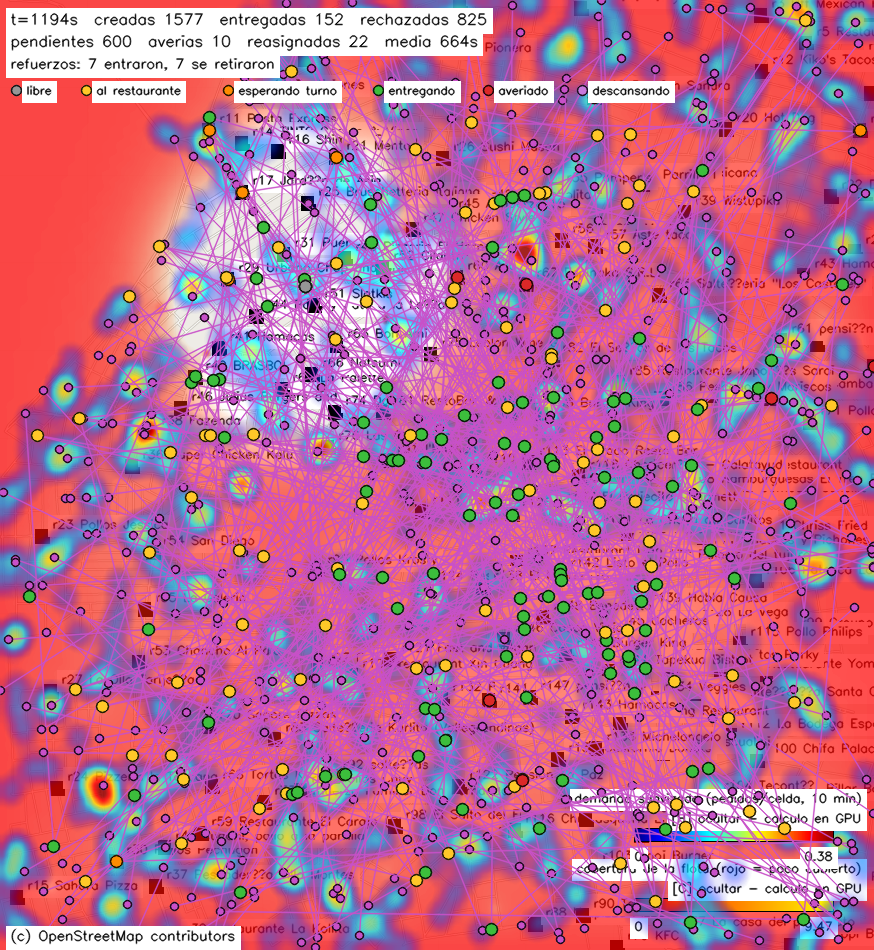


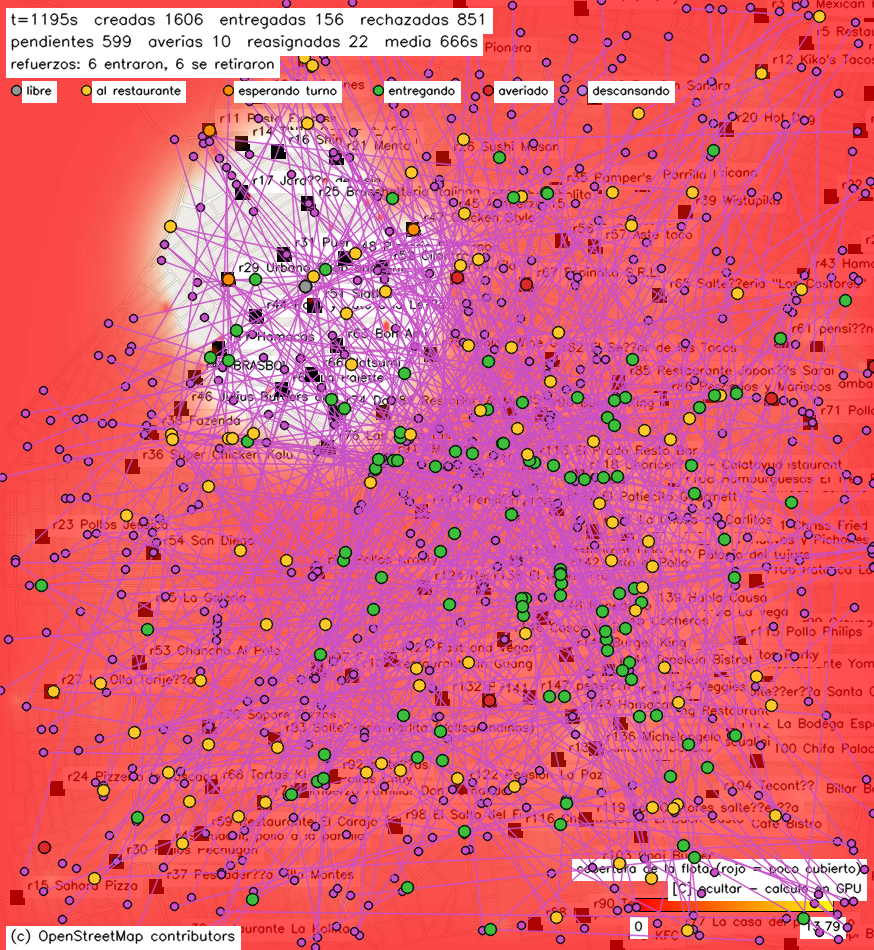

<!-- auto:simulacion -->
| Métrica (media de las corridas; mín–máx) | --backend cpu | --backend auto (GPU) | GPU vs CPU |
|---|---|---|---|
| Latencia de despacho: media (ms) | 171 (166–177) | 425 (378–483) | +148% |
| Latencia p50 (ms) | 62.8 (61.5–65.0) | 137 (131–141) | +118% |
| Latencia p90 (ms) | 459 (443–474) | 1,156 (1,057–1,277) | +152% |
| Latencia p99 (ms) | 733 (712–758) | 1,963 (1,667–2,490) | +168% |
| Latencia máx. (ms) | 829 (786–889) | 4,990 (1,840–8,388) | +502% |
| Pedidos servidos por hora simulada | 642 (638–646) | 621 (616–626) | -3% |
| Pedidos creados | 2,149 (2,148–2,150) | 2,144 (2,144–2,144) | -0% |
| Pedidos asignados | 920 (919–922) | 910 (908–913) | -1% |
| Pedidos entregados | 321 (319–323) | 311 (308–313) | -3% |
| Pedidos rechazados | 1,228 (1,228–1,229) | 1,234 (1,231–1,236) | +0% |
| Cuadros por segundo (media) | 23.0 (22.8–23.1) | 22.9 (22.8–23.1) | -0% |
| Tiempo de dibujo p50 (ms) | 10.2 (9.97–10.4) | 10.2 (10.2–10.3) | +0% |
| Tiempo de dibujo p95 (ms) | 13.2 (12.1–14.6) | 13.4 (12.4–14.0) | +2% |
| Corridas que validan (tools/validate_log.py) | 3/3 | 3/3 |  |

3 corridas con `--backend auto` (GPU) y 3 con `--backend cpu`, alternadas, de 30 s reales cada una en modo `no-window`, escenario `config/ciudad.json`. Fuente: `analysis/data/final/sim_compare/sim_compare.csv` (comando `tools/sim_compare.sh`, que valida cada log con `tools/validate_log.py` y calcula las métricas con `tools/sim_metrics.py`).

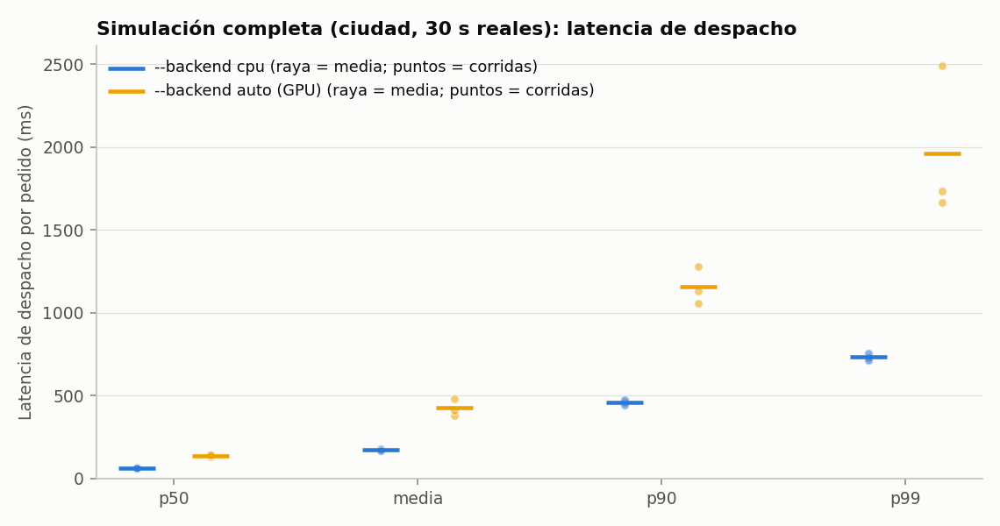
<!-- /auto:simulacion -->

**Qué pasa.** Con GPU (`--backend auto`) la latencia de despacho **empeora**: la media pasa de ~170 ms a ~420 ms y el
p99 de ~0,73 s a 1,7-2,5 s, mientras los pedidos servidos por hora caen ~3 % y los cuadros por segundo no cambian
(~23). La razón está en las secciones 2.7, 3.2, 3.6 y 3.8:

- en la simulación, cada ronda de cotización es **una tarea chica** (los couriers candidatos de una zona contra un
  pedido): la CPU la resuelve en microsegundos;
- con GPU, esa tarea **pasa por la cola del único hilo dueño de la GPU** (ADR 0004) y espera detrás de las rondas de los
  demás despachadores; cada una paga lanzar y esperar (~25 µs), la subida de couriers y pedidos y la bajada del
  resultado (ida y vuelta ≥ 0,2 ms), y con 2000 couriers las colas se alargan en los picos (de ahí el p99). Esto pasa
  **aun con la tabla de 56 MB residente**: el programa la sube una sola vez (`EtaBatch.cpp:133-137`,
  `CandidateFilter.cpp:101-105`), así que la latencia extra no viene de la tabla sino de la cola y de las copias chicas
  de cada ronda;
- en la CPU, los despachadores cotizan en paralelo, cada uno en su hilo, sin pasar por un punto único.

El rendimiento (pedidos por hora) casi no cambia porque el límite es la capacidad de la flota (≈ 57 % de los pedidos se
rechaza en los dos backends), y la ventana no pierde cuadros porque nunca espera a la GPU. Es la misma conclusión de
los kernels aislados de las aplicaciones 04, 08 y 10, ahora en el sistema completo.

---

## 6. Conclusiones y amenazas a la validez

### Conclusiones

1. **La GPU gana cuando hay mucho trabajo por cada byte que cruza el bus o los datos no salen de ella.** Cobertura
   (200 barridos sobre la misma grilla: 15,2×), percentiles (25 pasadas: 4,5×), línea de tiempo (11 rondas: 2,9×) y
   mapa de calor (49 multiplicaciones por celda: 3,0×) ganan extremo a extremo por encima de umbrales que van de
   ~77 celdas por lado a ~12 600 entregas.
2. **Los recorridos de una sola pasada no ganan extremo a extremo** (ETA, histograma, argmin, scan, filtro): copiar
   cuesta más que resolverlos en la CPU (calibración: 10 GB/s por el bus contra 20-28 GB/s de la CPU en su memoria).
   Su kernel solo sí gana (de 6× a 60× en los tamaños grandes), así que valen dentro de una cadena que ya tiene los
   datos en la GPU, nunca como paso suelto.
3. **El algoritmo importa más que el hardware**: Floyd-Warshall en GPU le gana a Dijkstra en CPU solo en un rango;
   en la ciudad, Dijkstra en paralelo (174 ms) le gana a la GPU (196 ms).
4. **Las optimizaciones del curso se miden, no se suponen**: la privatización del histograma ahorra 11×; el tiling
   del mapa de calor 1,47×; en cambio SoA vs AoS, el árbol convergente y la lista privada del filtro no cambian el
   tiempo en estos tamaños porque lo que limita es otra cosa (caché, lecturas por hilo, pocos candidatos).
5. **En el programa completo, con la escala de la ciudad, la GPU empeora la latencia de despacho** (~2,5× la media)
   sin mejorar el rendimiento: para el despacho conviene `--backend cpu`; la GPU tiene sentido para los cálculos en
   lote (mapa de calor, cobertura, línea de tiempo, percentiles) por encima de sus umbrales.

### Robustez de los resultados

<!-- auto:robustez -->
Se repitió la sesión con `--reps 30` (`analysis/data/final_r30`, todas las aplicaciones menos apsp). Puntos (aplicación, tamaño) comparables: **99**; puntos en que cambia el ganador entre la mejor CPU y la GPU extremo a extremo: **0**. Diferencia relativa de las medianas entre las dos corridas, en los tiempos ≥ 1 ms (mejor CPU, GPU kernel y GPU e2e; 99 valores): mediana 3.1%, cuartiles 1.0%–8.2%.
<!-- /auto:robustez -->

### Amenazas a la validez

1. **Jitter de la GPU bajo WSL2.** La dispersión de los tiempos de GPU es bimodal (p. ej. 1000 lanzamientos de
   `calib_launch`: 5,4-6,2 ms o 9-13 ms en la misma sesión) sin estrangulamiento: relojes fijos en P0 a 2355 MHz,
   temperatura estable (58-65 °C), la pantalla no está en la NVIDIA y ningún otro proceso usa la GPU. Se atribuye al
   planificador WDDM de Windows y a la paravirtualización de WSL2. Por eso se reporta la mediana con mín/máx/IQR, y la
   repetición con 30 corridas no cambia ningún ganador.
2. **Kernels en caché caliente.** En `gpu_kernel` la entrada se subió antes de medir: en tamaños que caben en la L2 el
   kernel rinde más que desde DRAM. Favorece a "solo kernel"; extremo a extremo no lo afecta.
3. **GPU de laptop.** Límite de potencia y estados de energía (P8 en reposo; la sesión final se hizo en P0 fijo). Otra
   laptop o una GPU de escritorio darían otros números.
4. **Misma máquina para CPU y GPU.** Elimina comparar máquinas distintas, pero comparten potencia y refrigeración;
   mitigado con versiones intercaladas.
5. **WSL2.** Lanzamiento y copias pueden costar más que en Linux nativo; las 16 CPU virtuales esconden la división P/E.
6. **Memoria.** WSL tiene 10 GB y la GPU 6 GiB: acotan los tamaños máximos (p. ej. 10 M en las aplicaciones de
   entregas, 3741 nodos en la 03).
7. **Copias con memoria paginable**, la que usa el programa; con memoria fijada serían más rápidas.
8. **Bytes del roofline por modelo.** Las fórmulas suponen reuso ideal en caché (y, en el merge, una cota superior);
   el tráfico real a DRAM se confirma con `ncu` (pendiente).
9. **Simulación completa corta**: 3 corridas de 30 s por backend; las diferencias de latencia (2,5×) son mucho
   mayores que la variación entre corridas.
10. **Pico INT32** tomado de la tabla de throughput de la guía de CUDA para cc 8.x (64 por ciclo y SM); el FP32 (128
    por SM) lo confirma la guía de ajuste de Ada.
11. **Nunca se cronometró la emulación de `cuda_compat.h`**: todas las cifras de GPU vienen del build con
    `-DUSE_CUDA=ON` en la GPU real.

### Pendientes

Ninguno. La comprobación de la aplicación 11 y el script de equivalencia GPU == CPU están en el commit `93fdcf6`
(sección 3, "Correctitud").
